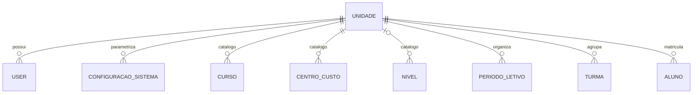
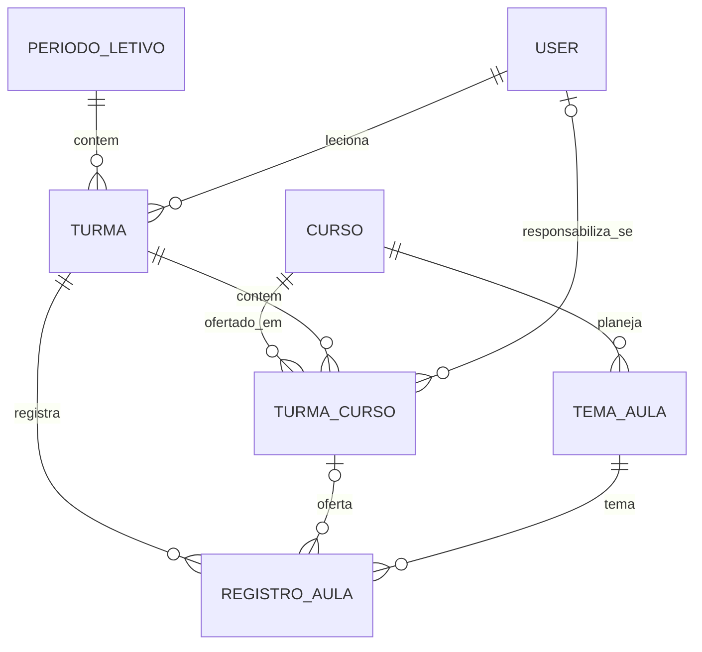
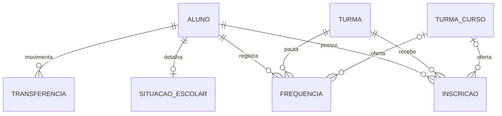
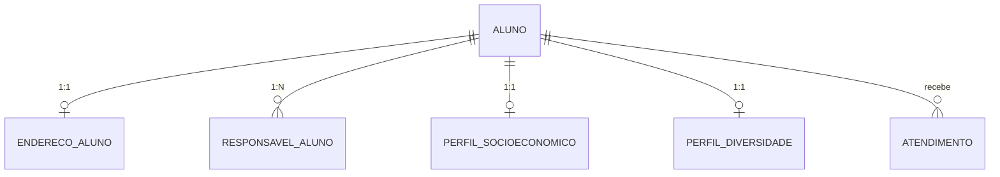
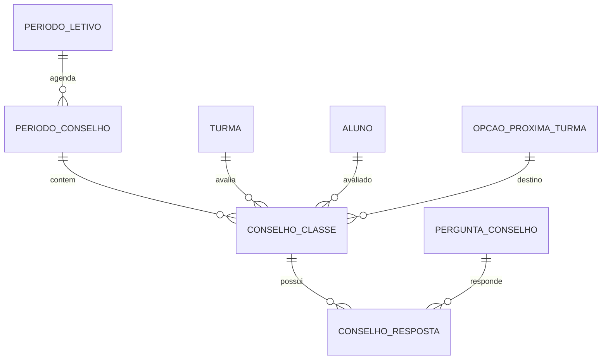
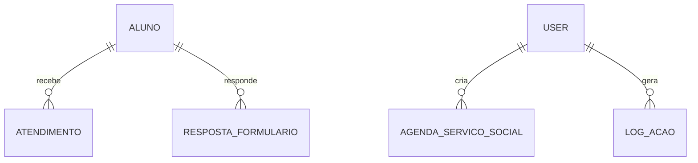
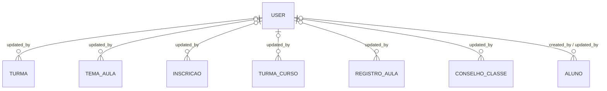

# MER — Modelo Entidade-Relacionamento

> Documento vivo do esquema do banco de dados. **Atualize sempre que criar,
> alterar ou remover uma tabela/coluna.** Cada alteração deve vir acompanhada
> da migration correspondente.
**Última atualização:** 2026-10-23 — Sincronizado com `app/models/` (19 arquivos) e `migrations/versions/` (26 revisões): **Onda 4 — Fases 0–4**: `turma_curso` (§7.32, §8.10), cadastro incremental e regra de principal (Fase 2), concomitância de horários (Fase 3). Heads unificadas em `b02f2051bc1e`; fix `8c4e1f9a7d32` adiciona colunas de auditoria à tabela. **Fase 4** (head `e7f3a1b9c4d5`): `frequencia` e `registro_aula` ganham `turma_curso_id` (§7.19/§7.20, §8.10). **Etapas F, G2 e G3 da Fase 4 (23/10/2026):** oferta criada junto com a turma (`criar_oferta_inicial_da_turma`, §7.32/§8.10), regras de `editar_turma` por número de ofertas ativas (G2) e tela de edição com bloco "Cursos desta turma" e campos somente leitura (G3) — §8.10. Demais ressalvas de §11.1 permanecem. **Etapa I:** `excluir_turma` com exclusão física (sem histórico) ou lógica (com histórico), preservando lançamentos e desativando turma/ofertas/inscrições. **Etapa J2:** contagens do BI consideram apenas turma ativa e inscrição enturmada em oferta ativa (`cond_inscricao_enturmada`). **Etapas K/K2:** C.H. por oferta (`TurmaCurso.carga_horaria_aula/total`) e listagem de turmas filtrada/agregada por oferta (COALESCE oferta→turma). **Centros de custo (23/10/2026):** tabela `centro_custo` (§7.4a, migration `d2e3f4a5b6c7`), catálogo por unidade com backfill a partir das colunas CSV existentes; formulário de períodos passa a criar/editar/inativar/reativar centros via `/centros-custo` com envio de CSRF e sincronização das checkboxes (§8.11). **Programa na oferta (23/10/2026):** coluna `turma_curso.programa` (varchar(50), nullable; migration `a1b2c3d4e5f6`) com backfill a partir de `turma.programa`; head atual `a1b2c3d4e5f6`. Fix de schema drift: DB local aplicado via `flask db upgrade` (coluna existia no modelo/migration, faltava no banco).

---

## Sumário

 1. [Visão geral](#1-vis%C3%A3o-geral)
 2. [Estrutura do pacote de modelos](#2-estrutura-do-pacote-de-modelos)
 3. [Glossário](#3-gloss%C3%A1rio)
 4. [Multitenancy](#4-multitenancy)
 5. [Mapa de domínios](#5-mapa-de-dom%C3%ADnios)
 6. [Diagramas ER por domínio](#6-diagramas-er-por-dom%C3%ADnio)
 7. [Dicionário de dados](#7-dicion%C3%A1rio-de-dados)
 8. [Regras de negócio transversais](#8-regras-de-neg%C3%B3cio-transversais)
 9. [Convenções de código](#9-conven%C3%A7%C3%B5es-de-c%C3%B3digo)
10. [Histórico de ondas](#10-hist%C3%B3rico-de-ondas)
11. [Referência cruzada com migrations](#11-refer%C3%AAncia-cruzada-com-migrations)
12. [Dívida técnica e roadmap](#12-d%C3%ADvida-t%C3%A9cnica-e-roadmap)

---

## 1. Visão geral

O sistema é um **ERP socioeducativo** multitenant, organizado em torno de
**unidades** (tenants). Cada unidade possui:

- Usuários próprios (professores, pedagogia, secretaria).
- Catálogo próprio de cursos, níveis e turmas.
- Períodos letivos, calendário e conselhos de classe.
- Alunos, seus perfis estruturados (socioeconômico, diversidade, endereço, responsáveis) e atendimentos.

**Banco:** PostgreSQL (produção) / SQLite (testes locais).
**ORM:** SQLAlchemy via Flask-SQLAlchemy.
**Migrations:** Alembic via Flask-Migrate.
**Fonte de verdade do código:** `app/models/` (pacote).
**Fonte de verdade do esquema:** este documento.

### Ajustes de arquitetura ativos

- `SoftDeleteMixin` (coluna `ativo`) e `TenantMixin` (coluna `unidade_id`, FK → `unidade.id`, **nullable por padrão**) ficam em `app/models/base.py`. O `AuditoriaMixin` (colunas `updated_by_id`, `updated_by_name` e `updated_at`) fica em `app/models/auditoria_mixin.py`.
- Os atributos herdados dos mixins são compartilhados e **não** precisam ser repetidos em cada classe. Uso atual:

| Mixin             | Modelos que o herdam                                                                                                                                             |
|-------------------|------------------------------------------------------------------------------------------------------------------------------------------------------------------|
| `SoftDeleteMixin` | `PeriodoLetivo`, `Turma`, `TurmaCurso`, `TemaAula`, `Inscricao`, `PerguntaConselho`, `OpcaoProximaTurma`                                                    |
| `TenantMixin`     | `PeriodoLetivo`, `Turma`, `TurmaCurso`, `TemaAula`, `Transferencia` (redeclara `unidade_id` como NOT NULL), `Frequencia`, `RegistroAula`, `ConselhoClasse`, `ConselhoResposta` |
| `AuditoriaMixin`  | `Turma`, `TurmaCurso`, `TemaAula`, `Inscricao`, `RegistroAula`, `ConselhoClasse`                                                                                              |

- `Aluno` **não** usa mixins: declara manualmente `ativo`, `unidade_id` e as colunas de auditoria de criação e edição (Onda 3B-ter).
- A auditoria automática é registrada ao iniciar a app em `app/__init__.py`, importando `app.models.auditoria_listener` dentro de `_register_auditoria_listener`.
- `Turma.professor` usa `foreign_keys=[professor_id]` para evitar colisão com `updated_by_id` herdado de `AuditoriaMixin`; `RegistroAula.instrutor` e `TurmaCurso.professor` também declaram `foreign_keys` pelo mesmo motivo.

---

## 2. Estrutura do pacote de modelos

```text
app/models/
├── __init__.py            # Reexporta os modelos (compatibilidade). NÃO reexporta
│                          # enums nem mixins
├── base.py                # Imports, JSONType e mixins SoftDeleteMixin/TenantMixin
│                          # (não define modelos)
├── enums.py               # Enumerações + conjuntos derivados
├── auditoria_mixin.py     # AuditoriaMixin (updated_by_id, updated_by_name, updated_at)
├── auditoria_listener.py  # Listener before_flush: preenche auditoria + grava LogAcao
├── organizacao.py         # Unidade, ConfiguracaoSistema
├── usuarios.py            # User
├── pedagogico.py          # Curso, Nivel, CentroCusto
├── academico.py           # PeriodoLetivo, Turma, TurmaCurso, TemaAula
├── pessoas.py             # Aluno, SituacaoEscolar
├── perfis.py              # EnderecoAluno, ResponsavelAluno,
│                          # PerfilSocioeconomico, PerfilDiversidade
├── matriculas.py          # Inscricao, Transferencia
├── calendario.py          # DiaBloqueado, DiaBloqueadoTurma
├── aulas.py               # Frequencia, RegistroAula
├── conselho.py            # PeriodoConselho, PerguntaConselho,
│                          # OpcaoProximaTurma, ConselhoClasse, ConselhoResposta
├── atendimento.py         # Atendimento
├── servico_social.py      # AgendaServicoSocial, RespostaFormulario
├── auditoria.py           # LogAcao
└── legado.py              # Registro
```

### Camada de serviços relacionada

```text
app/services/
├── aluno_perfil.py        # Centraliza leitura/escrita dos perfis do Aluno
│                          # (Onda 3B). Todo acesso a endereço/responsável/
│                          # socioeconômico/diversidade passa por aqui.
├── auth_service.py
├── bootstrap.py
└── calendar_service.py
```

### Regras de importação

1. Código **fora** do pacote importa os **modelos** sempre de `app.models`. Enums e mixins **não** são reexportados por `__init__.py`: importar de `app.models.enums`, `app.models.base` e `app.models.auditoria_mixin`.
2. Código **dentro** do pacote importa pelo caminho completo (ex.: `from app.models.pessoas import Aluno`).
3. Dentro de **métodos**, usar import local para evitar ciclos.
4. Ao ler/escrever dados de perfil do aluno, usar **sempre** `app.services.aluno_perfil` — nunca acessar `aluno.*_json` direto.
5. Novos modelamentos de tenant/soft-delete devem preferir herdar de `TenantMixin` e `SoftDeleteMixin` em vez de redeclarar campos duplicados; entidades editadas por usuários devem herdar também `AuditoriaMixin`.

### Auditoria automática

A auditoria é composta por duas peças:

1. **`AuditoriaMixin`** (`app/models/auditoria_mixin.py`) — adiciona `updated_by_id` (FK → `user.id`, `ON DELETE SET NULL`), `updated_by_name` (snapshot, `varchar(100)`) e `updated_at` (`default` e `onupdate` = `get_local_now`), além do relacionamento `updated_by` (→ `User`, `lazy='joined'`). FK e relationship são declarados via `@declared_attr` (exigência do SQLAlchemy 2.x).
2. **Listener `before_flush`** (`app/models/auditoria_listener.py`) — registrado em `db.session` quando o módulo é importado (feito no bootstrap da app, ver §1).

Comportamento do listener (conforme o código):

- Considera os objetos de `session.new` + `session.dirty` que possuam o atributo `updated_by_id`. A detecção é por `hasattr`, **não** por herança do mixin — portanto `Aluno` também é coberto.
- Preenche `updated_by_id` e `updated_by_name` com o `current_user` (ou `NULL` se não autenticado) e `updated_at = db.func.now()`.
- Cria um `LogAcao` por objeto: `acao` = `Criar <Classe>` (objeto novo) ou `Alterar <Classe>`; `detalhes` = `repr(obj)`; `ip` = `request.remote_addr` (apenas em contexto de request); `usuario_id`, `usuario_nome` e `unidade_id` vêm do `current_user`.
- **Não trata DELETE** (`session.deleted`): exclusões físicas, inclusive cascatas `delete-orphan`, não geram `LogAcao`; a premissa é o soft delete via `ativo=False`.
- Pontos de atenção em §12.11.

---

## 3. Glossário

| Termo                    | Significado                                                                                                                                                 |
|--------------------------|-------------------------------------------------------------------------------------------------------------------------------------------------------------|
| **Unidade**              | Tenant do sistema. Fronteira de isolamento de dados.                                                                                                        |
| **Turma**                | Agrupador lógico de alunos; a oferta acadêmica efetiva fica em `TurmaCurso` (Onda 4).                                                                           |
| **Oferta (TurmaCurso)**  | Vínculo concreto curso↔turma (`turma_curso`): atribui um curso a uma turma, com professor, turno, horários e vigência próprios.                                  |
| **Inscrição**            | Vínculo N:N entre Aluno e Turma, com histórico; na transição da Onda 4 aponta também para a oferta (`inscricoes.turma_curso_id`).                                 |
| **Conceito**             | Código de presença/falta: A/B/C/D (presente), F (falta), J (justificada).                                                                                   |
| **Conselho de Classe**   | Reunião colegiada que avalia aluno/turma por etapa.                                                                                                         |
| **Etapa**                | Momento do conselho: INICIAL, PERCURSO, FINAL.                                                                                                              |
| **Tema de Aula**         | Tópico macro do planejamento pedagógico.                                                                                                                    |
| **Dia bloqueado**        | Data sem aula em um período letivo (feriado, etc.).                                                                                                         |
| **Perfil do aluno**      | Dados complementares (endereço, responsável, socioeconômico, diversidade) em tabelas 1:1 ou 1:N com `Aluno`.                                                |
| **Documentos entregues** | Flags JSONB em `Aluno.documentos_entregues` indicando quais documentos foram anexados.                                                                      |
| **C.H. (carga horária)** | Calculada em `Turma`, em minutos: `carga_horaria_aula` = `hora_fim − hora_inicio`; `carga_horaria_total` = aula × `dias_aula_efetivos()`. Não é persistida. |
| **Mixin de auditoria**   | `AuditoriaMixin`: colunas `updated_by_id`, `updated_by_name` e `updated_at`, preenchidas pelo listener `before_flush`.                                      |

---

## 4. Multitenancy

A coluna `unidade_id` aparece em quase todas as tabelas de negócio.

Regras:

1. **Toda consulta de listagem deve filtrar por** `unidade_id` do usuário logado, exceto para o perfil `admin` global.
2. `Unidade` **não** é apagada se houver registros dependentes (integridade).
3. `User.email` é único **globalmente** (não por unidade).
4. `ConfiguracaoSistema.unidade_id = NULL` significa configuração **global**.
5. `Nivel.nome` é único **por unidade** (`uq_nivel_nome_unidade`: `nome` + `unidade_id`).
6. As tabelas de perfil do aluno (`endereco_aluno`, `responsavel_aluno`, `perfil_socioeconomico`, `perfil_diversidade`) herdam `unidade_id` do aluno no momento da criação.
7. `TenantMixin.unidade_id` é **nullable** por padrão (compatibilidade com registros globais/legados). Tabelas que o tornam NOT NULL: `curso`, `transferencia`, `dia_bloqueado` e `periodo_conselho`.
8. Tabelas **sem** `unidade_id`: `inscricoes`, `conselho_pergunta`, `opcao_proxima_turma`, `agenda_servico_social` e `respostas_formulario`. Quando necessário, o escopo é derivado por join (ex.: `inscricoes.turma_id → turma.unidade_id`).

---

## 5. Mapa de domínios

| Módulo               | Domínio                    | Entidades                                                                                        |
|----------------------|----------------------------|--------------------------------------------------------------------------------------------------|
| `organizacao`        | Estrutura Organizacional   | `Unidade`, `ConfiguracaoSistema`                                                                 |
| `base`               | Mixins de modelo           | `SoftDeleteMixin`, `TenantMixin`                                                                 |
| `usuarios`           | Usuários e Autenticação    | `User`                                                                                           |
| `pedagogico`         | Cadastros Pedagógicos      | `Curso`, `Nivel`                                                                                 |
| `academico`          | Estrutura Acadêmica        | `PeriodoLetivo`, `Turma`, `TurmaCurso`, `TemaAula`                                               |
| `pessoas`            | Pessoas                    | `Aluno`, `SituacaoEscolar`                                                                       |
| `perfis`             | Perfis do Aluno            | `EnderecoAluno`, `ResponsavelAluno`, `PerfilSocioeconomico`, `PerfilDiversidade`                 |
| `matriculas`         | Matrículas e Movimentações | `Inscricao`, `Transferencia`                                                                     |
| `calendario`         | Calendário Acadêmico       | `DiaBloqueado`, `DiaBloqueadoTurma`                                                              |
| `aulas`              | Frequência e Aulas         | `Frequencia`, `RegistroAula`                                                                     |
| `conselho`           | Conselho de Classe         | `PeriodoConselho`, `PerguntaConselho`, `OpcaoProximaTurma`, `ConselhoClasse`, `ConselhoResposta` |
| `atendimento`        | Atendimento                | `Atendimento`                                                                                    |
| `servico_social`     | Serviço Social             | `AgendaServicoSocial`, `RespostaFormulario`                                                      |
| `auditoria`          | Auditoria                  | `LogAcao`                                                                                        |
| `auditoria_mixin`    | Mixin de Auditoria         | `AuditoriaMixin`                                                                                 |
| `auditoria_listener` | Listener de Auditoria      | — (evento `before_flush`)                                                                        |
| `legado`             | Legado                     | `Registro`                                                                                       |

---

## 6. Diagramas ER por domínio

### 6.1 Núcleo organizacional e usuários



### 6.2 Estrutura acadêmica



### 6.3 Alunos, matrículas e frequência



### 6.4 Perfil do aluno (Onda 3A/3B)



### 6.5 Conselho de classe



### 6.6 Serviço social, atendimento e auditoria



### 6.7 Auditoria de edição (`updated_by`)



As cinco primeiras relações vêm do `AuditoriaMixin` (`ON DELETE SET NULL`, conforme `a9f3c8e2d1b7`). `Aluno` declara `created_by_id` e `updated_by_id` manualmente: no modelo as FKs não têm `ondelete`, mas a migration `f1a2b3c4d5e6` cria `fk_aluno_updated_by_id` com `ON DELETE SET NULL` (somente PostgreSQL).

---

## 7. Dicionário de dados

> Tipos lógicos. `NOT NULL` indicado explicitamente. Defaults descritos
> quando relevantes.
>
> Tabelas que usam mixins trazem a linha **Mixins** logo abaixo do título (`SoftDeleteMixin` → `ativo`; `TenantMixin` → `unidade_id`; `AuditoriaMixin` → `updated_by_id`, `updated_by_name`, `updated_at`).

### 7.1 `unidade`

| Coluna | Tipo         | Nulo | Default | Descrição       |
|--------|--------------|------|---------|-----------------|
| id     | int          | não  | auto    | PK              |
| nome   | varchar(100) | não  | —       | Nome da unidade |
| ativo  | bool         | não  | true    | Soft delete     |

### 7.2 `configuracao_sistema`

| Coluna     | Tipo         | Nulo | Default | Descrição                |
|------------|--------------|------|---------|--------------------------|
| id         | int          | não  | auto    | PK                       |
| chave      | varchar(50)  | não  | —       | Chave (única por escopo) |
| valor      | varchar(100) | sim  | —       | Valor serializado        |
| descricao  | varchar(255) | sim  | —       | Texto explicativo        |
| unidade_id | int          | sim  | —       | NULL = global            |

**Índices únicos parciais:** `ix_config_chave_global` (`chave WHERE unidade_id IS NULL`), `ix_config_chave_unidade` (`chave, unidade_id WHERE unidade_id IS NOT NULL`).

### 7.3 `user`

| Coluna       | Tipo         | Nulo | Default | Descrição                    |
|--------------|--------------|------|---------|------------------------------|
| id           | int          | não  | auto    | PK                           |
| name         | varchar(100) | não  | —       | Nome completo                |
| email        | varchar(120) | não  | —       | **UNIQUE** global            |
| password     | varchar(200) | sim  | —       | Hash Werkzeug; NULL para AD  |
| role         | varchar(20)  | não  | —       | Valor canônico em `UserRole` |
| is_active    | bool         | não  | true    | Conta ativa                  |
| is_ad_user   | bool         | não  | false   | Autenticação por domínio     |
| unidade_id   | int          | sim  | —       | FK → unidade                 |
| first_login  | bool         | sim  | true    | Força troca de senha         |
| google_id    | varchar(100) | sim  | —       | **UNIQUE**, indexado         |
| google_email | varchar(120) | sim  | —       | E-mail Google                |

**CHECK:** `ck_user_role` — restringe `role` aos valores de `UserRole`.

### 7.4 `curso`

| Coluna     | Tipo         | Nulo | Default | Descrição     |
|------------|--------------|------|---------|---------------|
| id         | int          | não  | auto    | PK            |
| nome       | varchar(150) | não  | —       | Nome do curso |
| descricao  | varchar(300) | sim  | —       | Descrição     |
| ativo      | bool         | não  | true    | Soft delete   |
| unidade_id | int          | não  | —       | FK → unidade  |
| created_at | timestamp    | sim  | now     | Auditoria     |

> **Removido:** `carga_horaria` (migration `d1e2f3a4b5c6`, rotulada "Onda 3C"). A C.H. agora é calculada por turma (§7.7).
>
> **Divergência modelo × banco:** a migration `a9f3c8e2d1b7` também criou `updated_by_id`, `updated_by_name` e `updated_at` em `curso`, mas `Curso` **não** herda `AuditoriaMixin`; essas colunas existem no banco e não estão mapeadas (ver §11.1, item 3).

### 7.4a `centro_custo` (catálogo de centros de custo)

**Mixins:** nenhum (`ativo` manual; `unidade_id` manual). Sem `AuditoriaMixin`.

| Coluna     | Tipo         | Nulo | Default | Descrição                  |
|------------|--------------|------|---------|----------------------------|
| id         | int          | não  | auto    | PK                         |
| nome       | varchar(150) | não  | —       | Nome do centro             |
| ativo      | bool         | não  | true    | Soft delete                |
| unidade_id | int          | não  | —       | FK → unidade               |
| created_at | timestamp    | sim  | now     | Auditoria                  |
| updated_at | timestamp    | sim  | now     | Auditoria                  |

**Unicidade:** `uq_centro_custo_nome_unidade` (`nome`, `unidade_id`).

**Relação com demais tabelas:** `periodo_letivo.centro_custo`, `turma.centro_custo` e `turma_curso.centro_custo` armazenam o **nome** do centro como token CSV (não FK); a tabela `centro_custo` é o catálogo da unidade, usado para validação/seleção no formulário de períodos. A edição de um centro propaga o novo nome para essas colunas (§8.11).

### 7.5 `nivel`

| Coluna     | Tipo         | Nulo | Default | Descrição         |
|------------|--------------|------|---------|-------------------|
| id         | int          | não  | auto    | PK                |
| nome       | varchar(100) | não  | —       | Único por unidade |
| ativo      | bool         | não  | true    | Soft delete       |
| unidade_id | int          | sim  | —       | FK → unidade      |

**UNIQUE:** (`nome`, `unidade_id`) via `uq_nivel_nome_unidade`. Níveis de unidades diferentes podem ter o mesmo nome; níveis legados sem unidade mantêm `unidade_id = NULL`. No PostgreSQL, `NULL` não colide em UNIQUE; logo a restrição não impede nomes duplicados entre níveis legados sem unidade.

### 7.6 `periodo_letivo`

**Mixins:** `SoftDeleteMixin`, `TenantMixin` (`unidade_id` **nullable**). Sem `AuditoriaMixin`.

| Coluna            | Tipo         | Nulo | Default  | Descrição                     |
|-------------------|--------------|------|----------|-------------------------------|
| id                | int          | não  | auto     | PK                            |
| nome              | varchar(150) | não  | —        | Nome                          |
| data_inicio       | date         | não  | —        | Início                        |
| data_fim          | date         | não  | —        | Fim                           |
| centro_custo      | varchar(150) | sim  | —        | Centro de custo               |
| estimativa_alunos | int          | não  | 0        | Planejamento                  |
| ativo             | bool         | não  | true     | Soft delete (SoftDeleteMixin) |
| unidade_id        | int          | sim  | —        | FK → unidade (TenantMixin)    |
| created_at        | timestamp    | sim  | now      | Auditoria                     |
| updated_at        | timestamp    | sim  | onupdate | Auditoria                     |

**Derivados (não persistidos):** `nome_exibicao` (property: `"<unidade> <nome>"`) e `alunos_enturmados()` (alunos únicos com alguma turma do período via `Aluno.turmas`; **não** filtra `Inscricao.ativo` nem `Aluno.ativo` — para as categorias oficiais de enturmação, ver §8.3).

### 7.7 `turma`

**Mixins:** `SoftDeleteMixin`, `TenantMixin`, `AuditoriaMixin`.

| Coluna              | Tipo             | Nulo | Default      | Descrição                                        |
|---------------------|------------------|------|--------------|--------------------------------------------------|
| id                  | int              | não  | auto         | PK                                               |
| nome                | varchar(100)     | não  | —            | Nome                                             |
| ativo               | bool             | não  | true         | Soft delete                                      |
| **data_inicio**     | **date**         | sim  | —            | Início (Onda 2A)                                 |
| **data_fim**        | **date**         | sim  | —            | Fim (Onda 2A)                                    |
| **hora_inicio**     | **time**         | sim  | —            | Hora (Onda 2A)                                   |
| **hora_fim**        | **time**         | sim  | —            | Hora (Onda 2A)                                   |
| dias_semana         | varchar(20)      | sim  | —            | CSV (ex.: "Segunda,Quarta")                      |
| programa            | varchar(50)      | sim  | —            | Esporte, Profissionalizante…                     |
| turno               | varchar(20)      | sim  | —            | Manhã, Tarde, Noite                              |
| centro_custo        | varchar(150)     | sim  | —            | —                                                |
| ordenacao           | int              | sim  | —            | Ordem de exibição                                |
| unidade_id          | int              | sim  | —            | FK → unidade                                     |
| periodo_letivo_id   | int              | sim  | —            | FK → periodo_letivo                              |
| curso_id            | int              | sim  | —            | LEGADO — FK → curso (convive com `turma_curso` até as fases finais da Onda 4) |
| professor_id        | int              | sim  | —            | FK → user                                        |
| avaliacao_inicial   | text             | sim  | —            | Parecer                                          |
| avaliacao_percurso  | text             | sim  | —            | Parecer                                          |
| avaliacao_final     | text             | sim  | —            | Parecer                                          |
| conselho_concluido  | bool             | não  | false        | Flag de encerramento                             |
| **updated_by_id**   | **int**          | sim  | —            | FK → user, `ON DELETE SET NULL` (AuditoriaMixin) |
| **updated_by_name** | **varchar(100)** | sim  | —            | Snapshot do editor (AuditoriaMixin)              |
| **updated_at**      | **timestamp**    | sim  | now/onupdate | Última modificação (AuditoriaMixin)              |

**Derivados (não persistidos):** `freq_geral` (§8.1); `alunos_ativos_count` (alunos com `Aluno.ativo=True` vinculados via `inscricoes`, sem filtrar `Inscricao.ativo`); `dias_aula_efetivos()` (via `app.utils.logica.calcular_dias_aula_turma`); `carga_horaria_aula` (minutos = `hora_fim − hora_inicio`; `None` se faltar hora ou `hora_fim <= hora_inicio`); `carga_horaria_total` (minutos = `carga_horaria_aula × dias_aula_efetivos()`; `None` se indefinido); `Turma.get_ativas()` (turmas com `ativo=True`, por nome).

### 7.8 `tema_aula`

**Mixins:** `SoftDeleteMixin`, `TenantMixin`, `AuditoriaMixin`.

| Coluna              | Tipo             | Nulo | Default      | Descrição                                        |
|---------------------|------------------|------|--------------|--------------------------------------------------|
| id                  | int              | não  | auto         | PK                                               |
| curso_id            | int              | sim  | —            | FK → curso                                       |
| turma_id            | int              | sim  | —            | LEGADO — FK → turma                              |
| unidade_id          | int              | sim  | —            | FK → unidade                                     |
| titulo              | varchar(200)     | sim  | —            | Título                                           |
| programa            | varchar(50)      | sim  | —            | Programa                                         |
| ativo               | bool             | não  | true         | Soft delete                                      |
| **data**            | **date**         | sim  | —            | Data (Onda 2A)                                   |
| ordem               | int              | não  | 0            | Sequência didática                               |
| **updated_by_id**   | **int**          | sim  | —            | FK → user, `ON DELETE SET NULL` (AuditoriaMixin) |
| **updated_by_name** | **varchar(100)** | sim  | —            | Snapshot do editor (AuditoriaMixin)              |
| **updated_at**      | **timestamp**    | sim  | now/onupdate | Última modificação (AuditoriaMixin)              |

### 7.9 `aluno`

**Mixins:** nenhum. `ativo`, `unidade_id` e a auditoria de criação/edição são declarados manualmente.

| Coluna                    | Tipo             | Nulo | Default | Descrição                                                     |
|---------------------------|------------------|------|---------|---------------------------------------------------------------|
| id                        | int              | não  | auto    | PK                                                            |
| nome                      | varchar(100)     | não  | —       | Nome civil                                                    |
| nome_social               | varchar(100)     | sim  | —       | Nome social (preferir em UI)                                  |
| ativo                     | bool             | não  | true    | Soft delete                                                   |
| data_nascimento           | date             | sim  | —       | —                                                             |
| foto_path                 | varchar(255)     | sim  | —       | Caminho relativo                                              |
| **documentos_entregues**  | **jsonb**        | sim  | —       | Flags de documentos (Onda 3A-bis)                             |
| escolaridade_json         | text             | sim  | —       | **LEGADO** — fallback (Onda 3C)                               |
| identificacao_json        | text             | sim  | —       | **LEGADO** — fallback (Onda 3C)                               |
| socioeconomico_json       | text             | sim  | —       | **LEGADO** — fallback (Onda 3C)                               |
| diversidade_json          | text             | sim  | —       | **LEGADO** — fallback (Onda 3C)                               |
| cpf                       | varchar(20)      | sim  | —       | —                                                             |
| rg                        | varchar(50)      | sim  | —       | —                                                             |
| whatsapp                  | varchar(30)      | sim  | —       | —                                                             |
| email                     | varchar(120)     | sim  | —       | —                                                             |
| nivel                     | varchar(20)      | sim  | —       | Básico / Intermediário / Avançado                             |
| **orgao_rg**              | varchar(20)      | sim  | —       | Onda 3A                                                       |
| **nacionalidade**         | varchar(50)      | sim  | —       | Onda 3A                                                       |
| **natural_uf**            | varchar(2)       | sim  | —       | Onda 3A                                                       |
| **natural_cidade**        | varchar(100)     | sim  | —       | Onda 3A                                                       |
| **nome_mae**              | varchar(150)     | sim  | —       | Onda 3A                                                       |
| **cpf_mae**               | varchar(20)      | sim  | —       | Onda 3A                                                       |
| **nome_pai**              | varchar(150)     | sim  | —       | Onda 3A                                                       |
| **cpf_pai**               | varchar(20)      | sim  | —       | Onda 3A                                                       |
| **vai_acompanhado_aulas** | bool             | não  | false   | Onda 3A                                                       |
| **acompanhante_aulas**    | varchar(150)     | sim  | —       | Onda 3A                                                       |
| created_by_id             | int              | sim  | —       | FK → user                                                     |
| created_by_name           | varchar(100)     | sim  | —       | Snapshot                                                      |
| created_at                | timestamp        | sim  | now     | Auditoria                                                     |
| **updated_by_id**         | **int**          | sim  | —       | FK → user; `SET NULL` na migration, sem `ON DELETE` no modelo |
| **updated_by_name**       | **varchar(100)** | sim  | —       | Snapshot (Onda 3B-ter)                                        |
| **updated_at**            | **timestamp**    | sim  | —       | Preenchido na 1ª edição (Onda 3B-ter)                         |
| unidade_id                | int              | sim  | —       | FK → unidade                                                  |

> **Nota (auditoria automática):** `Aluno` não herda `AuditoriaMixin`, mas possui `updated_by_id`; por isso o listener `before_flush` (§2) também o processa — preenche `updated_*` e grava `LogAcao` inclusive na **inclusão**. A regra "`updated_at` permanece NULL até a 1ª edição" vale apenas sem o listener ativo.

**Formato de** `documentos_entregues`**:**

```json
{"doc_entregue": {"doc_aluno": true, "doc_termo": false, ...}}
```

**Properties derivadas:** `matricula`, `foto`, `idade`, `*_json`, `documentos_dict()`, `documento_entregue(doc_id)`.

### 7.10 `situacao_escolar`

| Coluna                  | Tipo         | Nulo | Default      | Descrição               |
|-------------------------|--------------|------|--------------|-------------------------|
| id                      | int          | não  | auto         | PK                      |
| aluno_id                | int          | não  | —            | **UNIQUE** — FK → aluno |
| unidade_id              | int          | sim  | —            | FK → unidade            |
| escolaridade            | varchar(40)  | sim  | —            | —                       |
| ensino_superior_periodo | int          | sim  | —            | —                       |
| escolaridade_outro      | varchar(150) | sim  | —            | Quando "Outros"         |
| status                  | varchar(20)  | sim  | —            | —                       |
| status_outro            | varchar(150) | sim  | —            | Quando "Outros"         |
| nome_instituicao        | varchar(200) | sim  | —            | Indexado com unidade    |
| tipo_instituicao        | varchar(20)  | sim  | —            | —                       |
| bolsista                | bool         | não  | false        | —                       |
| tipo_instituicao_outro  | varchar(150) | sim  | —            | Quando "Outro"          |
| turno                   | varchar(20)  | sim  | —            | —                       |
| turno_outro             | varchar(100) | sim  | —            | Quando "Outros"         |
| created_at              | timestamp    | não  | now          | Auditoria               |
| updated_at              | timestamp    | não  | now/onupdate | Auditoria               |

**Índice:** `ix_situacao_escolar_unidade_nome` (`unidade_id`, `nome_instituicao`).

### 7.11 `endereco_aluno` (Onda 3A)

| Coluna                 | Tipo         | Nulo | Default      | Descrição               |
|------------------------|--------------|------|--------------|-------------------------|
| id                     | int          | não  | auto         | PK                      |
| aluno_id               | int          | não  | —            | **UNIQUE** — FK → aluno |
| unidade_id             | int          | sim  | —            | FK → unidade            |
| cep                    | varchar(10)  | sim  | —            | —                       |
| rua                    | varchar(200) | sim  | —            | —                       |
| numero                 | varchar(20)  | sim  | —            | —                       |
| bairro                 | varchar(100) | sim  | —            | —                       |
| cidade                 | varchar(100) | sim  | —            | —                       |
| uf                     | varchar(2)   | sim  | —            | —                       |
| zona                   | varchar(20)  | sim  | —            | Urbana / Rural / Outro  |
| possui_acesso_internet | bool         | não  | true         | —                       |
| created_at             | timestamp    | sim  | now          | Auditoria               |
| updated_at             | timestamp    | sim  | now/onupdate | Auditoria               |

### 7.12 `responsavel_aluno` (Onda 3A)

| Coluna     | Tipo         | Nulo | Default      | Descrição               |
|------------|--------------|------|--------------|-------------------------|
| id         | int          | não  | auto         | PK                      |
| aluno_id   | int          | não  | —            | FK → aluno              |
| unidade_id | int          | sim  | —            | FK → unidade            |
| tipo       | varchar(30)  | sim  | —            | Pai / Mãe / Avô/Avó / … |
| nome       | varchar(150) | sim  | —            | —                       |
| cpf        | varchar(20)  | sim  | —            | —                       |
| telefone   | varchar(30)  | sim  | —            | —                       |
| created_at | timestamp    | sim  | now          | Auditoria               |
| updated_at | timestamp    | sim  | now/onupdate | Auditoria               |

**Relação:** 1:N com `Aluno`. O formulário atual coleta 1; o schema aceita N.

### 7.13 `perfil_socioeconomico` (Onda 3A)

| Coluna                  | Tipo          | Nulo | Default      | Descrição                                              |
|-------------------------|---------------|------|--------------|--------------------------------------------------------|
| id                      | int           | não  | auto         | PK                                                     |
| aluno_id                | int           | não  | —            | **UNIQUE** — FK → aluno                                |
| unidade_id              | int           | sim  | —            | FK → unidade                                           |
| renda_familiar          | numeric(12,2) | sim  | —            | Renda familiar mensal em reais                         |
| residente_maior_renda   | varchar(50)   | sim  | —            | Aluno / Pai / Mãe / …                                  |
| pessoas_residencia      | int           | sim  | —            | Nº moradores                                           |
| ocupacao                | varchar(50)   | sim  | —            | Estudante / CLT / …                                    |
| beneficio_social_status | varchar(20)   | sim  | —            | Sim / Não                                              |
| beneficio_social_nome   | text          | sim  | —            | Nomes dos programas, separados internamente por ` \| ` |
| meio_transporte         | varchar(30)   | sim  | —            | Ônibus / Bicicleta / …                                 |
| vulnerabilidade_social  | bool          | não  | false        | —                                                      |
| created_at              | timestamp     | sim  | now          | Auditoria                                              |
| updated_at              | timestamp     | sim  | now/onupdate | Auditoria                                              |

**Notas (Etapa VI, 2026-09-22):**

- `renda_familiar` é valor mensal em reais; a renda per capita é derivada em
  runtime (`renda_per_capita()`) e não é persistida.
- `beneficio_social_nome` só é preenchido quando `beneficio_social_status =
  'Sim'` (vários programas unidos por ` | `).

### 7.14 `perfil_diversidade` (Onda 3A)

| Coluna                     | Tipo         | Nulo | Default      | Descrição                                                                       |
|----------------------------|--------------|------|--------------|---------------------------------------------------------------------------------|
| id                         | int          | não  | auto         | PK                                                                              |
| aluno_id                   | int          | não  | —            | **UNIQUE** — FK → aluno                                                         |
| unidade_id                 | int          | sim  | —            | FK → unidade                                                                    |
| genero                     | varchar(30)  | sim  | —            | —                                                                               |
| raca_cor                   | varchar(30)  | sim  | —            | —                                                                               |
| saude_laudo                | bool         | não  | false        | PCD                                                                             |
| tipo_deficiencia           | varchar(30)  | sim  | —            | Motora/Física, Auditiva, Psicossocial, Intelectual/Mental, Visual, Outro ou TEA |
| saude_medicacao            | varchar(5)   | sim  | —            | Sim / Não                                                                       |
| saude_medicamento_nome     | varchar(150) | sim  | —            | —                                                                               |
| saude_observacoes          | text         | sim  | —            | —                                                                               |
| informacoes_para_professor | text         | sim  | —            | —                                                                               |
| autorizacao_imagem         | bool         | não  | false        | —                                                                               |
| created_at                 | timestamp    | sim  | now          | Auditoria                                                                       |
| updated_at                 | timestamp    | sim  | now/onupdate | Auditoria                                                                       |

**Nota:** `tipo_deficiencia` é restrito ao catálogo `TIPOS_DEFICIENCIA` do
serviço e só é mantido enquanto `saude_laudo = true`.

### 7.15 `inscricoes`

**Mixins:** `SoftDeleteMixin`, `AuditoriaMixin`. Sem `TenantMixin`: a tabela **não possui** `unidade_id`.

| Coluna              | Tipo             | Nulo | Default      | Descrição                                        |
|---------------------|------------------|------|--------------|--------------------------------------------------|
| id                  | int              | não  | auto         | PK                                               |
| aluno_id            | int              | não  | —            | FK → aluno                                       |
| turma_id            | int              | não  | —            | FK → turma                                       |
| turma_curso_id      | int              | sim  | —            | FK → turma_curso (Onda 4; nullable na transição) |
| nivel               | varchar(30)      | sim  | —            | Nível na turma                                   |
| ativo               | bool             | não  | true         | Vínculo atual                                    |
| data_inicio         | date             | não  | now          | Início                                           |
| data_desativacao    | timestamp        | sim  | —            | Quando desativado                                |
| motivo_desativacao  | varchar(50)      | sim  | —            | Motivo                                           |
| **updated_by_id**   | **int**          | sim  | —            | FK → user, `ON DELETE SET NULL` (AuditoriaMixin) |
| **updated_by_name** | **varchar(100)** | sim  | —            | Snapshot do editor (AuditoriaMixin)              |
| **updated_at**      | **timestamp**    | sim  | now/onupdate | Última modificação (AuditoriaMixin)              |

> Múltiplas linhas com o mesmo (aluno, turma) são permitidas por design —
> histórico de ativação/desativação.

> A matriz de enturmação continua `(aluno, turma)`. `turma_curso_id` é
> preenchido no backfill e nas novas matrículas para vincular a inscrição à
> oferta concreta; a exigência de vínculo por oferta (NOT NULL) pertence à
> Fase 9 da Onda 4 (§8.10).

### 7.16 `transferencia`

**Mixins:** `TenantMixin`, com `unidade_id` redeclarado na classe como NOT NULL (sobrescreve o `nullable=True` do mixin).

| Coluna             | Tipo      | Nulo | Default | Descrição    |
|--------------------|-----------|------|---------|--------------|
| id                 | int       | não  | auto    | PK           |
| aluno_id           | int       | não  | —       | FK → aluno   |
| turma_origem_id    | int       | não  | —       | FK → turma   |
| turma_destino_id   | int       | não  | —       | FK → turma   |
| data_transferencia | timestamp | não  | now     | —            |
| observacoes        | text      | sim  | —       | —            |
| unidade_id         | int       | não  | —       | FK → unidade |

### 7.17 `dia_bloqueado`

| Coluna            | Tipo         | Nulo | Default | Descrição                           |
|-------------------|--------------|------|---------|-------------------------------------|
| id                | int          | não  | auto    | PK                                  |
| data              | date         | não  | —       | Dia bloqueado                       |
| **tipo**          | **enum**     | não  | —       | `tipo_dia_bloqueado_enum` (Onda 2B) |
| descricao         | varchar(200) | sim  | —       | —                                   |
| periodo_letivo_id | int          | não  | —       | FK → periodo_letivo                 |
| unidade_id        | int          | não  | —       | FK → unidade                        |
| criado_por_id     | int          | sim  | —       | FK → user                           |
| created_at        | timestamp    | sim  | now     | —                                   |

### 7.18 `dia_bloqueado_turma`

| Coluna        | Tipo      | Nulo | Default | Descrição    |
|---------------|-----------|------|---------|--------------|
| id            | int       | não  | auto    | PK           |
| turma_id      | int       | não  | —       | FK → turma   |
| **data**      | **date**  | não  | —       | Onda 2A      |
| unidade_id    | int       | sim  | —       | FK → unidade |
| criado_por_id | int       | sim  | —       | FK → user    |
| created_at    | timestamp | sim  | now     | —            |

**UNIQUE** (`turma_id`, `data`) via `uix_dia_bloqueado_turma`.

### 7.19 `frequencia`

**Mixins:** `TenantMixin`.

| Coluna       | Tipo     | Nulo | Default | Descrição                            |
|--------------|----------|------|---------|--------------------------------------|
| id           | int      | não  | auto    | PK                                   |
| aluno_id     | int      | não  | —       | FK → aluno                           |
| turma_id     | int      | não  | —       | FK → turma                           |
| **turma_curso_id** | **int** | sim | —      | FK → turma_curso; NULL = registro legado (Onda 4, Fase 4) |
| **data**     | **date** | não  | —       | Onda 2A                              |
| **conceito** | **enum** | sim  | —       | `conceito_frequencia_enum` (Onda 2B) |
| unidade_id   | int      | sim  | —       | FK → unidade                         |

**Unicidade (Onda 4, Fase 4):** o antigo `UNIQUE (aluno_id, turma_id, data)` (`uix_frequencia_aluno_turma_data`) foi **substituído** por dois índices únicos **parciais**:
- `uix_freq_legado` — UNIQUE (`aluno_id`, `turma_id`, `data`) **WHERE `turma_curso_id IS NULL`** (uma linha legada por aluno/turma/dia);
- `uix_freq_oferta` — UNIQUE (`aluno_id`, `turma_curso_id`, `data`) **WHERE `turma_curso_id IS NOT NULL`** (uma linha por oferta; o mesmo aluno/turma/dia pode existir em ofertas diferentes).

**Índices:** `ix_frequencia_turma_data` (`turma_id`, `data`), `ix_frequencia_aluno_data` (`aluno_id`, `data`) e **novo** `ix_frequencia_turma_curso_data` (`turma_curso_id`, `data`), para a "pauta da oferta".

**Nota (`turma_id` espelhado):** `turma_id` continua sendo gravado inclusive nos registros de oferta (backfill e `salvar_frequencia` preenchem ambos), para leitura retrocompatível por turma. A busca **legada** (`turma_curso_id IS NULL`) e a busca **por oferta** (`turma_curso_id = X`) são mutuamente exclusivas — ver §8.10.
**Property híbrida:** `presente` (A/B/C/D).

### 7.20 `registro_aula`

**Mixins:** `TenantMixin`, `AuditoriaMixin`.

| Coluna              | Tipo             | Nulo | Default      | Descrição                                        |
|---------------------|------------------|------|--------------|--------------------------------------------------|
| id                  | int              | não  | auto         | PK                                               |
| turma_id            | int              | não  | —            | FK → turma                                       |
| **turma_curso_id**  | **int**          | sim  | —            | FK → turma_curso; NULL = registro legado (Onda 4, Fase 4) |
| **data**            | **date**         | não  | —            | Onda 2A                                          |
| tema_id             | int              | sim  | —            | FK → tema_aula                                   |
| observacoes         | text             | sim  | —            | —                                                |
| instrutor_id        | int              | sim  | —            | FK → user                                        |
| created_at          | timestamp        | sim  | now          | —                                                |
| unidade_id          | int              | sim  | —            | FK → unidade                                     |
| **updated_by_id**   | **int**          | sim  | —            | FK → user, `ON DELETE SET NULL` (AuditoriaMixin) |
| **updated_by_name** | **varchar(100)** | sim  | —            | Snapshot do editor (AuditoriaMixin)              |
| **updated_at**      | **timestamp**    | sim  | now/onupdate | Última modificação (AuditoriaMixin)              |

**Índice novo (Onda 4, Fase 4):** `ix_registro_aula_turma_curso_data` (`turma_curso_id`, `data`). O diário é buscado por (`turma_curso_id`, `data`) quando há oferta e por (`turma_id`, `data`) **com `turma_curso_id IS NULL`** no caminho legado — ver §8.10.

### 7.21 `periodo_conselho`

| Coluna            | Tipo         | Nulo | Default | Descrição           |
|-------------------|--------------|------|---------|---------------------|
| id                | int          | não  | auto    | PK                  |
| nome              | varchar(100) | não  | —       | —                   |
| data_inicio       | date         | não  | —       | —                   |
| data_fim          | date         | não  | —       | —                   |
| conselho_final    | bool         | não  | false   | Encerramento        |
| periodo_letivo_id | int          | não  | —       | FK → periodo_letivo |
| unidade_id        | int          | não  | —       | FK → unidade        |

### 7.22 `conselho_pergunta`

**Mixins:** `SoftDeleteMixin`. A tabela **não possui** `unidade_id`.

| Coluna    | Tipo     | Nulo | Default | Descrição                       |
|-----------|----------|------|---------|---------------------------------|
| id        | int      | não  | auto    | PK                              |
| **etapa** | **enum** | sim  | —       | `etapa_conselho_enum` (Onda 2B) |
| **tipo**  | **enum** | sim  | ALUNO   | `tipo_pergunta_enum` (Onda 2B)  |
| texto     | text     | não  | —       | —                               |
| opcoes    | text     | sim  | —       | Alternativas serializadas       |
| ativo     | bool     | não  | true    | Soft delete                     |

### 7.23 `opcao_proxima_turma`

**Mixins:** `SoftDeleteMixin`. A tabela **não possui** `unidade_id`.

| Coluna | Tipo         | Nulo | Default | Descrição |
|--------|--------------|------|---------|-----------|
| id     | int          | não  | auto    | PK        |
| nome   | varchar(100) | não  | —       | —         |
| ativo  | bool         | não  | true    | —         |

### 7.24 `conselho_classe`

**Mixins:** `TenantMixin`, `AuditoriaMixin`.

| Coluna              | Tipo             | Nulo | Default      | Descrição                                        |
|---------------------|------------------|------|--------------|--------------------------------------------------|
| id                  | int              | não  | auto         | PK                                               |
| turma_id            | int              | não  | —            | FK → turma                                       |
| aluno_id            | int              | não  | —            | FK → aluno                                       |
| **etapa**           | **enum**         | não  | —            | `etapa_conselho_enum` (Onda 2B)                  |
| data_inicio         | date             | sim  | —            | —                                                |
| data_fim            | date             | sim  | —            | —                                                |
| concluido           | bool             | não  | false        | —                                                |
| instrutor_id        | int              | sim  | —            | FK → user                                        |
| observacao          | text             | sim  | —            | —                                                |
| situacao_final      | varchar(30)      | sim  | —            | Valor canônico em `SituacaoFinal`                |
| proxima_turma_id    | int              | sim  | —            | FK → opcao_proxima_turma                         |
| unidade_id          | int              | sim  | —            | FK → unidade                                     |
| **updated_by_id**   | **int**          | sim  | —            | FK → user, `ON DELETE SET NULL` (AuditoriaMixin) |
| **updated_by_name** | **varchar(100)** | sim  | —            | Snapshot do editor (AuditoriaMixin)              |
| **updated_at**      | **timestamp**    | sim  | now/onupdate | Última modificação (AuditoriaMixin)              |

**UNIQUE** (`turma_id`, `aluno_id`, `etapa`) via `uix_conselho_turma_aluno_etapa`.
**CHECK:** `ck_conselho_situacao_final` — restringe `situacao_final` aos valores de `SituacaoFinal`.

### 7.25 `conselho_resposta`

**Mixins:** `TenantMixin`.

| Coluna      | Tipo | Nulo | Default | Descrição              |
|-------------|------|------|---------|------------------------|
| id          | int  | não  | auto    | PK                     |
| conselho_id | int  | não  | —       | FK → conselho_classe   |
| aluno_id    | int  | não  | —       | FK → aluno             |
| pergunta_id | int  | não  | —       | FK → conselho_pergunta |
| resposta    | text | sim  | —       | —                      |
| observacao  | text | sim  | —       | —                      |
| unidade_id  | int  | sim  | —       | FK → unidade           |

### 7.26 `atendimento`

| Coluna            | Tipo         | Nulo | Default      | Descrição         |
|-------------------|--------------|------|--------------|-------------------|
| id                | int          | não  | auto         | PK                |
| aluno_id          | int          | não  | —            | FK → aluno        |
| setor             | varchar(50)  | não  | pedagogico   | **LEGADO**        |
| data_atendimento  | date         | não  | —            | —                 |
| resumo            | varchar(255) | sim  | —            | —                 |
| dados             | jsonb        | não  | {}           | Conteúdo variável |
| atendido_por_id   | int          | sim  | —            | FK → user         |
| atendido_por_nome | varchar(150) | sim  | —            | Snapshot          |
| unidade_id        | int          | sim  | —            | FK → unidade      |
| created_at        | timestamp    | sim  | now          | —                 |
| updated_at        | timestamp    | sim  | now/onupdate | —                 |

### 7.27 `agenda_servico_social`

| Coluna               | Tipo         | Nulo | Default | Descrição      |
|----------------------|--------------|------|---------|----------------|
| id                   | int          | não  | auto    | PK             |
| titulo               | varchar(200) | não  | —       | —              |
| categoria            | varchar(100) | não  | —       | —              |
| data                 | date         | não  | —       | —              |
| hora                 | varchar(5)   | não  | —       | HH:MM          |
| localizacao          | varchar(255) | sim  | —       | —              |
| descricao            | text         | sim  | —       | —              |
| google_event_id      | varchar(255) | sim  | —       | ID no Google   |
| participantes_emails | text         | sim  | —       | CSV de e-mails |
| user_id              | int          | não  | —       | FK → user      |
| data_criacao         | timestamp    | sim  | now     | —              |

### 7.28 `respostas_formulario`

| Coluna          | Tipo        | Nulo | Default      | Descrição     |
|-----------------|-------------|------|--------------|---------------|
| id              | int         | não  | auto         | PK            |
| tipo_formulario | varchar(50) | não  | —            | Identificador |
| aluno_id        | int         | sim  | —            | FK → aluno    |
| usuario_id      | int         | não  | —            | FK → user     |
| dados           | jsonb       | não  | —            | Respostas     |
| created_at      | timestamp   | sim  | now          | —             |
| updated_at      | timestamp   | sim  | now/onupdate | —             |

### 7.29 `log_acao`

| Coluna       | Tipo         | Nulo | Default | Descrição     |
|--------------|--------------|------|---------|---------------|
| id           | int          | não  | auto    | PK            |
| data_hora    | timestamp    | sim  | now     | —             |
| usuario_id   | int          | sim  | —       | FK → user     |
| usuario_nome | varchar(100) | sim  | —       | Snapshot      |
| acao         | varchar(255) | sim  | —       | Texto da ação |
| detalhes     | text         | sim  | —       | Contexto      |
| ip           | varchar(50)  | sim  | —       | IP de origem  |
| unidade_id   | int          | sim  | —       | FK → unidade  |

### 7.30 `registro` (LEGADO)

| Coluna      | Tipo         | Nulo | Default | Descrição           |
|-------------|--------------|------|---------|---------------------|
| id          | int          | não  | auto    | PK                  |
| educador_id | int          | não  | —       | FK → user           |
| turma       | varchar(100) | sim  | —       | Nome (string livre) |
| mes         | varchar(20)  | sim  | —       | —                   |
| turno       | varchar(20)  | sim  | —       | —                   |
| dados_json  | text         | sim  | —       | JSON cru            |
| criado_em   | timestamp    | sim  | now     | —                   |
| unidade_id  | int          | sim  | —       | FK → unidade        |

### 7.32 `turma_curso` (Onda 4 — Fase 1)

**Mixins:** `SoftDeleteMixin`, `TenantMixin` (`unidade_id` nullable), `AuditoriaMixin`.

**Constraints/índices:** `uix_turma_curso_oferta` = UNIQUE (`turma_id`, `curso_id`); `uix_turma_curso_principal` = índice **único parcial** em `turma_id` (`principal AND ativo`) — no máximo um principal por turma; `ix_turma_curso_curso_id`; `ix_turma_curso_professor_id`. FKs sem `ondelete` no modelo (`SET NULL` apenas nas FKs do `AuditoriaMixin`).

| Coluna              | Tipo             | Nulo | Default      | Descrição                                        |
|---------------------|------------------|------|--------------|--------------------------------------------------|
| id                  | int (serial)     | não  | auto         | PK                                               |
| turma_id            | int              | não  | —            | FK → turma                                       |
| curso_id            | int              | não  | —            | FK → curso                                       |
| principal           | bool             | não  | false        | Curso principal da **turma** (é marca do vínculo, não do curso nem do aluno) |
| professor_id        | int              | sim  | —            | FK → user; professor responsável pela oferta     |
| turno               | varchar(20)      | sim  | —            | Manhã, Tarde, Noite (por oferta)                 |
| dias_semana         | varchar(20)      | sim  | —            | CSV (legado: era de `turma`)                     |
| hora_inicio         | time             | sim  | —            | Início do horário da oferta                      |
| hora_fim            | time             | sim  | —            | Fim do horário da oferta                         |
| data_inicio         | date             | sim  | —            | Início da vigência da oferta                     |
| data_fim            | date             | sim  | —            | Fim da vigência da oferta                        |
| centro_custo        | varchar(150)     | sim  | —            | Individual; NULL = usa o compartilhado da turma  |
| programa            | varchar(50)      | sim  | —            | Programa da oferta (backfill a partir de `turma.programa` na migration `a1b2c3d4e5f6`); NULL = segue o da turma |
| created_at          | timestamp        | sim  | now          | —                                                |
| **updated_by_id**   | **int**          | sim  | —            | FK → user, `ON DELETE SET NULL` (AuditoriaMixin) |
| **updated_by_name** | **varchar(100)** | sim  | —            | Snapshot do editor (AuditoriaMixin)              |
| **updated_at**      | **timestamp**    | sim  | now/onupdate | Última modificação (AuditoriaMixin)              |

**Relacionamentos:** `turma` (backref `ofertas_curso`, cascade `all, delete-orphan` — apagar a turma remove as ofertas), `curso` (backref `ofertas_turma`), `professor` (`foreign_keys=[professor_id]`, backref `ofertas_como_responsavel`), backref `inscricoes_oferta` a partir de `Inscricao.turma_curso` (**sem** cascade, para proteger histórico de matrícula).

**Migration:** `311d554dfd6e` cria a tabela, os índices, `inscricoes.turma_curso_id` e executa o backfill (uma oferta por turma legada com `curso_id`, copiando professor/turno/dias/horários/datas/centro de custo da turma; `principal=false`; vincula as inscrições à oferta da turma). Verificação pós-deploy: `scripts/verificar_onda4_fase1.py`. **Programa na oferta (23/10/2026):** migration `a1b2c3d4e5f6` adiciona a coluna `programa` (varchar(50), nullable) em `turma_curso` com backfill a partir de `turma.programa`. **Criação da oferta inicial (Fase 4, Etapa F):** toda turma nova **com curso** já nasce com 1 oferta ativa, criada por `criar_oferta_inicial_da_turma` (`app/services/turma_curso.py`) na mesma transação de `criar_turma` — copia professor, turno, dias, horários, datas, centro de custo e unidade da turma; `principal=false`; idempotente. Ver §8.10.

### 7.33 Enumerações e constantes (`app/models/enums.py`)

| Enum                 | Persistência                                       | Valores                                                                                    |
|----------------------|----------------------------------------------------|--------------------------------------------------------------------------------------------|
| `ConceitoFrequencia` | ENUM nativo `conceito_frequencia_enum`             | `A`, `B`, `C`, `D` (presença), `F` (falta), `J` (justificada)                              |
| `TipoDiaBloqueado`   | ENUM nativo `tipo_dia_bloqueado_enum`              | `FERIADO`, `ATIVIDADE_PEDAGOGICA`, `REUNIAO_PAIS`, `ATIVIDADE_INTERNA`, `MANUTENCAO`       |
| `EtapaConselho`      | ENUM nativo `etapa_conselho_enum`                  | `INICIAL`, `PERCURSO`, `FINAL`                                                             |
| `TipoPergunta`       | ENUM nativo `tipo_pergunta_enum`                   | `TURMA`, `ALUNO`                                                                           |
| `UserRole`           | `varchar(20)` + CHECK `ck_user_role`               | `admin`, `pedagogico`, `professor`, `secretaria`, `servico_social`, `gerencia`, `pendente` |
| `SituacaoFinal`      | `varchar(30)` + CHECK `ck_conselho_situacao_final` | `Aprovado`, `Reprovado por Falta`, `Desistente`, `Evadido`, `Participação`, `Concluído`    |
| `StatusAluno`        | **não persistido** (derivado, §8.3)                | `NOVO`, `RENOVADO`, `RETORNANTE`, `EM_JANELA`, `NAO_RENOVADO`, `DESENTURMADO`, `OUTROS`    |

**Constantes:** `JANELA_RENOVACAO_DIAS = 14`; `CONCEITOS_PRESENCA` = {A, B, C, D}; `CONCEITOS_CONTABEIS` = presença + F; `ETAPAS_ORDEM` = (INICIAL, PERCURSO, FINAL); `ETAPA_PARA_CAMPO_AVALIACAO` mapeia a etapa para `Turma.avaliacao_inicial` / `avaliacao_percurso` / `avaliacao_final`.

---

## 8. Regras de negócio transversais

### 8.1 Frequência

- Conceitos A/B/C/D = presença.
- F = falta. J = justificada (não entra no denominador).
- Fórmula: `freq = presentes / (presentes + faltas) * 100`.
- Implementação (`Turma.freq_geral`): arredonda a 1 casa decimal e retorna `0.0` quando não há registros contáveis; registros com `conceito` nulo (coluna nullable) não entram na conta.

### 8.2 Conselho de Classe

- Etapas: INICIAL, PERCURSO, FINAL.
- `conselho_final=True` marca o conselho que define situação final.
- `situacao_final` só deve ser preenchida quando `concluido=True`.

### 8.3 Inscrição

- Um aluno pode ter **múltiplas linhas** em `inscricoes` para a mesma turma (histórico de ativação/desativação).
- Sempre considerar `ativo=True` como o vínculo atual.
- O status do aluno por período é **derivado do histórico**, não persistido, e sua regra fica em `app.services.aluno_status`.
- `Aluno.ativo` indica situação cadastral e não determina enturmação. Alunos com `Aluno.ativo=False` ficam fora das categorias de enturmação.
- O período da inscrição é obtido por `Inscricao.turma_id -> Turma.periodo_letivo_id`. P-1 é o período imediatamente anterior da mesma unidade, ordenado por `data_inicio`.
- Para D igual a hoje, `enturmado_em(P, D)` exige inscrição ativa. Para D passado, exige `data_inicio <= D` e `data_desativacao` nula ou posterior a D. A primeira enturmação em P é a menor `Inscricao.data_inicio` do aluno nesse período.
- A janela de renovação termina em `P.data_inicio + 14 dias`, inclusive. O prazo é centralizado em `JANELA_RENOVACAO_DIAS`, em `app.models.enums`.
- Categorias por aluno em P: **Novo** (enturmado em P sem histórico anterior), **Renovado** (teve em P-1 e primeira enturmação em P até o fim da janela), **Retornante** (enturmado em P com histórico anterior, mas não Renovado), **Em janela** e **Não renovado** (teve em P-1, ainda sem enturmação em P, respectivamente dentro ou após a janela), **Desenturmado** (teve inscrição em P, mas não está enturmado em D) e **Outros** (sem enturmação em P ou P-1).
- As categorias são exclusivas; Desenturmado prevalece quando houve inscrição em P sem vínculo vigente em D. Transferências e múltiplas inscrições no mesmo período contam uma vez por aluno.
- Total enturmado em P e D corresponde a Novo + Renovado + Retornante. Aluno não enturmado no período é cadastralmente ativo e não está enturmado em P e D.

### 8.4 Calendário

- `DiaBloqueado` afeta **todas** as turmas do período letivo.
- `DiaBloqueadoTurma` cria **exceção**: a turma tem aula naquele dia.

### 8.5 Aluno

- `matricula` = `{id:05d}.{ano_atual}` — sempre derivada, nunca persistida.
- `idade` = calculada em runtime a partir de `data_nascimento`.
- `nome_social` deve prevalecer sobre `nome` em todas as telas e relatórios.

### 8.6 Perfil do Aluno (Onda 3A/3B + Etapa VI)

- **Toda leitura/escrita** dos dados de perfil passa por `app.services.aluno_perfil`. Nunca acessar `aluno.*_json` direto fora do módulo de serviço.
- Os JSONs legados (`_identificacao_json`, etc.) são **fallback de leitura** durante a transição. O código novo **não escreve** neles.
- `upsert_endereco`, `upsert_responsavel`, `upsert_perfil_socioeconomico`, `upsert_perfil_diversidade` criam/atualizam os registros a partir do `request.form`. NÃO commitam — quem chama é responsável pelo commit.
- `get_perfil_completo(aluno)` retorna um dict com todas as seções (identificação, endereço, responsável, socioeconômico, diversidade) já resolvido, com fallback. É o ponto de entrada para templates e rotas.
- `Aluno.documentos_dict()` e `Aluno.documento_entregue(doc_id)` são os acessores de `documentos_entregues` — usam o JSONB novo, caindo no `escolaridade_json` legado se necessário.
- `money()` normaliza valores monetários brasileiros (`1.234,56`, `R$ 250,00`) para `Decimal` com 2 casas; valores negativos ou inválidos levantam `ValueError`.
- `renda_per_capita()` devolve `None` quando falta renda ou nº de moradores e recusa `pessoas_residencia <= 0`.
- `upsert_perfil_socioeconomico` zera `beneficio_social_nome` quando o status não é 'Sim'.
- `upsert_perfil_diversidade` valida `tipo_deficiencia` contra o catálogo e o zera quando `saude_laudo = False`.

### 8.7 Atendimento

- Campo `setor` **não deve ser usado** em novas features (legado).
- O fluxo atual é exclusivamente pedagógico.

### 8.8 Multitenancy nos perfis

- As tabelas de perfil herdam `unidade_id` do aluno no momento da criação.
- Consultas por unidade devem filtrar tanto por `Aluno.unidade_id` quanto pelas tabelas de perfil (embora na prática o vínculo já garanta).

### 8.9 Planejamento pedagógico

- `admin`, `pedagogico` e `secretaria` podem acessar o planejamento e manter cursos, temas, níveis e executar operações de conselho.
- Cursos, temas, níveis e turmas alvo devem pertencer à unidade efetiva dos perfis não administrativos; `secretaria` sem unidade efetiva é bloqueada.
- Os parâmetros de data do conselho ficam em `ConfiguracaoSistema` como configuração global e exigem unidade efetiva para `secretaria`.
- `Curso` **não possui** carga horária. A C.H. é calculada por turma, em minutos (`Turma.carga_horaria_aula` e `Turma.carga_horaria_total`); para exibição usar `formatar_ch()` de `app.utils.formatters`.

### 8.10 Turma, ofertas de curso e múltiplos cursos (Onda 4)

- **Turma é agrupador lógico**; o vínculo acadêmico concreto é a oferta `TurmaCurso` (curso + turma), com professor, turno, dias, horários e vigência próprios.
- Uma turma pode ofertar **vários cursos distintos** (sem limite fixo; cadastro incremental). Cada curso entra **no máximo uma vez** na mesma turma — `UNIQUE(turma_id, curso_id)`; o mesmo curso pode existir em turmas diferentes.
- `principal` pertence ao **vínculo turma↔curso**: sem marcação quando há oferta única; com 2+ ofertas ativas deve haver exatamente um. Máximo garantido por índice único parcial (`uix_turma_curso_principal`); obrigatoriedade e troca (swap atômico) validadas em `app/services/turma_curso.py` (Fase 2, rotas `/turma/<id>/ofertas*`).
- **Proibido** horário concomitante entre cursos da **mesma turma** (adjacência permitida; vigência considerada). Validação implementada na Fase 3 em `_validar_horario_concomitante` (`app/services/turma_curso.py`); chamada por `adicionar_oferta` e `editar_oferta`. Conflito entre turmas diferentes **não** bloqueia matrícula (regra aprovada; sem mecanismo de checagem).
- A matrícula é por aluno↔turma e convive com o vínculo à oferta (`inscricoes.turma_curso_id`); a exigência NOT NULL por oferta pertence à **Fase 9**. Aluno disponível para enturmação não é excluído por já estar em outro curso da mesma turma.
- **Compatibilidade legada (§14 da especificação):** as colunas de `Turma` (`curso_id`, `professor_id`, `turno`, `dias_semana`, horários, datas, centro de custo) continuam existindo; o backfill criou uma oferta por turma com curso. Dual-write descontrolado é proibido; remover colunas exige migrar todos os leitores (fases finais).
- **Programa na oferta (23/10/2026):** `turma_curso.programa` (varchar(50), nullable) é adicionado pela migration `a1b2c3d4e5f6` com backfill a partir de `turma.programa`; `NULL` = segue o programa da turma. `Turma.programa` permanece atributo do agrupador (filtros/listagens continuam por turma). Criação/edição de oferta deve propagar/copiar o programa quando aplicável.
- **Frequência e diário agora por oferta (Fase 4):** `frequencia` e `registro_aula` ganharam `turma_curso_id` (nullable). Ao lançar, `resolver_oferta_lancamento` decide a oferta: **oferta única** é escolhida automaticamente **sem validação extra** de vigência/dia/tema (comportamento anterior); com **2+ ofertas ativas** exige a escolha (`turma_curso`) e **valida** vigência da oferta, dia da grade (`_data_bate_dias_semana`) e tema (recusa tema de outro curso; aceita `curso_id` NULL). `salvar_frequencia` grava/busca RegistroAula e Frequência por (`turma_curso_id`, `data`) quando há oferta e por (`turma_id`, `data`) **com `turma_curso_id IS NULL`** no legado, de modo que o diário/frequência de uma segunda oferta **não sobrescreve** o da primeira no mesmo dia.
- **Pauta da oferta:** `_alunos_da_oferta` lista os alunos por inscrição na oferta; inscrições `turma_curso_id IS NULL` **entram** na pauta quando há **1 oferta ativa** (fallback) e **ficam de fora** de toda pauta com **2+ ofertas** (a secretaria é avisada pelo contador "sem curso definido", via `count(distinct aluno_id)`). Um aluno com 2 inscrições ativas aparece **uma vez** (consulta com `EXISTS`).
- **Pendência por oferta:** `contar_pendencias_frequencia` e `_aulas_pendentes` (dashboard do professor) com **2+ ofertas** avaliam cada oferta pela sua **própria agenda** (`datas_esperadas_oferta`: vigência + dias herdados da turma quando ausentes) e pela sua própria pauta; com 0/1 oferta o cálculo continua **por turma**, como antes.
- **Início de oferta em turma em andamento:** `adicionar_oferta`, se `data_inicio` vier vazio, a turma já tiver **outra oferta** (ativa ou desativada) e estiver **em andamento** (`data_inicio <= hoje` e `data_fim` aberto ou `>= hoje`), grava `data_inicio = hoje` (precede a herança); a rota sinaliza com flash. Na primeira oferta, ou com turma encerrada, mantém a herança.
- **Oferta criada junto com a turma (Fase 4, Etapa F):** `criar_turma`, ao gravar uma turma **com curso**, chama `criar_oferta_inicial_da_turma` (`app/services/turma_curso.py`) na **mesma transação** — a turma já nasce com 1 oferta ativa. A função copia `curso_id`, `professor_id`, `turno`, `dias_semana`, `hora_inicio`/`hora_fim`, `data_inicio`/`data_fim`, `centro_custo` e `unidade_id` da turma, marca `principal=false` (é espelho do legado, não novo principal) e é **idempotente** (não duplica se já houver oferta); **não commita** — quem commita é a rota. Turma **sem curso** não gera oferta.
- **Edição de turma com exatamente 1 oferta ativa (Fase 4, Etapa G2):** `editar_turma` carrega `ofertas_ativas(id)` antes de gravar. Os campos de agenda (`professor_id`, `turno`, `dias_semana`, `hora_inicio`/`hora_fim`, `data_inicio`/`data_fim`, `centro_custo`) são gravados na **turma e espelhados na oferta** numa **transação única**, precedidos de `_validar_horario_concomitante(..., exclude_oferta_id=oferta.id)`; `ValueError` faz **rollback** de turma e oferta antes do flash/redirect. **Trocar o curso é recusado** (flash "Para trocar o curso, desative a oferta e cadastre outra em Cursos da Turma") e nada é gravado.
- **Edição de turma com 2+ ofertas ativas (Fase 4, Etapa G2):** o servidor **descarta** `curso_id`, professor, turno, dias, horários, datas e centro de custo vindos do formulário; grava **apenas** nome, programa, período e ordenação, com flash informativo de que os dados de oferta se editam em Cursos da Turma. `dados_de_lancamento_alterados` é **forçado a `False`**, de modo que a limpeza de lançamentos **não é disparada** nesse ramo.
- **Tela de edição (Fase 4, Etapa G3):** o GET injeta `ofertas` (`ofertas_ativas(id)`) e `n_ofertas`. Com **≥1** oferta aparece o bloco "Cursos desta turma" com botão "Adicionar curso" (→ `registros.turma_ofertas`). Com **1** oferta o curso é exibido **pela oferta ativa** (`ofertas[0]`) e enviado em campo oculto `curso_id` (curso somente leitura); com **2+**, os campos de oferta (curso, professor, turno, dias, horários, datas, centro) ficam **somente leitura** (texto + hidden) com aviso no topo, e `editar.js` não dispara recálculo de C.H. nem confirmação de limpeza (`window.turmaOfertasBloqueadas`). Turma **sem oferta** mantém a tela como era.
- **Exclusão de turma (Etapa I):** `excluir_turma` usa `turma_tem_historico` (Frequencia, RegistroAula, ConselhoClasse, Transferencia, por turma ou por oferta). Sem histórico: exclusão física de inscrições, ofertas e turma (TemaAula tem `turma_id` liberado) e `LogAcao`. Com histórico: exclusão lógica — turma, ofertas e inscrições ativas viram `ativo=False` (inscrições com `data_desativacao` + motivo `TURMA_DESATIVADA`); lançamentos preservados; aluno permanece ativo e disponível para nova enturmação. Motivo token em CAIXA-ALTA, sem acento, alinhado a `TRANSFERENCIA`.
- **Contagens do BI (Etapa J2):** helper `cond_inscricao_enturmada` (`app/relatorios/bi_filtros.py`) considera uma inscrição enturmada quando a turma está ativa e a inscrição está ligada a uma oferta ativa (por `turma_curso_id`), ou `turma_curso_id` NULL numa turma com exatamente 1 oferta ativa. BI de alunos, frequência, total de turmas, média de alunos, status de alunos e filtros agregados passam a filtrar turma ativa e usar o helper; `aluno_status` ignora turma desativada na coorte e no histórico, evitando inflar DESENTURMADO.
- **C.H. por oferta (Etapa K):** `TurmaCurso` ganha `carga_horaria_aula` e `carga_horaria_total` (minutos), herdando `hora_inicio`/`hora_fim` da turma quando a oferta não define os próprios; `datas_aula_oferta` (extraída de `datas_esperadas_oferta`) calcula a agenda da oferta com teto opcional. Pendência de otimização: `Turma.freq_geral_oferta` faz 1 consulta por oferta (N+1 na listagem).
- **Listagem de turmas por oferta (Etapa K2):** a rota `listar`/`_filtrar_turmas` agrega professores/turnos/dias das ofertas ativas, filtra professor/turno/dia/horário por COALESCE(oferta→turma) com fallback apenas quando a turma não tem oferta ativa, e avalia `min_freq`/`min_ch_aula`/`min_ch_total` sobre a oferta principal com 2+ ofertas. `pos_filtrar_turmas` tolera objetos sem relação `ofertas_curso`. Template exibe selo/sub-linha só com 2+ ofertas.
- **Filtros da listagem (selects):** os campos "Nome da Turma" e "Professor" passaram de texto livre para `<select>`, com opções derivadas das turmas atualmente exibidas (`nomes_turmas`, `professores`), mantendo coerência com o resultado filtrado. Programa já era select.
- **Conselho, ficha do aluno, BI e transferências ainda leem por `turma_id`** (D3b-2 pendente); **D5 (conselho por oferta) permanece pendente** de decisão do usuário.
- `TurmaCurso` **não** é excluído em cascata por desativação; apagar a **turma** fisicamente remove suas ofertas (cascade do relacionamento `turma`); apagar oferta **não** apaga inscrições (histórico protegido).

### 8.11 Centros de custo (catálogo por unidade)

- A tabela `centro_custo` é o catálogo de nomes de centro de custo de uma unidade (§7.4a).
- `periodo_letivo.centro_custo`, `turma.centro_custo` e `turma_curso.centro_custo` armazenam o **nome** do centro como token CSV (não FK), permitindo múltiplos centros por registro.
- A edição de um centro de custo (renomear) propaga o novo nome para essas colunas via `_propagar_centro_custo` (`app/registros/periodos.py`), preservando vínculos.
- A inativação de um centro **não** remove o token das colunas (soft delete no catálogo); reativação o torna selecionável novamente.
- O formulário de períodos (`app/templates/periodos/form.html`) consome o catálogo via `/centros-custo` e mantém as checkboxes sincronizadas após criar/editar/inativar/reativar; as requisições POST enviam `X-CSRFToken`.

---

## 9. Convenções de código

### 9.1 Estrutura do pacote

- Um arquivo por domínio (ver §2).
- `__init__.py` reexporta **todos os modelos** — é o ponto de entrada público para modelos. Enums e mixins não são reexportados (ver §2, regra 1).
- `base.py` centraliza imports, `JSONType` e os mixins `SoftDeleteMixin`/`TenantMixin`; `AuditoriaMixin` fica em `auditoria_mixin.py`.
- `enums.py` centraliza enums + constantes derivadas.

### 9.2 Nomenclatura

- Tabelas em **português**, plural quando coleção.
- Colunas em **snake_case**.
- FKs: `<entidade>_id`.
- Backrefs existentes **não devem ser renomeados sem migration**.

### 9.3 Boas práticas

- Não colocar lógica de negócio pesada nos models — preferir services.
- Preferir `back_populates` em código novo.
- Entidades novas: herdar `TenantMixin`/`SoftDeleteMixin` (e `AuditoriaMixin` quando houver edição por usuários) em vez de redeclarar `unidade_id`, `ativo` e `updated_*`.
- Em mixins com `ForeignKey` ou `relationship`, usar `@declared_attr` (SQLAlchemy 2.x).
- Se um modelo com `AuditoriaMixin` tiver outra FK para `user.id`, o relacionamento correspondente deve declarar `foreign_keys=` explicitamente (ex.: `Turma.professor`, `RegistroAula.instrutor`).
- Novas colunas de data/hora devem usar tipos nativos (`Date`, `Time`).
- Novos enums devem usar `db.Enum` ou constantes, não strings soltas.
- **Novos campos JSON** só com justificativa clara. Prefira colunas/tabelas.
- **Toda leitura/escrita de perfil do aluno** via `services.aluno_perfil`.
- Nunca interpolar Jinja com espaço entre chaves (`{ { } }`) — só `{{ }}`.

---

## 10. Histórico de ondas

### Onda 1 — Modularização + integridade + JSONB

- Pacote `app/models/` criado (antes era `models.py` monolítico).
- UNIQUE constraints em `frequencia`, `conselho_classe`.
- Índices em `frequencia` (turma+data, aluno+data).
- `db.JSON` → JSONB em `atendimento.dados` e `respostas_formulario.dados`.
- `ConfiguracaoSistema`: dois índices únicos parciais (global + por unidade).
- Correção do bug `Inscricao.data_inicio` (UTC → local, datetime → date).

### Onda 2A — Datas/horas nativas

- `Turma.data_inicio`, `data_fim`, `hora_inicio`, `hora_fim` → `Date`/`Time`.
- `Frequencia.data`, `RegistroAula.data` → `Date`.
- `DiaBloqueadoTurma.data`, `TemaAula.data` → `Date`.
- Criado `app/utils/datetime_parse.py` (`parse_date`, `parse_time`, `parse_datetime`).

### Onda 2B — Enums + CHECK

- Enums nativos no Postgres: `conceito_frequencia_enum`, `tipo_dia_bloqueado_enum`, `etapa_conselho_enum`, `tipo_pergunta_enum`.
- CHECK constraints: `ck_user_role`, `ck_conselho_situacao_final`.
- Criado `app/models/enums.py`.
- Refatoração de strings literais → constantes dos enums em todo o código.

### Onda 3A — Tabelas de perfil do Aluno

- Criadas `endereco_aluno` (1:1), `responsavel_aluno` (1:N), `perfil_socioeconomico` (1:1), `perfil_diversidade` (1:1).
- Adicionadas 10 colunas em `aluno`: `orgao_rg`, `nacionalidade`, `natural_uf`, `natural_cidade`, `nome_mae`, `cpf_mae`, `nome_pai`, `cpf_pai`, `vai_acompanhado_aulas`, `acompanhante_aulas`.
- Backfill a partir dos JSONs legados.
- **Nada foi removido** — JSONs continuam como fallback.

### Onda 3A-bis — `documentos_entregues`

- Adicionada coluna `aluno.documentos_entregues` (JSONB).
- Backfill a partir de `escolaridade_json`.

### Onda 3B — Migração de código

- Criado `app/services/aluno_perfil.py` (upserts + leituras com fallback).
- `registros/alunos.py` refatorado: cadastro e edição escrevem nas tabelas novas e nas colunas novas; `documentos_entregues` substitui o JSONB antigo.
- `relatorios/geral.py`, `relatorios/alunos.py`, `relatorios/shared.py` refatorados para usar JOINs nas tabelas novas.
- `registros/servico_social.py` usa `get_perfil_completo`.
- Templates `editar.html`, `impressao.html`, `atendimento_pedagogico.html`, `gerenciar.html` refatorados para usar `perfil` injetado pela rota.

### Onda 3B-bis — Etapa VI do cadastro do aluno (2026-09-22)

- `perfil_socioeconomico.renda_familiar`: `varchar(50)` (faixa textual) → `numeric(12,2)` (valor mensal em reais); faixas antigas descartadas na conversão, sem estimativa retroativa.
- `perfil_socioeconomico.beneficio_social_nome`: `varchar(100)` → `text` (vários programas unidos por ` | `).
- `perfil_diversidade.tipo_deficiencia`: nova coluna `varchar(30)`, restrita ao catálogo `TIPOS_DEFICIENCIA` do serviço. ⚠️ A criação da coluna está **comentada** na migration `3b7c9d1e4f20` e nenhuma outra migration a cria (ver §11.1, item 4).
- `app/services/aluno_perfil.py`: normalizador `money()`, cálculo de `renda_per_capita()` em runtime e validação `tipo_deficiencia()`.

### Onda 3B-ter — Auditoria de edição em `aluno` (2026-09-27)

- Adicionadas colunas `updated_by_id` (FK → user), `updated_by_name` (snapshot) e `updated_at` (timestamp) em `aluno`.
- Migration `f1a2b3c4d5e6` (FK `fk_aluno_updated_by_id`, `ON DELETE SET NULL`, só PostgreSQL). A migration `e1e3a5b2c333` repete as mesmas colunas (§11.1, item 2).
- `editar_aluno` grava esses campos a cada `POST` bem-sucedido.
- `editar_aluno` registra `LogAcao` com `acao='Editar aluno'` e `detalhes='aluno_id=N nome="..."'`.
- Permite rastrear retroativamente quem editou cada aluno consultando `aluno.updated_by_name` ou filtrando `log_acao` por `acao='Editar aluno'`.

### Ajustes de 2026-10 — mixins, auditoria automática, níveis e C.H.

- **Mixins:** `SoftDeleteMixin` e `TenantMixin` implementados em `base.py` e adotados por `PeriodoLetivo`, `Turma`, `TemaAula`, `Inscricao`, `Transferencia`, `Frequencia`, `RegistroAula`, `ConselhoClasse`, `ConselhoResposta`, `PerguntaConselho` e `OpcaoProximaTurma` (ver §1).
  - Efeito no esquema: `periodo_letivo.unidade_id` passa a ser **nullable** (antes documentado como NOT NULL).
- **Auditoria automática:** `AuditoriaMixin` (`auditoria_mixin.py`) adiciona `updated_by_id`, `updated_by_name` e `updated_at` em `turma`, `tema_aula`, `inscricoes`, `registro_aula` e `conselho_classe`; o listener `before_flush` (`auditoria_listener.py`) preenche as colunas e grava `LogAcao`. Migration: `a9f3c8e2d1b7`, que também cria as colunas em `curso` (sem mapeamento no modelo).
- **Níveis:** `nivel` passa a ter UNIQUE (`nome`, `unidade_id`) em vez de unicidade global (`c4d5e6f7a8b9`).
- **Carga horária calculada:** `curso.carga_horaria` removida do modelo e do banco (`d1e2f3a4b5c6`); `Turma.carga_horaria_aula` e `Turma.carga_horaria_total` (minutos) passam a ser properties calculadas. O código e a migration rotulam essa mudança como "Onda 3C", mas ela **não** é a Onda 3C de remoção dos JSONs legados descrita abaixo, que segue pendente.
- **Correções de schema:** `5a676f37b9a3` converte de fato `VARCHAR → DATE/TIME/ENUM` no PostgreSQL (o `batch_alter_table` das Ondas 2A/2B não convertia) e garante índices únicos de `frequencia` e `conselho_classe`; `b7c1d2e3f4a5` recria a sequência/default de `inscricoes.id` (drift de dump antigo).

### Onda 3C — Pendente (~2 semanas)

- Dropar os 4 JSONs de `Aluno`.
- Remover properties correspondentes em `pessoas.py`.
- Remover blocos `# FALLBACK` em `aluno_perfil.py`.
- Atualizar este MER.

### Onda 4 — Múltiplos cursos por turma (Fases 0–4 — 22/10/2026)

- **Fase 0:** unificados os dois heads históricos (`b7c1d2e3f4a5` e `d1e2f3a4b5c6`) via revision de merge `b02f2051bc1e`; `flask db upgrade` voltou a funcionar. `5a676f37b9a3` tornou-se **idempotente** no PostgreSQL (guards por inspeção de `pg_attribute` antes de cada `ALTER COLUMN TYPE`), tolerando bancos restaurados de dump com o schema parcialmente aplicado.
- **Fase 1:** criado `TurmaCurso` (`turma_curso`, §7.32) com `UNIQUE(turma_id, curso_id)` e índice único parcial do principal; adicionado `inscricoes.turma_curso_id` (nullable na transição) com relacionamento `turma_curso` (backref `inscricoes_oferta`, sem cascade).
- Migration `311d554dfd6e` com backfill portável em SQL puro: uma oferta por turma legada com curso (atributos de horário/professor/turno/datas/centro de custo copiados da turma, `principal=false`) e vínculo das inscrições à oferta; reforço idempotente da sequência `turma_curso_id_seq` (lição de `b7c1d2e3f4a5`).
- Reescrita manual da migration gerada por autogenerate: as propostas destrutivas (DROP das colunas de auditoria de `curso` e ~10 alter comments de drift pré-existente) foram removidas e registradas em §11.1/§12.12.
- Testes: `tests/test_turma_curso.py` (7 cenários: unicidade da oferta, principal por turma via índice parcial, inscrições↔oferta). Fixados fixtures obsoletos de `tests/test_carga_horaria.py` e `formatar_ch` para valores negativos.
- Verificação pós-deploy: `scripts/verificar_onda4_fase1.py` (estrutura, backfill, órfãs, duplicatas, principal, divergência com legado).
- **Fase 2:** criado `app/services/turma_curso.py` (regras de aplicação: cadastro incremental, principal obrigatório com 2+ ofertas — máximo já garantido pelo índice parcial —, swap atômico de principal, soft delete com guarda, `UNIQUE` pleno inclusive para ofertas desativadas) e rotas `/turma/<id>/ofertas*` em `app/registros/turmas.py` com a tela `turmas/ofertas.html`; acesso por novo botão na ficha da turma. Espelhamento legado apenas em turma sem curso legado com oferta única (situação nova); turmas do backfill mantêm as colunas congeladas.
- **Fase 3:** validação de concomitância de horários (`_validar_horario_concomitante`): sobreposição proibida entre ofertas ativas da mesma turma quando compartilham dia + intersecção estrita de horário + vigências interceptam; adjacência permitida. Chamada em `adicionar_oferta` e `editar_oferta`. Migration corretiva `8c4e1f9a7d32` adiciona as colunas de auditoria (`updated_by_id`/`name`/`at`) que faltavam em `turma_curso` no PostgreSQL.
- **Fase 4:** frequência e diário por oferta. Migration `e7f3a1b9c4d5` adiciona `turma_curso_id` (nullable FK) a `frequencia` e `registro_aula`, **substitui** o UNIQUE legado `uix_frequencia_aluno_turma_data` pelos índices únicos parciais `uix_freq_legado`/`uix_freq_oferta`, cria `ix_frequencia_turma_curso_data`/`ix_registro_aula_turma_curso_data` e faz backfill apenas em turmas com oferta única. Em `app/services/turma_curso.py`: `resolver_oferta_lancamento` (escolha + validação de vigência/dia/tema com 2+ ofertas), `datas_esperadas_oferta`/`_dias_efetivos_da_oferta` (agenda por oferta) e `_alunos_da_oferta` (movida para services para evitar ciclo de import; usa `EXISTS`, sem duplicar aluno). Leitores/escritores adaptados em `app/utils/logica.py` (`salvar_frequencia`, `carregar_frequencias` — busca legada agora filtra `turma_curso_id IS NULL`), `app/utils/frequencia.py` (`frequencias_lancadas`, `contar_pendencias_frequencia`), `app/main/dashboard_professor.py` (`_aulas_pendentes`) e rotas/templates (`imprimir_pauta`, `ver_observacoes`, `turmas/detalhe.html`, `frequencia/lancar.html`, `dashboard/professor.html`). Regra "turma em andamento" em `adicionar_oferta`. Testes: `tests/test_turma_curso_fase4.py` e `tests/test_turma_curso_fase4_dash.py`; verificação `scripts/verificar_onda4_fase4.py`.
- **Fase 4 — Etapas F, G2 e G3 (23/10/2026):** Etapa F — `criar_oferta_inicial_da_turma` faz a turma nova com curso nascer já com 1 oferta na mesma transação (espelho do legado, `principal=false`, idempotente); checagem "turma ativa com curso e sem oferta" (aviso) em `scripts/verificar_onda4_fase4.py`. Etapa G2 — `editar_turma` bifurca por número de ofertas ativas (0: fluxo atual; 1: grava na turma e espelha na oferta com validação de concomitância e transação única, recusando troca de curso; 2+: descarta campos de oferta, grava só nome/programa/período/ordenação sem disparar limpeza); correção do ramo sem oferta (curso vazio não apaga o `curso_id` da turma) e rollback antes do flash quando a concomitância falha. Etapa G3 — tela de edição com bloco "Cursos desta turma" (+ botão "Adicionar curso"), curso exibido/enviado pela oferta ativa com 1 oferta e campos somente leitura com 2+; `editar.js` não pede confirmação de limpeza com 2+ ofertas. Testes: `tests/test_turma_curso_edicao.py`. Suíte completa: **174 aprovados**, apenas as 2 falhas preexistentes de `/cursos`.
- Pendentes: **D3b-2** (ficha do aluno, BI de frequência/diário, `freq_geral` na listagem de turmas e no BI, relatórios, certificados e histórico ainda leem por `turma_id`); Fases 5–9 (autorização por professor ofertada §8, centro de custo §9, transferências §10, **D5 conselho**, certificados/indicadores, NOT NULL final). Com 2+ ofertas a ficha da turma deixou de oferecer a **pauta mensal** (só "Pauta Completa" por oferta). Resta um `date.today()` em `app/main/dashboard_professor.py` (~linha 123, `render_dashboard_professor`). Colunas legadas de `Turma` permanecem (§8.10). **Exclusão de turma (Etapa I, implementada):** `excluir_turma` verifica `turma_tem_historico` (Frequencia, RegistroAula, ConselhoClasse, Transferencia, por turma ou oferta). **Sem histórico:** exclusão física de inscrições, ofertas e turma (liberando TemaAula por `turma_id` nulo) e `LogAcao`. **Com histórico:** exclusão lógica — turma, ofertas e inscrições ativas viram `ativo=False` (inscrições com `data_desativacao` + motivo `TURMA_DESATIVADA`); lançamentos/diário/conselho/transferências preservados; aluno permanece ativo e disponível para nova enturmação. **Etapa J2:** contagens do BI filtram turma ativa e usam `cond_inscricao_enturmada` (inscrição ativa em oferta ativa, ou NULL numa turma com exatamente 1 oferta ativa); `status_alunos` ignora turma desativada. **Etapas K/K2:** `TurmaCurso` ganha `carga_horaria_aula`/`carga_horaria_total` (herdando horários da turma quando a oferta não define os próprios) e a listagem de turmas agrega professores/turnos/dias das ofertas, filtra por COALESCE(oferta→turma) e avalia C.H./freq. sobre a oferta principal com 2+ ofertas. Pendências restantes inalteradas: D3b-2, Fases 5–9, D5 conselho. **Turma sem oferta que lança frequência e depois ganha a primeira oferta:** registros com `turma_curso_id` NULL deixam de aparecer na tela por oferta e relançar o mesmo dia cria linha duplicada (turmas novas já nascem com oferta, então só afeta turmas sem curso). **Turma que desativa todas as ofertas** deixa de mostrar, na tela legada, o histórico lançado por oferta.
- **Centros de custo (23/10/2026):** tabela `centro_custo` (§7.4a, migration `d2e3f4a5b6c7`), catálogo por unidade com backfill a partir das colunas CSV existentes; formulário de períodos passa a criar/editar/inativar/reativar centros via `/centros-custo` com envio de CSRF e sincronização das checkboxes (§8.11).
- **Programa na oferta (23/10/2026):** migration `a1b2c3d4e5f6` adiciona `turma_curso.programa` (varchar(50), nullable) com backfill a partir de `turma.programa`; head atual `a1b2c3d4e5f6`. Fix de schema drift aplicado via `flask db upgrade`.

---

### Centros de custo (23/10/2026)

- Criada a tabela `centro_custo` (§7.4a) como catálogo de centros de custo por unidade, com unicidade (`nome`, `unidade_id`) e soft delete.
- Migration `d2e3f4a5b6c7` cria a tabela e faz backfill a partir das colunas CSV `centro_custo` de `periodo_letivo`, `turma` e `turma_curso`.
- `app/registros/periodos.py` expõe CRUD em `/centros-custo` (listar, criar, editar, inativar, reativar), com propagação do nome editado para as colunas CSV via `_propagar_centro_custo`.
- `app/static/js/periodos/centros_custo.js` passa a enviar `X-CSRFToken` em todos os POSTs e a sincronizar as checkboxes do formulário de períodos após cada operação.

---


## 11. Referência cruzada com migrations

| Hash           | Revises        | Descrição                                                    | Estado  |
|----------------|----------------|--------------------------------------------------------------|---------|
| `6a8df39d`     | —              | Google OAuth2 em User (**raiz** do histórico Alembic)        | ✅       |
| `a1b2c3d4`     | `6a8df39d`     | Tabela de atendimentos                                       | ✅       |
| `7aa724d05691` | `a1b2c3d4`     | Ajustes em atendimento + tamanho de `google_id`              | ✅       |
| `b2c3d4e5`     | `7aa724d05691` | Campo `ordem` em TemaAula                                    | ✅       |
| `99f0996802e6` | `b2c3d4e5`     | Período de conselho                                          | ✅       |
| `26e459a7e00a` | `99f0996802e6` | Inscricao com PK própria                                     | ✅       |
| `73f922fd358f` | `26e459a7e00a` | **Onda 1**: integridade + JSONB                              | ✅       |
| `a1bbf3c29231` | `73f922fd358f` | **Onda 2A**: datas/horas nativas                             | ⚠️ 6    |
| `ef4e5af7e876` | `a1bbf3c29231` | **Onda 2B**: enums + CHECK                                   | ⚠️ 6    |
| `5ae559bc9d87` | `ef4e5af7e876` | **Onda 3A**: tabelas de perfil                               | ✅       |
| `29a29fdbc2aa` | `5ae559bc9d87` | **Onda 3A-bis**: `documentos_entregues`                      | ⚠️ 5    |
| `3b7c9d1e4f20` | `29a29fdbc2aa` | **Onda 3B-bis**: renda mensal (`tipo_deficiencia` comentado) | ⚠️ 4    |
| `4c8e2f7a1b30` | `3b7c9d1e4f20` | **Onda 3B-bis**: programas sociais                           | ✅       |
| `f1a2b3c4d5e6` | `4c8e2f7a1b30` | **Onda 3B-ter**: auditoria de edição em `aluno`              | ✅       |
| `e1e3a5b2c333` | `f1a2b3c4d5e6` | Colunas de auditoria em `aluno` (repete `f1a2b3c4d5e6`)      | ⚠️ 2    |
| `a9f3c8e2d1b7` | `e1e3a5b2c333` | `AuditoriaMixin`: colunas de auditoria em 6 tabelas          | ⚠️ 3    |
| `c4d5e6f7a8b9` | `a9f3c8e2d1b7` | Níveis únicos por unidade (**ponto de bifurcação**)          | ✅       |
| `5a676f37b9a3` | `c4d5e6f7a8b9` | Fix Onda 2A/2B: conversão real de tipos + índices (idempotente desde 22/10) | ⚠️ 6 |
| `b7c1d2e3f4a5` | `5a676f37b9a3` | Fix sequência de `inscricoes.id`                               | ⚠️ 1    |
| `d1e2f3a4b5c6` | `c4d5e6f7a8b9` | **Onda 3C**: remove `curso.carga_horaria`                      | ⚠️ 1    |
| `b02f2051bc1e` | `b7c1d2e3f4a5` + `d1e2f3a4b5c6` | **Merge dos heads** (Onda 4, Fase 0; head única)     | ✅       |
| `311d554dfd6e` | `b02f2051bc1e` | **Onda 4, Fase 1**: `turma_curso` + `inscricoes.turma_curso_id` + backfill | ✅       |
| `8c4e1f9a7d32` | `311d554dfd6e` | **Onda 4, fix Fase 1**: colunas de auditoria em `turma_curso` (PG) | ✅       |
| `e7f3a1b9c4d5` | `8c4e1f9a7d32` | **Onda 4, Fase 4**: `turma_curso_id` em `frequencia`/`registro_aula`; UNIQUE legado → índices únicos parciais; backfill oferta única | ✅       |
| `d2e3f4a5b6c7` | `e7f3a1b9c4d5` | **Centro de custo**: tabela `centro_custo` (catálogo por unidade) + backfill a partir de `periodo_letivo`/`turma`/`turma_curso` | ✅       |
| `a1b2c3d4e5f6` | `d2e3f4a5b6c7` | **Programa na oferta**: coluna `programa` em `turma_curso` (varchar(50), nullable) + backfill a partir de `turma.programa` | ✅       |

> **Estado:** ✅ = registrada em `migrations/versions/` sem ressalvas; ⚠️ *n* = registrada com a ressalva *n* de §11.1. O estado reflete os arquivos, não o `alembic_version` de cada banco.

> Consulte `flask db history` para confirmar a cadeia em execução. Toda
> migration deve ter `revision` e `down_revision` preenchidos com hashes
> reais — **nunca** deixar `<hash>` literal.

### 11.1 Ressalvas das migrations registradas

1. **Dois heads. ✅ RESOLVIDO em 22/10/2026 (Onda 4, Fase 0).** `c4d5e6f7a8b9` tinha dois filhos: `5a676f37b9a3` (→ `b7c1d2e3f4a5`) e `d1e2f3a4b5c6`. Criada a revision de merge `b02f2051bc1e` e aplicado `flask db upgrade heads`; head única confirmada. No banco local (restaurado de dump sem stamp) o ramo `5a676f37b9a3` estava parcialmente aplicado (colunas em DATE/TIME e sequência existentes, ENUMs ainda em VARCHAR); a revision foi tornada idempotente com guards por `pg_attribute` antes de reexecutar. Resíduo histórico sem efeito: o cabeçalho de `d1e2f3a4b5c6` traz `Create Date: 2026-10-27`, posterior à data real do arquivo.
2. **`e1e3a5b2c333` duplica `f1a2b3c4d5e6`.** Ambas fazem `add_column` de `aluno.updated_by_id`, `updated_by_name` e `updated_at` e criam `fk_aluno_updated_by_id`; em um banco novo, a segunda falha por coluna duplicada. Ação: tornar `e1e3a5b2c333` idempotente ou removê-la (apontando `a9f3c8e2d1b7` para `f1a2b3c4d5e6`) — esta última só se nenhum banco tiver `e1e3a5b2c333` em `alembic_version`.
3. **`a9f3c8e2d1b7` inclui `curso`.** Cria as colunas de auditoria em `turma`, `tema_aula`, `registro_aula`, `curso`, `conselho_classe` e `inscricoes`; porém `Curso` não herda `AuditoriaMixin` (pelas migrations, o banco terá três colunas a mais que o modelo). Além disso, o modelo `Aluno` declara a FK `updated_by_id` sem `ondelete`, enquanto a migration cria `ON DELETE SET NULL`. Ação: herdar o mixin em `Curso` (ou dropar as colunas) e alinhar o `ondelete` em `Aluno`.
4. **`perfil_diversidade.tipo_deficiencia` sem migration.** Em `3b7c9d1e4f20` o `add_column` está comentado, o `downgrade` tenta dropar a coluna e nenhuma outra revisão a cria — modelo e MER a possuem. Ação: nova migration com `add_column` (checando existência).
5. **`aluno.documentos_entregues` é criado como `JSON`, não `JSONB`.** `29a29fdbc2aa` usa `sa.JSON()` genérico (no SQLite, pula a criação) e nenhuma revisão posterior altera o tipo; o modelo usa `JSONType` (JSONB no PostgreSQL). Ação: migration `alter_column` para JSONB (`postgresql_using="documentos_entregues::jsonb"`).
6. **Ondas 2A/2B só convertidas em `5a676f37b9a3`.** O `batch_alter_table` de `a1bbf3c29231`/`ef4e5af7e876` não converteu os tipos no PostgreSQL; `5a676f37b9a3` faz `ALTER COLUMN ... TYPE ... USING` (não é idempotente: tende a falhar se as colunas já forem `DATE`/`TIME`) e cria `uix_frequencia_aluno_turma_data` e `uix_conselho_turma_aluno_etapa` com `CREATE UNIQUE INDEX IF NOT EXISTS` — no-op se as constraints de `73f922fd358f` já existirem. Ambas são no-op no SQLite.
7. **`47ae52f8da90` não consta em `versions/`.** A linha "Ajustes de auditoria em Turma/TemaAula" listada em revisões anteriores deste MER foi removida; a migration de auditoria registrada é `a9f3c8e2d1b7`. Se algum banco tiver `47ae52f8da90` em `alembic_version`, o Alembic não localizará a revisão.
8. **Alterações de modelo sem migration.** Nenhuma revisão altera `periodo_letivo`: a mudança de `unidade_id` para nullable via `TenantMixin` (§12.10) não tem migration, nem as alterações de `comment=` das colunas dos mixins.
9. **Inconsistências de cabeçalho (sem efeito na cadeia).** `b2c3d4e5` documenta `Revises: a1b2c3d4`, mas o `down_revision` real é `7aa724d05691`; `7aa724d05691` tem nome de arquivo "add google_id and google_email", porém ajusta `atendimento` e o tamanho de `google_id` (`google_email` é criado em `6a8df39d`). Não existe migration-base: o schema inicial é anterior ao Alembic.

---

## 12. Dívida técnica e roadmap

### 12.1 Datas/horas como string

**Status:** resolvido na Onda 2A. Todas as colunas convertidas.

### 12.2 `backref` em vez de `back_populates`

**Onde:** maioria dos relacionamentos.
**Impacto:** dificulta leitura e refatoração.
**Plano:** migração gradual, mantendo os mesmos nomes de backref.

### 12.3 Adoção parcial dos mixins

**Status:** implementado parcialmente. `SoftDeleteMixin` e `TenantMixin` existem em `base.py`; `AuditoriaMixin` existe em `auditoria_mixin.py` (ver §1 e §2).
**Pendente:**

- Modelos que ainda redeclaram `ativo` e/ou `unidade_id` manualmente: `Unidade`, `Curso`, `Nivel`, `Aluno`, `SituacaoEscolar`, `EnderecoAluno`, `ResponsavelAluno`, `PerfilSocioeconomico`, `PerfilDiversidade`, `User`, `ConfiguracaoSistema`, `DiaBloqueado`, `DiaBloqueadoTurma`, `PeriodoConselho`, `Atendimento`, `LogAcao` e `Registro`.
- `Aluno` mantém colunas de auditoria manuais (FK sem `ondelete` no modelo, embora o banco tenha `SET NULL`; `updated_at` sem default) em vez do `AuditoriaMixin`.
- `created_at`/`updated_at` continuam repetidos por modelo; o `TimestampMixin` citado no docstring de `base.py` **não foi implementado**.

### 12.4 JSONs legados em `Aluno`

**Onde:** `_escolaridade_json`, `_identificacao_json`,
`_socioeconomico_json`, `_diversidade_json`.
**Status:** a serem removidos na Onda 3C.

`_socioeconomico_json` é uma coluna `text` que contém um objeto JSON legado
com as chaves `renda_familiar`, `residente_maior_renda`,
`pessoas_residencia`, `ocupacao`, `beneficio_social_status`,
`beneficio_social_nome`, `meio_transporte` e `vulnerabilidade_social`.
O acesso deve ser feito pela propriedade `Aluno.socioeconomico_json`; o
serviço `app.services.aluno_perfil` usa esse JSON somente como fallback quando
`PerfilSocioeconomico` ainda não existe. Dados novos devem ser gravados na
tabela estruturada, e não duplicados nesse JSON.

### 12.5 `Turma.dias_semana` como CSV

**Onde:** coluna `varchar(20)` com nomes separados por vírgula.
**Impacto:** dificulta "quantas turmas têm aula na sexta".
**Plano futuro:** tabela `turma_dia_semana (turma_id, dia)`.

### 12.6 `AgendaServicoSocial.participantes_emails` como CSV

**Plano futuro:** tabela `participante_evento`.

### 12.7 Unicidade do nome de `Nivel`

**Status:** resolvido pela migration `c4d5e6f7a8b9`, que substitui a unicidade global por UNIQUE (`nome`, `unidade_id`).

### 12.8 `Atendimento.setor` legado

**Status:** sem uso no fluxo atual. Pode ser dropado em onda futura.

### 12.9 `Registro` (modelo legado)

**Status:** mantido apenas para leitura histórica. Não usar em código novo.

### 12.10 `unidade_id` nullable em `periodo_letivo` (via `TenantMixin`)

**Onde:** `PeriodoLetivo` (documentado como NOT NULL até a revisão anterior deste MER).
**Impacto:** o modelo aceita períodos sem unidade, o que contradiz a regra de isolamento (§4); se o banco ainda estiver NOT NULL, há divergência modelo × schema.
**Plano:** decidir entre sobrescrever `unidade_id` com `nullable=False` no modelo (como em `Transferencia`) ou criar a migration correspondente — nenhuma revisão registrada em `versions/` altera `periodo_letivo` (§11.1, item 8).

### 12.11 Pontos de atenção da auditoria automática

- Detecção por `hasattr(obj, 'updated_by_id')`: `Aluno` é auditado pelo listener **e** por `LogAcao(acao='Editar aluno')` em `editar_aluno` (possível duplicidade de logs).
- O listener grava `updated_at = db.func.now()` (relógio do servidor de banco), enquanto o `default`/`onupdate` das colunas usa `get_local_now` (fuso da aplicação) — risco de horários inconsistentes.
- O listener também preenche `updated_*` em INSERTs, contrariando os docstrings de `AuditoriaMixin` e `Aluno` ("NULL até a primeira edição"); no mixin, o próprio `default=get_local_now` já preenche a coluna na inclusão.
- DELETE físico não é auditado (só `session.new` e `session.dirty` são processados).
- `AuditoriaMixin.updated_by` usa `lazy='joined'`: toda consulta dos 5 modelos auditados faz JOIN com `user`.

### 12.12 Integridade da cadeia de migrations e drift modelo × banco

**Onde:** `migrations/versions/` (ver §11.1).
**Impacto:** dois heads impedem `flask db upgrade`; `e1e3a5b2c333` quebra a criação de bancos novos; `tipo_deficiencia`, o tipo de `documentos_entregues` e as colunas de auditoria de `curso` divergem entre modelo e banco.
**Plano:** executar as ações do §11.1 (merge dos heads, idempotência de `e1e3a5b2c333`, migrations corretivas) antes da Onda 3C de remoção dos JSONs.
**Parcialmente resolvido (22/10/2026):** merge dos heads concluído (`b02f2051bc1e`) e `5a676f37b9a3` idempotente. Permanecem: `e1e3a5b2c333` não idempotente, `tipo_deficiencia` sem migration, `documentos_entregues` como JSON e o drift das colunas de auditoria de `curso` — o autogenerate de `311d554dfd6e` propôs dropá-las; a proposta foi descartada e uma revision de sincronia modelo × banco fica no backlog.

---

## Apêndice A — Como ler/escrever perfil do aluno

```python
from app.services.aluno_perfil import (
    get_perfil_completo,        # leitura completa (fallback incluso)
    get_endereco,                # leitura individual
    get_responsavel_principal,
    get_perfil_socioeconomico,
    get_perfil_diversidade,
    get_identificacao,
    upsert_endereco,             # escrita a partir do request.form
    upsert_responsavel,
    upsert_perfil_socioeconomico,
    upsert_perfil_diversidade,
)

# Leitura
perfil = get_perfil_completo(aluno)
endereco = perfil["endereco"]     # dict já resolvido

# Escrita
upsert_endereco(aluno, request.form)
upsert_responsavel(aluno, request.form)
# … (commit fica a cargo de quem chama)
```

## Apêndice B — Como acessar documentos entregues

```python
aluno.documentos_dict()
# → {'doc_entregue': {'doc_aluno': True, 'doc_termo': False, ...}}

aluno.documento_entregue('doc_laudo')
# → True / False
```

Em template Jinja:

```jinja
✓
```

## Apêndice C — Declarando um modelo com os mixins

```python
from app.models.base import db, SoftDeleteMixin, TenantMixin
from app.models.auditoria_mixin import AuditoriaMixin


class MinhaEntidade(SoftDeleteMixin, TenantMixin, AuditoriaMixin, db.Model):
    __tablename__ = 'minha_entidade'

    id = db.Column(db.Integer, primary_key=True)
    # `ativo`, `unidade_id`, `updated_by_id`, `updated_by_name` e `updated_at`
    # já vêm dos mixins; o listener before_flush preenche a auditoria.
```
