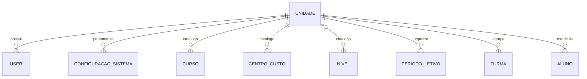
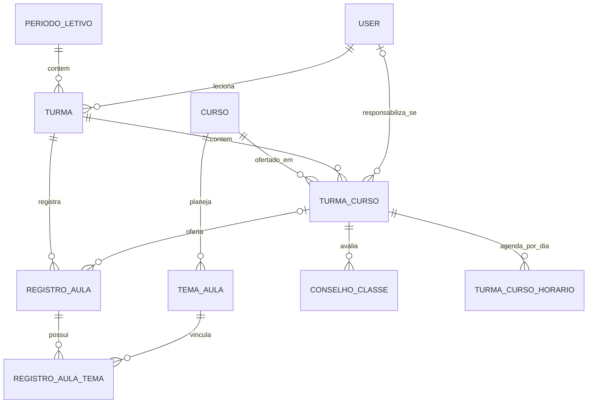
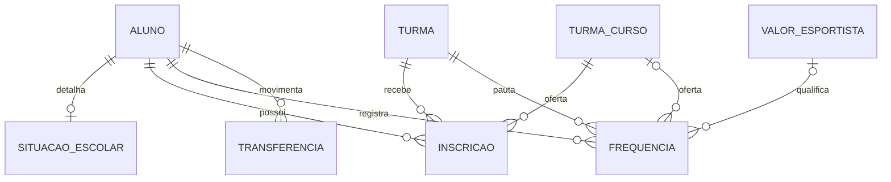
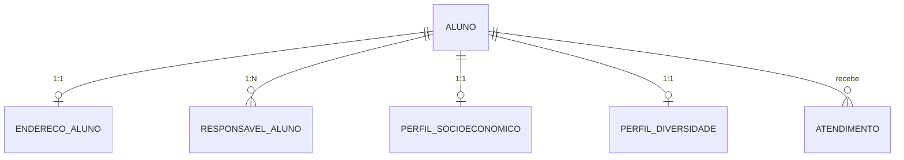
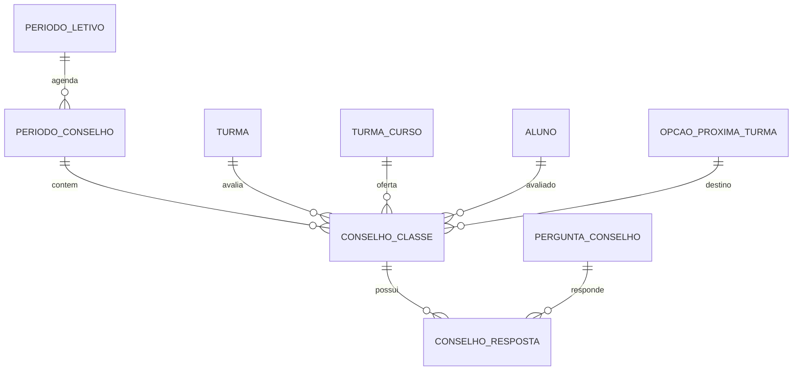
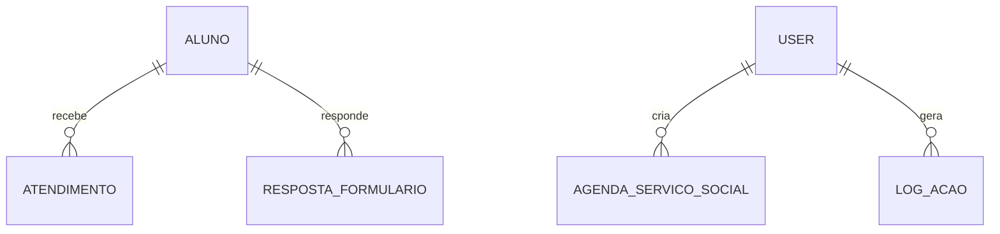
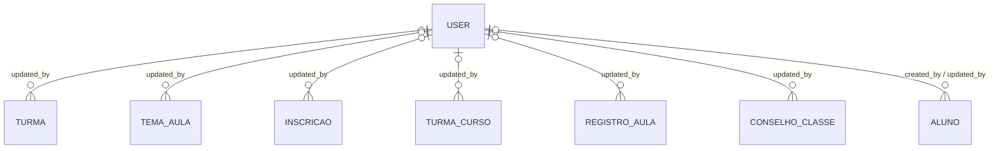

# MER — Modelo Entidade-Relacionamento

**Complemento de 26/10/2026:** incluída a relação `registro_aula_tema` e a migration `a8b9c0d1e2f3` para múltiplos temas por aula. **Complemento H1 (26/10/2026):** criada a grade `turma_curso_horario` (migration `5730d7c594ba`), o serviço `app/services/turma_curso_horario.py` e o conversor único `app/utils/dias_semana.py`; as colunas de agenda de `turma_curso` viraram projeção transitória (§7.32a, §8.10, §12.25). **Complemento H5b (26/10/2026):** removidas fisicamente as seis colunas escalares de agenda de `turma`/`turma_curso` (migration `8d2e3f4a5b6c`) e `ck_tch_dia` apertado de 0–6 para 0–5 (`7c1d2e3f4a5b`); a grade `turma_curso_horario` é a fonte única. **Aplicação no principal (27/10/2026):** H5b-A e H5b-B aplicadas no banco `pautaon` em 00:04:55 (head `8d2e3f4a5b6c`), após preflight read-only e backup `pautaon_pre_H5b_final.sql`. **Complemento H4c/H4d (27/10/2026):** regras de UX do componente de agenda por dia documentadas em §8.10; render dos estados e funções puras do JS cobertos por testes (sem mudança de comportamento).

> Documento vivo do esquema do banco de dados. **Atualize sempre que criar,
> alterar ou remover uma tabela/coluna.** Cada alteração deve vir acompanhada
> da migration correspondente.
**Última atualização:** 2026-10-28 — Sincronizado com as etapas T1, P1, B1–B7, M1, M1.1, M2, M4, L1, L2, **D5.0–D5.5**, **H1–H5b** e **A1** (frequência do histórico pela regra D2; BI com `turma.ativo`). **Inscrição exige oferta:** `inscricoes.turma_curso_id` NOT NULL (`c3d4e5f6a7b8`, endurecida na B5 com checagens de NULL/duplicata); índice único parcial `uix_inscricao_ativa_aluno_oferta` `(aluno_id, turma_curso_id) WHERE ativo IS TRUE`. **Programa obrigatório:** `turma_curso.programa` NOT NULL (`d4e5f6a7b8c9`, endurecida na B5 com `COALESCE` preservando `turma.programa` e recusa explícita sem programa padrão). **Serviço único de enturmação** (`app/services/enturmacao.py`, M2); desenturmar/transferir/desativar oferta por oferta. **Guarda de desativar oferta** (M4): recusa se houver aluno ativo em período em andamento. **Oferta efetiva** (M4): `cond_oferta_efetiva()` preserva histórico em período encerrado. **Isolamento por unidade** (B3/B4): vale para todos os perfis; Visão Global somente leitura. **Conselho de classe POR OFERTA (D5.1–D5.5, concluído):** `conselho_classe.turma_curso_id` **NOT NULL** (`e5f6a7b8c9d0` + endurecimento `f6a7b8c9d0e1`); `Turma.conselho_concluido` **removida** (encerramento por oferta, turma derivada); histórico, ficha 360°, painel por turma, resultado do conselho e certificado leem por oferta. **H1 (26/10):** grade de horário por dia na oferta (§7.32a) criada por `5730d7c594ba` com backfill da herança campo a campo (COALESCE oferta→turma); serviço `turma_curso_horario` (leitura/escrita/projeção) e conversor `dias_semana`; nenhum comportamento visível alterado — leitores/escritores da grade chegam em H2–H5 (§12.25). **H5b (26/10):** removidas fisicamente as seis colunas escalares de agenda (`8d2e3f4a5b6c`) e `ck_tch_dia` apertado para 0–5 (`7c1d2e3f4a5b`); a grade é a fonte única e o downgrade reconstrói a projeção com perda documentada; **aplicada no principal em 27/10/2026** (3 turmas / 5 ofertas / 8 linhas de grade, 6 colunas ausentes, CHECK 0–5). Suíte: **684 passed**, 0 falhas. **Head Alembic:** `b7c8d9e0f1a2`. **D3b-2.0–2.6 (27/10):** frequência/diário por oferta — mapas em lote (`freq_geral_turmas_em_lote`/`freq_geral_ofertas_em_lote`), histórico sem N+1 (`frequencias_aluno_por_inscricao`), estatísticas do GET `/frequencia` por oferta em 2+ ofertas (`conceitos_frequencia_por_aluno`), `min_freq` coerente com o valor exibido (D7), `f_prog` por `TurmaCurso.programa`. Suíte: 662 → 684 passed. **A1 — Valores do Esportista (28/10):** catálogo `valor_esportista` (escopo por unidade, único `lower(nome)` + `unidade_id`, `ativo`) e coluna adicional `frequencia.valor_esportista_id` (FK `ON DELETE SET NULL`, migration `b7c8d9e0f1a2`, sem backfill); o valor só é gravado com conceito A–D e **não** entra em nenhuma conta de presença/falta/pauta/diário/relatório/exportação (§7.5a, §7.19, §8.1). **Abas do Planejamento (28/10):** a aba ativa passou a viver na querystring (`?aba=temas|valores|niveis`) — escrita volta para a aba de origem e preserva os filtros da lista de temas (§9.3); sem mudança de schema. **Abas do Conselho de Perguntas (28/10):** etapa e foco também vão para a querystring (`?etapa=inicial|percurso|final&foco=turma|aluno`); salvar volta para a aba da pergunta gravada e excluir para a aba de origem (§9.3); sem mudança de schema. Suíte: 735 → 791 passed (38 da feature + 10 das abas do planejamento + 8 das abas do conselho). **Atividades da aula (28/10):** `registro_aula.atividades` (TEXT, nullable, migration `c8d9e0f1a2b3`, **aplicada no principal em 28/10/2026**); texto independente das observações, sem efeito em frequência, estatísticas, pauta impressa ou relatórios; o Diário de Observações passou a exibir as duas seções e a listar aulas com qualquer um dos dois textos (§7.20). Suíte: 791 → 805 passed (14 novos). **Diário de Observações (28/10):** `ver_observacoes` passa a exigir a unidade da turma e, para professor, o vínculo `turma.professor_id`; botão no painel (`/painel`) e no detalhe da turma (§7.20). Sem schema. Suíte: 805 → 813 passed. **Diário de Observações global (28/10):** `/relatorios/observacoes` com filtros por período letivo, turma, curso e professor para `ROLES_RELATORIOS`; template compartilhado em `modo_global`. Sem schema. Suíte: 813 → 826 passed.

---

## Sumário

 1. [Visão geral](#1-vis%C3%A3o-geral)
 2. [Estrutura do pacote de modelos](#2-estrutura-do-pacote-de-modelos)
 3. [Glossário](#3-gloss%C3%A1rio)
 4. [Multitenancy](#4-multitenancy)
 5. [Mapa de domínios](#5-mapa-de-dom%C3%ADnios)
 6. [Diagramas ER por domínio](#6-diagramas-er-por-dom%C3%ADnio)
 7. [Dicionário de dados](#7-dicion%C3%A1rio-de-dados)
 8. [Regras de negócio transversais](#8-regras-de-neg%C3%B3cio-transversais)
 9. [Convenções de código](#9-conven%C3%A7%C3%B5es-de-c%C3%B3digo)
10. [Histórico de ondas](#10-hist%C3%B3rico-de-ondas)
11. [Referência cruzada com migrations](#11-refer%C3%AAncia-cruzada-com-migrations)
12. [Dívida técnica e roadmap](#12-d%C3%ADvida-t%C3%A9cnica-e-roadmap)

---

## 1. Visão geral

O sistema é um **ERP socioeducativo** multitenant, organizado em torno de
**unidades** (tenants). Cada unidade possui:

- Usuários próprios (professores, pedagogia, secretaria).
- Catálogo próprio de cursos, níveis e turmas.
- Períodos letivos, calendário e conselhos de classe.
- Alunos, seus perfis estruturados (socioeconômico, diversidade, endereço, responsáveis) e atendimentos.

**Banco:** PostgreSQL (banco local de desenvolvimento/ensaio) / SQLite (testes). Não há ambiente de produção real; o banco local foi restaurado de dump antigo (§12.17).
**ORM:** SQLAlchemy via Flask-SQLAlchemy.
**Migrations:** Alembic via Flask-Migrate.
**Fonte de verdade do código:** `app/models/` (pacote).
**Fonte de verdade do esquema:** este documento.

### Ajustes de arquitetura ativos

- `SoftDeleteMixin` (coluna `ativo`) e `TenantMixin` (coluna `unidade_id`, FK → `unidade.id`, **nullable por padrão**) ficam em `app/models/base.py`. O `AuditoriaMixin` (colunas `updated_by_id`, `updated_by_name` e `updated_at`) fica em `app/models/auditoria_mixin.py`.
- Os atributos herdados dos mixins são compartilhados e **não** precisam ser repetidos em cada classe. Uso atual:

| Mixin             | Modelos que o herdam                                                                                                                                             |
|-------------------|------------------------------------------------------------------------------------------------------------------------------------------------------------------|
| `SoftDeleteMixin` | `PeriodoLetivo`, `Turma`, `TurmaCurso`, `TemaAula`, `Inscricao`, `PerguntaConselho`, `OpcaoProximaTurma`                                                    |
| `TenantMixin`     | `PeriodoLetivo`, `Turma`, `TurmaCurso`, `TemaAula`, `Transferencia` (redeclara `unidade_id` como NOT NULL), `Frequencia`, `RegistroAula`, `ConselhoClasse`, `ConselhoResposta` |
| `AuditoriaMixin`  | `Turma`, `TurmaCurso`, `TemaAula`, `Inscricao`, `RegistroAula`, `ConselhoClasse`                                                                                              |

- `Aluno` **não** usa mixins: declara manualmente `ativo`, `unidade_id` e as colunas de auditoria de criação e edição (Onda 3B-ter).
- A auditoria automática é registrada ao iniciar a app em `app/__init__.py`, importando `app.models.auditoria_listener` dentro de `_register_auditoria_listener`.
- `Turma.professor` usa `foreign_keys=[professor_id]` para evitar colisão com `updated_by_id` herdado de `AuditoriaMixin`; `RegistroAula.instrutor` e `TurmaCurso.professor` também declaram `foreign_keys` pelo mesmo motivo.

---

## 2. Estrutura do pacote de modelos

```text
app/models/
├── __init__.py            # Reexporta os modelos (compatibilidade). NÃO reexporta
│                          # enums nem mixins
├── base.py                # Imports, JSONType e mixins SoftDeleteMixin/TenantMixin
│                          # (não define modelos)
├── enums.py               # Enumerações + conjuntos derivados
├── auditoria_mixin.py     # AuditoriaMixin (updated_by_id, updated_by_name, updated_at)
├── auditoria_listener.py  # Listener before_flush: preenche auditoria + grava LogAcao
├── organizacao.py         # Unidade, ConfiguracaoSistema
├── usuarios.py            # User
├── pedagogico.py          # Curso, Nivel, CentroCusto
├── academico.py           # PeriodoLetivo, Turma, TurmaCurso, TurmaCursoHorario,
│                          # TemaAula
├── pessoas.py             # Aluno, SituacaoEscolar
├── perfis.py              # EnderecoAluno, ResponsavelAluno,
│                          # PerfilSocioeconomico, PerfilDiversidade
├── matriculas.py          # Inscricao, Transferencia
├── calendario.py          # DiaBloqueado, DiaBloqueadoTurma
├── aulas.py               # Frequencia, RegistroAula
├── conselho.py            # PeriodoConselho, PerguntaConselho,
│                          # OpcaoProximaTurma, ConselhoClasse, ConselhoResposta
├── atendimento.py         # Atendimento
├── servico_social.py      # AgendaServicoSocial, RespostaFormulario
├── auditoria.py           # LogAcao
└── legado.py              # Registro
```

### Camada de serviços relacionada

```text
app/services/
├── aluno_perfil.py        # Centraliza leitura/escrita dos perfis do Aluno
│                          # (Onda 3B). Todo acesso a endereço/responsável/
│                          # socioeconômico/diversidade passa por aqui.
├── aluno_status.py        # Categorias oficiais de enturmação e status do
│                          # aluno por data (usa espelho de `cond_oferta_efetiva`).
├── auth_service.py
├── bootstrap.py
├── calendar_service.py
├── conselho_leitura.py    # Leitura do conselho POR OFERTA (D5.4): lote por
│                          # (aluno, oferta, etapa), rótulo "Turma — Curso"
│                          # e derivados (histórico, ficha, painel, resultado).
├── enturmacao.py          # Serviço único de criação de inscrição
│                          # (`enturmar_aluno`; M2). Regras 0/1/2+ ofertas.
├── maintenance.py         # Toggle de manutenção e indisponibilidade
├── turma_curso.py         # Regras de aplicação da oferta `TurmaCurso`
│                          # (adicionar/editar/desativar, concomitância,
│                          # guarda de período M4, `_alunos_da_oferta`).
└── turma_curso_horario.py # Grade de horário por dia da oferta (H1): leitura
                           # (`grade_da_oferta`, `grades_em_lote` sem N+1),
                           # escrita atômica (`definir_grade`), derivados
                           # (`duracao_do_dia`, `grade_uniforme`, `resumo_grade`)
                           # e `sincronizar_projecao_horario` — o ÚNICO ponto
                           # que escreve a projeção escalar de `turma_curso`
                           # a partir do H2. Usa o conversor único
                           # `app/utils/dias_semana.py`. Nenhuma função commita.
```

### Regras de importação

1. Código **fora** do pacote importa os **modelos** sempre de `app.models`. Enums e mixins **não** são reexportados por `__init__.py`: importar de `app.models.enums`, `app.models.base` e `app.models.auditoria_mixin`.
2. Código **dentro** do pacote importa pelo caminho completo (ex.: `from app.models.pessoas import Aluno`).
3. Dentro de **métodos**, usar import local para evitar ciclos.
4. Ao ler/escrever dados de perfil do aluno, usar **sempre** `app.services.aluno_perfil` — nunca acessar `aluno.*_json` direto.
5. Novos modelamentos de tenant/soft-delete devem preferir herdar de `TenantMixin` e `SoftDeleteMixin` em vez de redeclarar campos duplicados; entidades editadas por usuários devem herdar também `AuditoriaMixin`.

### Auditoria automática

A auditoria é composta por duas peças:

1. **`AuditoriaMixin`** (`app/models/auditoria_mixin.py`) — adiciona `updated_by_id` (FK → `user.id`, `ON DELETE SET NULL`), `updated_by_name` (snapshot, `varchar(100)`) e `updated_at` (`default` e `onupdate` = `get_local_now`), além do relacionamento `updated_by` (→ `User`, `lazy='joined'`). FK e relationship são declarados via `@declared_attr` (exigência do SQLAlchemy 2.x).
2. **Listener `before_flush`** (`app/models/auditoria_listener.py`) — registrado em `db.session` quando o módulo é importado (feito no bootstrap da app, ver §1).

Comportamento do listener (conforme o código):

- Considera os objetos de `session.new` + `session.dirty` que possuam o atributo `updated_by_id`. A detecção é por `hasattr`, **não** por herança do mixin — portanto `Aluno` também é coberto.
- Preenche `updated_by_id` e `updated_by_name` com o `current_user` (ou `NULL` se não autenticado) e `updated_at = db.func.now()`.
- Cria um `LogAcao` por objeto: `acao` = `Criar <Classe>` (objeto novo) ou `Alterar <Classe>`; `detalhes` = `repr(obj)`; `ip` = `request.remote_addr` (apenas em contexto de request); `usuario_id`, `usuario_nome` e `unidade_id` vêm do `current_user`.
- **Não trata DELETE** (`session.deleted`): exclusões físicas, inclusive cascatas `delete-orphan`, não geram `LogAcao`; a premissa é o soft delete via `ativo=False`.
- Pontos de atenção em §12.11.

---

## 3. Glossário

| Termo                    | Significado                                                                                                                                                 |
|--------------------------|-------------------------------------------------------------------------------------------------------------------------------------------------------------|
| **Unidade**              | Tenant do sistema. Fronteira de isolamento de dados.                                                                                                        |
| **Turma**                | Agrupador lógico de alunos; a oferta acadêmica efetiva fica em `TurmaCurso` (Onda 4).                                                                           |
| **Oferta (TurmaCurso)**  | Vínculo concreto curso↔turma (`turma_curso`): atribui um curso a uma turma, com professor, turno, horários e vigência próprios.                                  |
| **Inscrição**            | Vínculo do aluno a uma oferta concreta (`inscricoes.turma_curso_id`, NOT NULL desde `c3d4e5f6a7b8`), com histórico de ativação/desativação por oferta.                       |
| **Conceito**             | Código de presença/falta: A/B/C/D (presente), F (falta), J (justificada).                                                                                   |
| **Conselho de Classe**   | Reunião colegiada que avalia o aluno **em uma OFERTA** por etapa (`conselho_classe.turma_curso_id` NOT NULL desde a D5.5); o encerramento é manual por oferta e derivado na turma (§8.2). |
| **Etapa**                | Momento do conselho: INICIAL, PERCURSO, FINAL.                                                                                                              |
| **Tema de Aula**         | Tópico macro do planejamento pedagógico.                                                                                                                    |
| **Dia bloqueado**        | Data sem aula em um período letivo (feriado, etc.).                                                                                                         |
| **Perfil do aluno**      | Dados complementares (endereço, responsável, socioeconômico, diversidade) em tabelas 1:1 ou 1:N com `Aluno`.                                                |
| **Documentos entregues** | Flags JSONB em `Aluno.documentos_entregues` indicando quais documentos foram anexados.                                                                      |
| **C.H. (carga horária)** | Calculada a partir da **grade** (`turma_curso_horario`), em minutos: `carga_horaria_aula` é a duração uniforme da grade (indefinida quando os dias têm durações diferentes); `carga_horaria_total` soma as ocorrências esperadas de cada dia (na turma, une os intervalos das ofertas ativas por data). Não é persistida (§10). |
| **Mixin de auditoria**   | `AuditoriaMixin`: colunas `updated_by_id`, `updated_by_name` e `updated_at`, preenchidas pelo listener `before_flush`.                                      |

---

## 4. Multitenancy

A coluna `unidade_id` aparece em quase todas as tabelas de negócio.

Regras:

1. **Toda consulta de listagem deve filtrar por** `unidade_id` do usuário logado, exceto para o perfil `admin` global.
2. `Unidade` **não** é apagada se houver registros dependentes (integridade).
3. `User.email` é único **globalmente** (não por unidade).
4. `ConfiguracaoSistema.unidade_id = NULL` significa configuração **global**.
5. `Nivel.nome` é único **por unidade** (`uq_nivel_nome_unidade`: `nome` + `unidade_id`).
6. As tabelas de perfil do aluno (`endereco_aluno`, `responsavel_aluno`, `perfil_socioeconomico`, `perfil_diversidade`) herdam `unidade_id` do aluno no momento da criação.
7. `TenantMixin.unidade_id` é **nullable** por padrão (compatibilidade com registros globais/legados). Tabelas que o tornam NOT NULL: `curso`, `transferencia`, `dia_bloqueado` e `periodo_conselho`.
8. Tabelas **sem** `unidade_id`: `inscricoes`, `conselho_pergunta`, `opcao_proxima_turma`, `agenda_servico_social` e `respostas_formulario`. Quando necessário, o escopo é derivado por join (ex.: `inscricoes.turma_id → turma.unidade_id`).
9. `conselho_classe` **não** tem dimensão própria de unidade além do `unidade_id` herdado do `TenantMixin` (nullable, espelho da unidade da turma/oferta): não há coluna nem FK composta de unidade na unicidade por oferta (`uix_conselho_oferta` é `turma_curso_id + aluno_id + etapa`). O escopo por unidade é aplicado nas rotas (`assert_unidade_context`) e nas consultas dos leitores — ver §8.2.

---

## 5. Mapa de domínios

| Módulo               | Domínio                    | Entidades                                                                                        |
|----------------------|----------------------------|--------------------------------------------------------------------------------------------------|
| `organizacao`        | Estrutura Organizacional   | `Unidade`, `ConfiguracaoSistema`                                                                 |
| `base`               | Mixins de modelo           | `SoftDeleteMixin`, `TenantMixin`                                                                 |
| `usuarios`           | Usuários e Autenticação    | `User`                                                                                           |
| `pedagogico`         | Cadastros Pedagógicos      | `Curso`, `Nivel`                                                                                 |
| `academico`          | Estrutura Acadêmica        | `PeriodoLetivo`, `Turma`, `TurmaCurso`, `TemaAula`                                               |
| `pessoas`            | Pessoas                    | `Aluno`, `SituacaoEscolar`                                                                       |
| `perfis`             | Perfis do Aluno            | `EnderecoAluno`, `ResponsavelAluno`, `PerfilSocioeconomico`, `PerfilDiversidade`                 |
| `matriculas`         | Matrículas e Movimentações | `Inscricao`, `Transferencia`                                                                     |
| `calendario`         | Calendário Acadêmico       | `DiaBloqueado`, `DiaBloqueadoTurma`                                                              |
| `aulas`              | Frequência e Aulas         | `Frequencia`, `RegistroAula`                                                                     |
| `conselho`           | Conselho de Classe         | `PeriodoConselho`, `PerguntaConselho`, `OpcaoProximaTurma`, `ConselhoClasse`, `ConselhoResposta` |
| `atendimento`        | Atendimento                | `Atendimento`                                                                                    |
| `servico_social`     | Serviço Social             | `AgendaServicoSocial`, `RespostaFormulario`                                                      |
| `auditoria`          | Auditoria                  | `LogAcao`                                                                                        |
| `auditoria_mixin`    | Mixin de Auditoria         | `AuditoriaMixin`                                                                                 |
| `auditoria_listener` | Listener de Auditoria      | — (evento `before_flush`)                                                                        |
| `legado`             | Legado                     | `Registro`                                                                                       |

---

## 6. Diagramas ER por domínio

### 6.1 Núcleo organizacional e usuários



### 6.2 Estrutura acadêmica



### 6.3 Alunos, matrículas e frequência



### 6.4 Perfil do aluno (Onda 3A/3B)



### 6.5 Conselho de classe



### 6.6 Serviço social, atendimento e auditoria



### 6.7 Auditoria de edição (`updated_by`)



As cinco primeiras relações vêm do `AuditoriaMixin` (`ON DELETE SET NULL`, conforme `a9f3c8e2d1b7`). `Aluno` declara `created_by_id` e `updated_by_id` manualmente: no modelo as FKs não têm `ondelete`, mas a migration `f1a2b3c4d5e6` cria `fk_aluno_updated_by_id` com `ON DELETE SET NULL` (somente PostgreSQL).

---

## 7. Dicionário de dados

> Tipos lógicos. `NOT NULL` indicado explicitamente. Defaults descritos
> quando relevantes.
>
> Tabelas que usam mixins trazem a linha **Mixins** logo abaixo do título (`SoftDeleteMixin` → `ativo`; `TenantMixin` → `unidade_id`; `AuditoriaMixin` → `updated_by_id`, `updated_by_name`, `updated_at`).

### 7.1 `unidade`

| Coluna | Tipo         | Nulo | Default | Descrição       |
|--------|--------------|------|---------|-----------------|
| id     | int          | não  | auto    | PK              |
| nome   | varchar(100) | não  | —       | Nome da unidade |
| ativo  | bool         | não  | true    | Soft delete     |

### 7.2 `configuracao_sistema`

| Coluna     | Tipo         | Nulo | Default | Descrição                |
|------------|--------------|------|---------|--------------------------|
| id         | int          | não  | auto    | PK                       |
| chave      | varchar(50)  | não  | —       | Chave (única por escopo) |
| valor      | varchar(100) | sim  | —       | Valor serializado        |
| descricao  | varchar(255) | sim  | —       | Texto explicativo        |
| unidade_id | int          | sim  | —       | NULL = global            |

**Índices únicos parciais:** `ix_config_chave_global` (`chave WHERE unidade_id IS NULL`), `ix_config_chave_unidade` (`chave, unidade_id WHERE unidade_id IS NOT NULL`).

### 7.3 `user`

| Coluna       | Tipo         | Nulo | Default | Descrição                    |
|--------------|--------------|------|---------|------------------------------|
| id           | int          | não  | auto    | PK                           |
| name         | varchar(100) | não  | —       | Nome completo                |
| email        | varchar(120) | não  | —       | **UNIQUE** global            |
| password     | varchar(200) | sim  | —       | Hash Werkzeug; NULL para AD  |
| role         | varchar(20)  | não  | —       | Valor canônico em `UserRole` |
| is_active    | bool         | não  | true    | Conta ativa                  |
| is_ad_user   | bool         | não  | false   | Autenticação por domínio     |
| unidade_id   | int          | sim  | —       | FK → unidade                 |
| first_login  | bool         | sim  | true    | Força troca de senha         |
| google_id    | varchar(100) | sim  | —       | **UNIQUE**, indexado         |
| google_email | varchar(120) | sim  | —       | E-mail Google                |

**CHECK:** `ck_user_role` — restringe `role` aos valores de `UserRole`.

### 7.4 `curso`

| Coluna     | Tipo         | Nulo | Default | Descrição     |
|------------|--------------|------|---------|---------------|
| id         | int          | não  | auto    | PK            |
| nome       | varchar(150) | não  | —       | Nome do curso |
| descricao  | varchar(300) | sim  | —       | Descrição     |
| ativo      | bool         | não  | true    | Soft delete   |
| unidade_id | int          | não  | —       | FK → unidade  |
| created_at | timestamp    | sim  | now     | Auditoria     |

> **Removido:** `carga_horaria` (migration `d1e2f3a4b5c6`, rotulada "Onda 3C"). A C.H. agora é calculada por turma (§7.7).
>
> **Divergência modelo × banco:** a migration `a9f3c8e2d1b7` também criou `updated_by_id`, `updated_by_name` e `updated_at` em `curso`, mas `Curso` **não** herda `AuditoriaMixin`; essas colunas existem no banco e não estão mapeadas (ver §11.1, item 3).

### 7.4a `centro_custo` (catálogo de centros de custo)

**Mixins:** nenhum (`ativo` manual; `unidade_id` manual). Sem `AuditoriaMixin`.

| Coluna     | Tipo         | Nulo | Default | Descrição                  |
|------------|--------------|------|---------|----------------------------|
| id         | int          | não  | auto    | PK                         |
| nome       | varchar(150) | não  | —       | Nome do centro             |
| ativo      | bool         | não  | true    | Soft delete                |
| unidade_id | int          | não  | —       | FK → unidade               |
| created_at | timestamp    | sim  | now     | Auditoria                  |
| updated_at | timestamp    | sim  | now     | Auditoria                  |

**Unicidade:** `uq_centro_custo_nome_unidade` (`nome`, `unidade_id`).

**Relação com demais tabelas:** `periodo_letivo.centro_custo`, `turma.centro_custo` e `turma_curso.centro_custo` armazenam o **nome** do centro como token CSV (não FK); a tabela `centro_custo` é o catálogo da unidade, usado para validação/seleção no formulário de períodos. A edição de um centro propaga o novo nome para essas colunas (§8.11).

### 7.5 `nivel`

| Coluna     | Tipo         | Nulo | Default | Descrição         |
|------------|--------------|------|---------|-------------------|
| id         | int          | não  | auto    | PK                |
| nome       | varchar(100) | não  | —       | Único por unidade |
| ativo      | bool         | não  | true    | Soft delete       |
| unidade_id | int          | sim  | —       | FK → unidade      |

**UNIQUE:** (`nome`, `unidade_id`) via `uq_nivel_nome_unidade`. Níveis de unidades diferentes podem ter o mesmo nome; níveis legados sem unidade mantêm `unidade_id = NULL`. No PostgreSQL, `NULL` não colide em UNIQUE; logo a restrição não impede nomes duplicados entre níveis legados sem unidade.

### 7.5a `valor_esportista` (A1)

Catálogo do planejamento pedagógico — o "Valor / Postura do Esportista" escolhido no lançamento de frequência. Sem mixins: é catálogo simples, não participa de soft delete de domínio nem de auditoria de edição.

| Coluna     | Tipo         | Nulo | Default | Descrição                          |
|------------|--------------|------|---------|------------------------------------|
| id         | int          | não  | auto    | PK                                 |
| nome       | varchar(100) | não  | —       | Único por unidade, sem case        |
| ativo      | bool         | não  | true    | `false` esconde do seletor         |
| unidade_id | int          | não  | —       | FK → unidade (`fk_valor_esportista_unidade`) |
| created_at | timestamp    | sim  | now     | —                                  |
| updated_at | timestamp    | sim  | onupdate| —                                  |

**UNIQUE funcional:** `uix_valor_esportista_nome_unidade` em (`lower(nome)`, `unidade_id`) — a unicidade é por unidade e **não** diferencia maiúsculas de minúsculas. A rota valida com `func.lower` antes do `INSERT` para devolver mensagem amigável (o índice segue como garantia final). `unidade_id` é **NOT NULL** (não há valor global, ao contrário de `nivel` legado): criar/editar/inativar exige unidade efetiva na sessão — a Visão Global é somente leitura.

**Exclusão:** com uso, o valor **nunca** é apagado — apenas inativado (`Registros de cadastro: registros.planejamento` com `tipo_post="valor"`, `registros.editar_valor`, `registros.inativar_valor`). Registros históricos continuam exibindo o valor inativo.

### 7.6 `periodo_letivo`

**Mixins:** `SoftDeleteMixin`, `TenantMixin` (`unidade_id` **nullable**). Sem `AuditoriaMixin`.

| Coluna            | Tipo         | Nulo | Default  | Descrição                     |
|-------------------|--------------|------|----------|-------------------------------|
| id                | int          | não  | auto     | PK                            |
| nome              | varchar(150) | não  | —        | Nome                          |
| data_inicio       | date         | não  | —        | Início                        |
| data_fim          | date         | não  | —        | Fim                           |
| centro_custo      | varchar(150) | sim  | —        | Centro de custo               |
| estimativa_alunos | int          | não  | 0        | Planejamento                  |
| ativo             | bool         | não  | true     | Soft delete (SoftDeleteMixin) |
| unidade_id        | int          | sim  | —        | FK → unidade (TenantMixin)    |
| created_at        | timestamp    | sim  | now      | Auditoria                     |
| updated_at        | timestamp    | sim  | onupdate | Auditoria                     |

**Derivados (não persistidos):** `nome_exibicao` (property: `"<unidade> <nome>"`) e `alunos_enturmados()` (alunos únicos com alguma turma do período via `Aluno.turmas`; **não** filtra `Inscricao.ativo` nem `Aluno.ativo` — para as categorias oficiais de enturmação, ver §8.3).

### 7.7 `turma`

**Mixins:** `SoftDeleteMixin`, `TenantMixin`, `AuditoriaMixin`.

| Coluna              | Tipo             | Nulo | Default      | Descrição                                        |
|---------------------|------------------|------|--------------|--------------------------------------------------|
| id                  | int              | não  | auto         | PK                                               |
| nome                | varchar(100)     | não  | —            | Nome                                             |
| ativo               | bool             | não  | true         | Soft delete                                      |
| **data_inicio**     | **date**         | sim  | —            | Início (Onda 2A)                                 |
| **data_fim**        | **date**         | sim  | —            | Fim (Onda 2A)                                    |
| programa            | varchar(50)      | sim  | —            | Esporte, Profissionalizante…                     |
| turno               | varchar(20)      | sim  | —            | Manhã, Tarde, Noite                              |
| centro_custo        | varchar(150)     | sim  | —            | —                                                |
| ordenacao           | int              | sim  | —            | Ordem de exibição                                |
| unidade_id          | int              | sim  | —            | FK → unidade                                     |
| periodo_letivo_id   | int              | sim  | —            | FK → periodo_letivo                              |
| curso_id            | int              | sim  | —            | LEGADO — FK → curso (convive com `turma_curso` até as fases finais da Onda 4) |
| professor_id        | int              | sim  | —            | FK → user                                        |
| avaliacao_inicial   | text             | sim  | —            | **LEGADO** — parecer coletivo agora em `turma_curso.avaliacao_inicial`; remover após conferir o dump autêntico |
| avaliacao_percurso  | text             | sim  | —            | **LEGADO** — idem (`turma_curso.avaliacao_percurso`) |
| avaliacao_final     | text             | sim  | —            | **LEGADO** — idem (`turma_curso.avaliacao_final`) |
| **updated_by_id**   | **int**          | sim  | —            | FK → user, `ON DELETE SET NULL` (AuditoriaMixin) |
| **updated_by_name** | **varchar(100)** | sim  | —            | Snapshot do editor (AuditoriaMixin)              |
| **updated_at**      | **timestamp**    | sim  | now/onupdate | Última modificação (AuditoriaMixin)              |

**Derivados (não persistidos):** `freq_geral` (§8.1); `alunos_ativos_count` (alunos com `Aluno.ativo=True` vinculados via `inscricoes`, sem filtrar `Inscricao.ativo`); `dias_aula_efetivos()` (via `app.utils.logica.calcular_dias_aula_turma`, derivado da grade das ofertas ativas); `carga_horaria_aula`/`carga_horaria_total` (delegam a `cargas_horarias_turmas_em_lote`, calculadas pela grade — ver §7.32a/§10; `None` quando indefinido); `Turma.get_ativas()` (turmas com `ativo=True`, por nome).

**Sem colunas de agenda (H5b):** `dias_semana`, `hora_inicio` e `hora_fim` **não existem mais** em `turma` (migration `8d2e3f4a5b6c`). A agenda da turma é **derivada** da grade das ofertas ativas; turma sem oferta não tem agenda.

**Remoção de `conselho_concluido` (D5.5, `f6a7b8c9d0e1`):** a coluna `turma.conselho_concluido` **não existe mais**. O encerramento é da OFERTA (`turma_curso.conselho_concluido`) e a visão da turma é **derivada na leitura** (`turma_conselho_concluido()` em `app/services/turma_curso.py`: verdadeiro só com ao menos uma oferta ativa e todas concluídas). `Turma.avaliacao_inicial/percurso/final` **permanecem** como legado (parecer coletivo agora é da oferta). Ver §8.2.

### 7.8 `tema_aula`

**Mixins:** `SoftDeleteMixin`, `TenantMixin`, `AuditoriaMixin`.

| Coluna              | Tipo             | Nulo | Default      | Descrição                                        |
|---------------------|------------------|------|--------------|--------------------------------------------------|
| id                  | int              | não  | auto         | PK                                               |
| curso_id            | int              | sim  | —            | FK → curso                                       |
| turma_id            | int              | sim  | —            | LEGADO — FK → turma                              |
| unidade_id          | int              | sim  | —            | FK → unidade                                     |
| titulo              | varchar(200)     | sim  | —            | Título                                           |
| programa            | varchar(50)      | sim  | —            | Programa                                         |
| ativo               | bool             | não  | true         | Soft delete                                      |
| **data**            | **date**         | sim  | —            | Data (Onda 2A)                                   |
| ordem               | int              | não  | 0            | Sequência didática                               |
| **updated_by_id**   | **int**          | sim  | —            | FK → user, `ON DELETE SET NULL` (AuditoriaMixin) |
| **updated_by_name** | **varchar(100)** | sim  | —            | Snapshot do editor (AuditoriaMixin)              |
| **updated_at**      | **timestamp**    | sim  | now/onupdate | Última modificação (AuditoriaMixin)              |

### 7.9 `aluno`

**Mixins:** nenhum. `ativo`, `unidade_id` e a auditoria de criação/edição são declarados manualmente.

| Coluna                    | Tipo             | Nulo | Default | Descrição                                                     |
|---------------------------|------------------|------|---------|---------------------------------------------------------------|
| id                        | int              | não  | auto    | PK                                                            |
| nome                      | varchar(100)     | não  | —       | Nome civil                                                    |
| nome_social               | varchar(100)     | sim  | —       | Nome social (preferir em UI)                                  |
| ativo                     | bool             | não  | true    | Soft delete                                                   |
| data_nascimento           | date             | sim  | —       | —                                                             |
| foto_path                 | varchar(255)     | sim  | —       | Caminho relativo                                              |
| **documentos_entregues**  | **jsonb**        | sim  | —       | Flags de documentos (Onda 3A-bis)                             |
| escolaridade_json         | text             | sim  | —       | **LEGADO** — fallback (Onda 3C)                               |
| identificacao_json        | text             | sim  | —       | **LEGADO** — fallback (Onda 3C)                               |
| socioeconomico_json       | text             | sim  | —       | **LEGADO** — fallback (Onda 3C)                               |
| diversidade_json          | text             | sim  | —       | **LEGADO** — fallback (Onda 3C)                               |
| cpf                       | varchar(20)      | sim  | —       | —                                                             |
| rg                        | varchar(50)      | sim  | —       | —                                                             |
| whatsapp                  | varchar(30)      | sim  | —       | —                                                             |
| email                     | varchar(120)     | sim  | —       | —                                                             |
| nivel                     | varchar(20)      | sim  | —       | Básico / Intermediário / Avançado                             |
| **orgao_rg**              | varchar(20)      | sim  | —       | Onda 3A                                                       |
| **nacionalidade**         | varchar(50)      | sim  | —       | Onda 3A                                                       |
| **natural_uf**            | varchar(2)       | sim  | —       | Onda 3A                                                       |
| **natural_cidade**        | varchar(100)     | sim  | —       | Onda 3A                                                       |
| **nome_mae**              | varchar(150)     | sim  | —       | Onda 3A                                                       |
| **cpf_mae**               | varchar(20)      | sim  | —       | Onda 3A                                                       |
| **nome_pai**              | varchar(150)     | sim  | —       | Onda 3A                                                       |
| **cpf_pai**               | varchar(20)      | sim  | —       | Onda 3A                                                       |
| **vai_acompanhado_aulas** | bool             | não  | false   | Onda 3A                                                       |
| **acompanhante_aulas**    | varchar(150)     | sim  | —       | Onda 3A                                                       |
| created_by_id             | int              | sim  | —       | FK → user                                                     |
| created_by_name           | varchar(100)     | sim  | —       | Snapshot                                                      |
| created_at                | timestamp        | sim  | now     | Auditoria                                                     |
| **updated_by_id**         | **int**          | sim  | —       | FK → user; `SET NULL` na migration, sem `ON DELETE` no modelo |
| **updated_by_name**       | **varchar(100)** | sim  | —       | Snapshot (Onda 3B-ter)                                        |
| **updated_at**            | **timestamp**    | sim  | —       | Preenchido na 1ª edição (Onda 3B-ter)                         |
| unidade_id                | int              | sim  | —       | FK → unidade                                                  |

> **Nota (auditoria automática):** `Aluno` não herda `AuditoriaMixin`, mas possui `updated_by_id`; por isso o listener `before_flush` (§2) também o processa — preenche `updated_*` e grava `LogAcao` inclusive na **inclusão**. A regra "`updated_at` permanece NULL até a 1ª edição" vale apenas sem o listener ativo.

**Formato de** `documentos_entregues`**:**

```json
{"doc_entregue": {"doc_aluno": true, "doc_termo": false, ...}}
```

**Properties derivadas:** `matricula`, `foto`, `idade`, `*_json`, `documentos_dict()`, `documento_entregue(doc_id)`.

### 7.10 `situacao_escolar`

| Coluna                  | Tipo         | Nulo | Default      | Descrição               |
|-------------------------|--------------|------|--------------|-------------------------|
| id                      | int          | não  | auto         | PK                      |
| aluno_id                | int          | não  | —            | **UNIQUE** — FK → aluno |
| unidade_id              | int          | sim  | —            | FK → unidade            |
| escolaridade            | varchar(40)  | sim  | —            | —                       |
| ensino_superior_periodo | int          | sim  | —            | —                       |
| escolaridade_outro      | varchar(150) | sim  | —            | Quando "Outros"         |
| status                  | varchar(20)  | sim  | —            | —                       |
| status_outro            | varchar(150) | sim  | —            | Quando "Outros"         |
| nome_instituicao        | varchar(200) | sim  | —            | Indexado com unidade    |
| tipo_instituicao        | varchar(20)  | sim  | —            | —                       |
| bolsista                | bool         | não  | false        | —                       |
| tipo_instituicao_outro  | varchar(150) | sim  | —            | Quando "Outro"          |
| turno                   | varchar(20)  | sim  | —            | —                       |
| turno_outro             | varchar(100) | sim  | —            | Quando "Outros"         |
| created_at              | timestamp    | não  | now          | Auditoria               |
| updated_at              | timestamp    | não  | now/onupdate | Auditoria               |

**Índice:** `ix_situacao_escolar_unidade_nome` (`unidade_id`, `nome_instituicao`).

### 7.11 `endereco_aluno` (Onda 3A)

| Coluna                 | Tipo         | Nulo | Default      | Descrição               |
|------------------------|--------------|------|--------------|-------------------------|
| id                     | int          | não  | auto         | PK                      |
| aluno_id               | int          | não  | —            | **UNIQUE** — FK → aluno |
| unidade_id             | int          | sim  | —            | FK → unidade            |
| cep                    | varchar(10)  | sim  | —            | —                       |
| rua                    | varchar(200) | sim  | —            | —                       |
| numero                 | varchar(20)  | sim  | —            | —                       |
| bairro                 | varchar(100) | sim  | —            | —                       |
| cidade                 | varchar(100) | sim  | —            | —                       |
| uf                     | varchar(2)   | sim  | —            | —                       |
| zona                   | varchar(20)  | sim  | —            | Urbana / Rural / Outro  |
| possui_acesso_internet | bool         | não  | true         | —                       |
| created_at             | timestamp    | sim  | now          | Auditoria               |
| updated_at             | timestamp    | sim  | now/onupdate | Auditoria               |

### 7.12 `responsavel_aluno` (Onda 3A)

| Coluna     | Tipo         | Nulo | Default      | Descrição               |
|------------|--------------|------|--------------|-------------------------|
| id         | int          | não  | auto         | PK                      |
| aluno_id   | int          | não  | —            | FK → aluno              |
| unidade_id | int          | sim  | —            | FK → unidade            |
| tipo       | varchar(30)  | sim  | —            | Pai / Mãe / Avô/Avó / … |
| nome       | varchar(150) | sim  | —            | —                       |
| cpf        | varchar(20)  | sim  | —            | —                       |
| telefone   | varchar(30)  | sim  | —            | —                       |
| created_at | timestamp    | sim  | now          | Auditoria               |
| updated_at | timestamp    | sim  | now/onupdate | Auditoria               |

**Relação:** 1:N com `Aluno`. O formulário atual coleta 1; o schema aceita N.

### 7.13 `perfil_socioeconomico` (Onda 3A)

| Coluna                  | Tipo          | Nulo | Default      | Descrição                                              |
|-------------------------|---------------|------|--------------|--------------------------------------------------------|
| id                      | int           | não  | auto         | PK                                                     |
| aluno_id                | int           | não  | —            | **UNIQUE** — FK → aluno                                |
| unidade_id              | int           | sim  | —            | FK → unidade                                           |
| renda_familiar          | numeric(12,2) | sim  | —            | Renda familiar mensal em reais                         |
| residente_maior_renda   | varchar(50)   | sim  | —            | Aluno / Pai / Mãe / …                                  |
| pessoas_residencia      | int           | sim  | —            | Nº moradores                                           |
| ocupacao                | varchar(50)   | sim  | —            | Estudante / CLT / …                                    |
| beneficio_social_status | varchar(20)   | sim  | —            | Sim / Não                                              |
| beneficio_social_nome   | text          | sim  | —            | Nomes dos programas, separados internamente por ` \| ` |
| meio_transporte         | varchar(30)   | sim  | —            | Ônibus / Bicicleta / …                                 |
| vulnerabilidade_social  | bool          | não  | false        | —                                                      |
| created_at              | timestamp     | sim  | now          | Auditoria                                              |
| updated_at              | timestamp     | sim  | now/onupdate | Auditoria                                              |

**Notas (Etapa VI, 2026-09-22):**

- `renda_familiar` é valor mensal em reais; a renda per capita é derivada em
  runtime (`renda_per_capita()`) e não é persistida.
- `beneficio_social_nome` só é preenchido quando `beneficio_social_status =
  'Sim'` (vários programas unidos por ` | `).

### 7.14 `perfil_diversidade` (Onda 3A)

| Coluna                     | Tipo         | Nulo | Default      | Descrição                                                                       |
|----------------------------|--------------|------|--------------|---------------------------------------------------------------------------------|
| id                         | int          | não  | auto         | PK                                                                              |
| aluno_id                   | int          | não  | —            | **UNIQUE** — FK → aluno                                                         |
| unidade_id                 | int          | sim  | —            | FK → unidade                                                                    |
| genero                     | varchar(30)  | sim  | —            | —                                                                               |
| raca_cor                   | varchar(30)  | sim  | —            | —                                                                               |
| saude_laudo                | bool         | não  | false        | PCD                                                                             |
| tipo_deficiencia           | varchar(30)  | sim  | —            | Motora/Física, Auditiva, Psicossocial, Intelectual/Mental, Visual, Outro ou TEA |
| saude_medicacao            | varchar(5)   | sim  | —            | Sim / Não                                                                       |
| saude_medicamento_nome     | varchar(150) | sim  | —            | —                                                                               |
| saude_observacoes          | text         | sim  | —            | —                                                                               |
| informacoes_para_professor | text         | sim  | —            | —                                                                               |
| autorizacao_imagem         | bool         | não  | false        | —                                                                               |
| created_at                 | timestamp    | sim  | now          | Auditoria                                                                       |
| updated_at                 | timestamp    | sim  | now/onupdate | Auditoria                                                                       |

**Nota:** `tipo_deficiencia` é restrito ao catálogo `TIPOS_DEFICIENCIA` do
serviço e só é mantido enquanto `saude_laudo = true`.

### 7.15 `inscricoes`

**Mixins:** `SoftDeleteMixin`, `AuditoriaMixin`. Sem `TenantMixin`: a tabela **não possui** `unidade_id`.

| Coluna              | Tipo             | Nulo | Default      | Descrição                                        |
|---------------------|------------------|------|--------------|--------------------------------------------------|
| id                  | int              | não  | auto         | PK                                               |
| aluno_id            | int              | não  | —            | FK → aluno                                       |
| turma_id            | int              | não  | —            | FK → turma                                       |
| turma_curso_id      | int              | não  | —            | FK → turma_curso (Onda 4; NOT NULL desde `c3d4e5f6a7b8`) |
| nivel               | varchar(30)      | sim  | —            | Nível na turma                                   |
| ativo               | bool             | não  | true         | Vínculo atual                                    |
| data_inicio         | date             | não  | now          | Início                                           |
| data_desativacao    | timestamp        | sim  | —            | Quando desativado                                |
| motivo_desativacao  | varchar(50)      | sim  | —            | Motivo                                           |
| **updated_by_id**   | **int**          | sim  | —            | FK → user, `ON DELETE SET NULL` (AuditoriaMixin) |
| **updated_by_name** | **varchar(100)** | sim  | —            | Snapshot do editor (AuditoriaMixin)              |
| **updated_at**      | **timestamp**    | sim  | now/onupdate | Última modificação (AuditoriaMixin)              |

> Múltiplas linhas por `(aluno_id, turma_id)` são permitidas por design — cada
> linha vincula o aluno a uma **oferta concreta** (`turma_curso_id`); linhas
> históricas inativas (`ativo=false`) coexistem com a ativa atual.

> **Índice único parcial:** `uix_inscricao_ativa_aluno_oferta` — UNIQUE
> `(aluno_id, turma_curso_id) WHERE ativo IS TRUE` (migration
> `c3d4e5f6a7b8`): impede duas inscrições ativas do mesmo aluno na mesma
> oferta; múltiplas ofertas ativas na mesma turma para o mesmo aluno são
> permitidas; inscrições inativas não são bloqueadas pelo índice.

> A exigência NOT NULL por oferta (`c3d4e5f6a7b8`) foi aplicada — o antigo
> estado `turma_curso_id IS NULL` (fallback da Fase 1–4 transicional) não é
> mais alcançável no banco.

### 7.16 `transferencia`

**Mixins:** `TenantMixin`, com `unidade_id` redeclarado na classe como NOT NULL (sobrescreve o `nullable=True` do mixin).

| Coluna             | Tipo      | Nulo | Default | Descrição    |
|--------------------|-----------|------|---------|--------------|
| id                 | int       | não  | auto    | PK           |
| aluno_id           | int       | não  | —       | FK → aluno   |
| turma_origem_id    | int       | não  | —       | FK → turma   |
| turma_destino_id   | int       | não  | —       | FK → turma   |
| data_transferencia | timestamp | não  | now     | —            |
| observacoes        | text      | sim  | —       | —            |
| unidade_id         | int       | não  | —       | FK → unidade |

> **Nota (M2):** a transferência é **por oferta** (`turma_curso_id_destino` é
> obrigatório no POST de `transferir_aluno`; ver §8.10), porém a tabela
> `transferencia` **não persiste** `turma_curso_id` de origem nem de destino —
> apenas `turma_origem_id`/`turma_destino_id`. Rastrear qual oferta foi
> envolvida exige consultar `Inscricao` (motivo `TRANSFERENCIA` na origem e
> `data_inicio` da inscrição ativa no destino). Decisão pendente (§backlog
> “Transferencia não registra a oferta de origem/destino”).

### 7.17 `dia_bloqueado`

| Coluna            | Tipo         | Nulo | Default | Descrição                           |
|-------------------|--------------|------|---------|-------------------------------------|
| id                | int          | não  | auto    | PK                                  |
| data              | date         | não  | —       | Dia bloqueado                       |
| **tipo**          | **enum**     | não  | —       | `tipo_dia_bloqueado_enum` (Onda 2B) |
| descricao         | varchar(200) | sim  | —       | —                                   |
| periodo_letivo_id | int          | não  | —       | FK → periodo_letivo                 |
| unidade_id        | int          | não  | —       | FK → unidade                        |
| criado_por_id     | int          | sim  | —       | FK → user                           |
| created_at        | timestamp    | sim  | now     | —                                   |

### 7.18 `dia_bloqueado_turma`

| Coluna        | Tipo      | Nulo | Default | Descrição    |
|---------------|-----------|------|---------|--------------|
| id            | int       | não  | auto    | PK           |
| turma_id      | int       | não  | —       | FK → turma   |
| **data**      | **date**  | não  | —       | Onda 2A      |
| unidade_id    | int       | sim  | —       | FK → unidade |
| criado_por_id | int       | sim  | —       | FK → user    |
| created_at    | timestamp | sim  | now     | —            |

**UNIQUE** (`turma_id`, `data`) via `uix_dia_bloqueado_turma`.

### 7.19 `frequencia`

**Mixins:** `TenantMixin`.

| Coluna       | Tipo     | Nulo | Default | Descrição                            |
|--------------|----------|------|---------|--------------------------------------|
| id           | int      | não  | auto    | PK                                   |
| aluno_id     | int      | não  | —       | FK → aluno                           |
| turma_id     | int      | não  | —       | FK → turma                           |
| **turma_curso_id** | **int** | sim | —      | FK → turma_curso; NULL = registro legado (Onda 4, Fase 4) |
| **data**     | **date** | não  | —       | Onda 2A                              |
| **conceito** | **enum** | sim  | —       | `conceito_frequencia_enum` (Onda 2B) |
| **valor_esportista_id** | **int** | sim | — | FK → `valor_esportista`, `ON DELETE SET NULL` (A1); **dado adicional**, não entra em nenhuma conta |
| unidade_id   | int      | sim  | —       | FK → unidade                         |

**Unicidade (Onda 4, Fase 4):** o antigo `UNIQUE (aluno_id, turma_id, data)` (`uix_frequencia_aluno_turma_data`) foi **substituído** por dois índices únicos **parciais**:
- `uix_freq_legado` — UNIQUE (`aluno_id`, `turma_id`, `data`) **WHERE `turma_curso_id IS NULL`** (uma linha legada por aluno/turma/dia);
- `uix_freq_oferta` — UNIQUE (`aluno_id`, `turma_curso_id`, `data`) **WHERE `turma_curso_id IS NOT NULL`** (uma linha por oferta; o mesmo aluno/turma/dia pode existir em ofertas diferentes).

**Índices:** `ix_frequencia_turma_data` (`turma_id`, `data`), `ix_frequencia_aluno_data` (`aluno_id`, `data`) e **novo** `ix_frequencia_turma_curso_data` (`turma_curso_id`, `data`), para a "pauta da oferta". **A1:** `ix_frequencia_valor_esportista` (`valor_esportista_id`).

**Nota (`turma_id` espelhado):** `turma_id` continua sendo gravado inclusive nos registros de oferta (backfill e `salvar_frequencia` preenchem ambos), para leitura retrocompatível por turma. A busca **legada** (`turma_curso_id IS NULL`) e a busca **por oferta** (`turma_curso_id = X`) são mutuamente exclusivas — ver §8.10.
**Property híbrida:** `presente` (A/B/C/D).

**Obrigatoriedade para presença (V2, 28/10/2026):** a coluna continua **nullable no schema** (registros anteriores à V2 têm `NULL` e não são tocados), mas a escrita pela pauta (`salvar_frequencia`) passou a **exigir** valor quando o conceito é A/B/C/D e a unidade da turma tem ao menos um valor **ativo** no catálogo. Não há migration: a regra é só de aplicação. Regra completa em §8.1.

### 7.20 `registro_aula`

**Mixins:** `TenantMixin`, `AuditoriaMixin`.

| Coluna              | Tipo             | Nulo | Default      | Descrição                                        |
|---------------------|------------------|------|--------------|--------------------------------------------------|
| id                  | int              | não  | auto         | PK                                               |
| turma_id            | int              | não  | —            | FK → turma                                       |
| **turma_curso_id**  | **int**          | sim  | —            | FK → turma_curso; NULL = registro legado (Onda 4, Fase 4) |
| **data**            | **date**         | não  | —            | Onda 2A                                          |
| tema_id             | int              | sim  | —            | FK → tema_aula; espelho do primeiro tema para compatibilidade durante a transição |
| observacoes         | text             | sim  | —            | Observações da aula                    |
| **atividades**      | **text**         | sim  | —            | Atividades da aula (A1) — texto independente das observações |
| instrutor_id        | int              | sim  | —            | FK → user                                        |
| created_at          | timestamp        | sim  | now          | —                                                |
| unidade_id          | int              | sim  | —            | FK → unidade                                     |
| **updated_by_id**   | **int**          | sim  | —            | FK → user, `ON DELETE SET NULL` (AuditoriaMixin) |
| **updated_by_name** | **varchar(100)** | sim  | —            | Snapshot do editor (AuditoriaMixin)              |
| **updated_at**      | **timestamp**    | sim  | now/onupdate | Última modificação (AuditoriaMixin)              |

**Índice novo (Onda 4, Fase 4):** `ix_registro_aula_turma_curso_data` (`turma_curso_id`, `data`). O diário é buscado por (`turma_curso_id`, `data`) quando há oferta e por (`turma_id`, `data`) **com `turma_curso_id IS NULL`** no caminho legado — ver §8.10.

**Atividades da aula (A1, migration `c8d9e0f1a2b3`):** coluna `atividades` TEXT nullable, **sem backfill** (registros antigos ficam NULL). Campo de texto adicional ao lado de `observacoes`: `salvar_frequencia` grava os dois de forma independente (`form.get(...).strip() or None`) e `carregar_frequencias_e_valores` devolve `(conceitos, valores, temas, observacoes, atividades)` — `carregar_frequencias` continua com 3 valores e descarta as atividades. **Não** participa de frequência, estatísticas, pauta impressa, BI, relatórios ou exportações. O Diário de Observações (`/turma/<id>/observacoes`) passou a listar aulas com **qualquer um** dos dois textos e exibe as duas seções.

**Acesso ao Diário de Observações (28/10/2026):** `ver_observacoes` aplica `assert_unidade_context(turma.unidade_id, get_unidade_id())` e, para `UserRole.PROFESSOR`, exige `turma.professor_id == current_user.id` — mesma guarda de `ver_turma`/`imprimir_pauta`. A tela é alcançável pelo painel (`/painel`, botão por turma) e pelo detalhe da turma (`/turma/<id>`). **Visão global (28/10/2026):** `GET /relatorios/observacoes` (`relatorios.observacoes`, `app/relatorios/observacoes.py`) lista o diário de todas as turmas do período para `ROLES_RELATORIOS`, com filtros por período letivo, turma, curso (oferta) e professor; `turmas/observacoes.html` é compartilhado via `modo_global` (filtros, badge da turma, teto de 500 linhas) e o fluxo por turma continua sem filtros.

**Temas múltiplos (migration `a8b9c0d1e2f3`):** o vínculo normalizado fica em `registro_aula_tema` (`registro_aula_id`, `tema_aula_id`), com PK composta e FKs para `registro_aula` (CASCADE) e `tema_aula` (RESTRICT). O backfill copia os valores não nulos de `registro_aula.tema_id`. A coluna antiga permanece temporariamente como espelho do primeiro tema; leituras novas usam a relação `RegistroAula.temas`. **Contrato de leitura da pauta (`carregar_frequencias`, `app/utils/logica.py`):** o segundo elemento devolvido é **sempre a lista** de `tema_aula.id` marcados no dia — `RegistroAula.temas`, com fallback no espelho `tema_id` quando a relação estiver vazia, e **lista vazia** (nunca `None`) quando não há diário ainda ou quando `turma_id`/`data` são inválidos; o template testa a expressão `tema.id in tema_selecionado` e `None` derrubava o GET `/frequencia` de um dia ainda não lançado (`TypeError: argument of type 'NoneType' is not a container or iterable`; corrigido em 27/10/2026).

### 7.20.1 `registro_aula_tema`

| Coluna          | Tipo | Nulo | Descrição |
|-----------------|------|------|-----------|
| registro_aula_id | int  | não  | PK composta; FK → `registro_aula.id`, exclusão em cascata |
| tema_aula_id     | int  | não  | PK composta; FK → `tema_aula.id`, exclusão restrita |

**Índice:** `ix_registro_aula_tema_tema` (`tema_aula_id`), para consultas reversas e agregações de cobertura curricular.

### 7.21 `periodo_conselho`

| Coluna            | Tipo         | Nulo | Default | Descrição           |
|-------------------|--------------|------|---------|---------------------|
| id                | int          | não  | auto    | PK                  |
| nome              | varchar(100) | não  | —       | —                   |
| data_inicio       | date         | não  | —       | —                   |
| data_fim          | date         | não  | —       | —                   |
| conselho_final    | bool         | não  | false   | Encerramento        |
| periodo_letivo_id | int          | não  | —       | FK → periodo_letivo |
| unidade_id        | int          | não  | —       | FK → unidade        |

### 7.22 `conselho_pergunta`

**Mixins:** `SoftDeleteMixin`. A tabela **não possui** `unidade_id`.

| Coluna    | Tipo     | Nulo | Default | Descrição                       |
|-----------|----------|------|---------|---------------------------------|
| id        | int      | não  | auto    | PK                              |
| **etapa** | **enum** | sim  | —       | `etapa_conselho_enum` (Onda 2B) |
| **tipo**  | **enum** | sim  | ALUNO   | `tipo_pergunta_enum` (Onda 2B)  |
| texto     | text     | não  | —       | —                               |
| opcoes    | text     | sim  | —       | Alternativas serializadas       |
| ativo     | bool     | não  | true    | Soft delete                     |

### 7.23 `opcao_proxima_turma`

**Mixins:** `SoftDeleteMixin`. A tabela **não possui** `unidade_id`.

| Coluna | Tipo         | Nulo | Default | Descrição |
|--------|--------------|------|---------|-----------|
| id     | int          | não  | auto    | PK        |
| nome   | varchar(100) | não  | —       | —         |
| ativo  | bool         | não  | true    | —         |

### 7.24 `conselho_classe`

**Mixins:** `TenantMixin`, `AuditoriaMixin`.

| Coluna              | Tipo             | Nulo | Default      | Descrição                                        |
|---------------------|------------------|------|--------------|--------------------------------------------------|
| id                  | int              | não  | auto         | PK                                               |
| turma_id            | int              | não  | —            | FK → turma (denormalizado da oferta)             |
| aluno_id            | int              | não  | —            | FK → aluno                                       |
| **turma_curso_id**  | **int**          | **não** | —         | FK → turma_curso, `ON DELETE RESTRICT` (**D5.5**: obrigatória — conselho sem oferta não existe) |
| **etapa**           | **enum**         | não  | —            | `etapa_conselho_enum` (Onda 2B)                  |
| data_inicio         | date             | sim  | —            | —                                                |
| data_fim            | date             | sim  | —            | —                                                |
| concluido           | bool             | não  | false        | —                                                |
| instrutor_id        | int              | sim  | —            | FK → user                                        |
| observacao          | text             | sim  | —            | —                                                |
| situacao_final      | varchar(30)      | sim  | —            | Valor canônico em `SituacaoFinal`                |
| proxima_turma_id    | int              | sim  | —            | FK → opcao_proxima_turma                         |
| unidade_id          | int              | sim  | —            | FK → unidade                                     |
| **updated_by_id**   | **int**          | sim  | —            | FK → user, `ON DELETE SET NULL` (AuditoriaMixin) |
| **updated_by_name** | **varchar(100)** | sim  | —            | Snapshot do editor (AuditoriaMixin)              |
| **updated_at**      | **timestamp**    | sim  | now/onupdate | Última modificação (AuditoriaMixin)              |

**UNIQUE por OFERTA (D5.1, plena na D5.5):** `uix_conselho_oferta` = UNIQUE (`turma_curso_id`, `aluno_id`, `etapa`) — um conselho por aluno/etapa em cada oferta; o mesmo aluno pode ter conselho em ofertas diferentes da mesma turma. O índice mantém o predicado `WHERE turma_curso_id IS NOT NULL` (criado na D5.1, quando a coluna era nullable); com o NOT NULL da D5.5 o predicado é **inócuo** e foi preservado por decisão da etapa (nenhum índice novo foi criado).
**Índice de apoio:** `ix_conselho_turma_curso` (não único) em `turma_curso_id`.
**Removidos na D5.5 (`f6a7b8c9d0e1`):** a UNIQUE antiga `uix_conselho_turma_aluno_etapa` (`turma_id`, `aluno_id`, `etapa`) — já removida na D5.1 — e o índice parcial do ramo legado `uix_conselho_legado` (`turma_id`, `aluno_id`, `etapa` WHERE `turma_curso_id IS NULL`). Não existe mais conselho sem oferta: `turma_curso_id` NULL é recusado pelo banco.
**CHECK:** `ck_conselho_situacao_final` — restringe `situacao_final` aos valores de `SituacaoFinal`.

**Leitura:** sempre por (`aluno_id`, `turma_curso_id`, `etapa`) via `app/services/conselho_leitura.py` (§8.2). `turma_id` permanece por compatibilidade/consulta de turma; `situacao_final`/`proxima_turma_id` são por oferta.
**Migration:** criada em `e5f6a7b8c9d0` (D5.1) e endurecida em `f6a7b8c9d0e1` (D5.5).

### 7.25 `conselho_resposta`

**Mixins:** `TenantMixin`.

| Coluna      | Tipo | Nulo | Default | Descrição              |
|-------------|------|------|---------|------------------------|
| id          | int  | não  | auto    | PK                     |
| conselho_id | int  | não  | —       | FK → conselho_classe   |
| aluno_id    | int  | não  | —       | FK → aluno             |
| pergunta_id | int  | não  | —       | FK → conselho_pergunta |
| resposta    | text | sim  | —       | —                      |
| observacao  | text | sim  | —       | —                      |
| unidade_id  | int  | sim  | —       | FK → unidade           |

### 7.26 `atendimento`

| Coluna            | Tipo         | Nulo | Default      | Descrição         |
|-------------------|--------------|------|--------------|-------------------|
| id                | int          | não  | auto         | PK                |
| aluno_id          | int          | não  | —            | FK → aluno        |
| setor             | varchar(50)  | não  | pedagogico   | **LEGADO**        |
| data_atendimento  | date         | não  | —            | —                 |
| resumo            | varchar(255) | sim  | —            | —                 |
| dados             | jsonb        | não  | {}           | Conteúdo variável |
| atendido_por_id   | int          | sim  | —            | FK → user         |
| atendido_por_nome | varchar(150) | sim  | —            | Snapshot          |
| unidade_id        | int          | sim  | —            | FK → unidade      |
| created_at        | timestamp    | sim  | now          | —                 |
| updated_at        | timestamp    | sim  | now/onupdate | —                 |

### 7.27 `agenda_servico_social`

| Coluna               | Tipo         | Nulo | Default | Descrição      |
|----------------------|--------------|------|---------|----------------|
| id                   | int          | não  | auto    | PK             |
| titulo               | varchar(200) | não  | —       | —              |
| categoria            | varchar(100) | não  | —       | —              |
| data                 | date         | não  | —       | —              |
| hora                 | varchar(5)   | não  | —       | HH:MM          |
| localizacao          | varchar(255) | sim  | —       | —              |
| descricao            | text         | sim  | —       | —              |
| google_event_id      | varchar(255) | sim  | —       | ID no Google   |
| participantes_emails | text         | sim  | —       | CSV de e-mails |
| user_id              | int          | não  | —       | FK → user      |
| data_criacao         | timestamp    | sim  | now     | —              |

### 7.28 `respostas_formulario`

| Coluna          | Tipo        | Nulo | Default      | Descrição     |
|-----------------|-------------|------|--------------|---------------|
| id              | int         | não  | auto         | PK            |
| tipo_formulario | varchar(50) | não  | —            | Identificador |
| aluno_id        | int         | sim  | —            | FK → aluno    |
| usuario_id      | int         | não  | —            | FK → user     |
| dados           | jsonb       | não  | —            | Respostas     |
| created_at      | timestamp   | sim  | now          | —             |
| updated_at      | timestamp   | sim  | now/onupdate | —             |

### 7.29 `log_acao`

| Coluna       | Tipo         | Nulo | Default | Descrição     |
|--------------|--------------|------|---------|---------------|
| id           | int          | não  | auto    | PK            |
| data_hora    | timestamp    | sim  | now     | —             |
| usuario_id   | int          | sim  | —       | FK → user     |
| usuario_nome | varchar(100) | sim  | —       | Snapshot      |
| acao         | varchar(255) | sim  | —       | Texto da ação |
| detalhes     | text         | sim  | —       | Contexto      |
| ip           | varchar(50)  | sim  | —       | IP de origem  |
| unidade_id   | int          | sim  | —       | FK → unidade  |

### 7.30 `registro` (LEGADO)

| Coluna      | Tipo         | Nulo | Default | Descrição           |
|-------------|--------------|------|---------|---------------------|
| id          | int          | não  | auto    | PK                  |
| educador_id | int          | não  | —       | FK → user           |
| turma       | varchar(100) | sim  | —       | Nome (string livre) |
| mes         | varchar(20)  | sim  | —       | —                   |
| turno       | varchar(20)  | sim  | —       | —                   |
| dados_json  | text         | sim  | —       | JSON cru            |
| criado_em   | timestamp    | sim  | now     | —                   |
| unidade_id  | int          | sim  | —       | FK → unidade        |

### 7.32 `turma_curso` (Onda 4 — Fase 1)

**Mixins:** `SoftDeleteMixin`, `TenantMixin` (`unidade_id` nullable), `AuditoriaMixin`.

**Constraints/índices:** `uix_turma_curso_oferta` = UNIQUE (`turma_id`, `curso_id`); `uix_turma_curso_principal` = índice **único parcial** em `turma_id` (`principal AND ativo`) — no máximo um principal por turma; `ix_turma_curso_curso_id`; `ix_turma_curso_professor_id`. FKs sem `ondelete` no modelo (`SET NULL` apenas nas FKs do `AuditoriaMixin`).

| Coluna              | Tipo             | Nulo | Default      | Descrição                                        |
|---------------------|------------------|------|--------------|--------------------------------------------------|
| id                  | int (serial)     | não  | auto         | PK                                               |
| turma_id            | int              | não  | —            | FK → turma                                       |
| curso_id            | int              | não  | —            | FK → curso                                       |
| principal           | bool             | não  | false        | Curso principal da **turma** (é marca do vínculo, não do curso nem do aluno) |
| professor_id        | int              | sim  | —            | FK → user; professor responsável pela oferta     |
| turno               | varchar(20)      | sim  | —            | Manhã, Tarde, Noite (por oferta)                 |
| data_inicio         | date             | sim  | —            | Início da vigência da oferta                     |
| data_fim            | date             | sim  | —            | Fim da vigência da oferta                        |
| centro_custo        | varchar(150)     | sim  | —            | Individual; NULL = usa o compartilhado da turma  |
| programa            | varchar(50)      | **não** | —         | Programa obrigatório desta oferta; não herda valor da turma |
| **conselho_concluido** | **bool**       | **não** | false      | Encerramento MANUAL do conselho da **oferta** (D5.1/D5.3; alternado em `alternar_conselho`). A turma é derivada na leitura |
| **avaliacao_inicial**  | **text**       | sim  | —          | Parecer coletivo da etapa INICIAL (JSON de perguntas tipo TURMA, D5.1/D5.2) |
| **avaliacao_percurso** | **text**       | sim  | —          | Parecer coletivo da etapa PERCURSO (JSON)        |
| **avaliacao_final**    | **text**       | sim  | —          | Parecer coletivo da etapa FINAL (JSON)           |
| created_at          | timestamp        | sim  | now          | —                                                |
| **updated_by_id**   | **int**          | sim  | —            | FK → user, `ON DELETE SET NULL` (AuditoriaMixin) |
| **updated_by_name** | **varchar(100)** | sim  | —            | Snapshot do editor (AuditoriaMixin)              |
| **updated_at**      | **timestamp**    | sim  | now/onupdate | Última modificação (AuditoriaMixin)              |

**Relacionamentos:** `turma` (backref `ofertas_curso`, cascade `all, delete-orphan` — apagar a turma remove as ofertas), `curso` (backref `ofertas_turma`), `professor` (`foreign_keys=[professor_id]`, backref `ofertas_como_responsavel`), `horarios` (lista de `TurmaCursoHorario`, `order_by=dia_semana`, `lazy="selectin"`, cascade `all, delete-orphan`, `passive_deletes=True` — H1), backref `inscricoes_oferta` a partir de `Inscricao.turma_curso` (**sem** cascade, para proteger histórico de matrícula).

**Professor da oferta e oferta principal (G1, 28/10/2026) — regra alvo, ainda NÃO obrigatória no serviço:** toda oferta deve ter professor, mas `professor_id` segue **nullable** e o serviço/UI ainda aceitam vazio (a TRAVA do G1 encontrou 4 ofertas ativas sem professor no banco principal e 1 no ensaio, todas em turmas também sem professor — ver `docs/Relatórios/G1_ProfessorDaOferta.md` e `scripts/saneamento_professor_oferta.py`). O `professor_id` da OFERTA é a **única** fonte de acesso do perfil professor à pauta impressa e ao I1 (§8.12) — `turma.professor_id` não é herdado nesses dois caminhos. **`principal` (R2):** serve apenas para a ordem de listagem nos certificados e para a projeção de programa da turma; **não** influencia nenhum acesso.

**Migration:** `311d554dfd6e` cria a tabela, os índices, `inscricoes.turma_curso_id` e executa o backfill. A coluna `programa`, inicialmente preenchida a partir de `turma.programa` por `a1b2c3d4e5f6`, tornou-se obrigatória por `d4e5f6a7b8c9`. `Turma.programa` representa o programa da oferta principal ativa e é atualizado junto às operações de oferta. **Criação da oferta inicial (Fase 4, Etapa F):** toda turma nova com curso já nasce com uma oferta ativa na mesma transação; seu programa é obrigatório. **Conselho por oferta (D5.1/D5.5):** `e5f6a7b8c9d0` acrescenta `conselho_concluido` (NOT NULL default false) e `avaliacao_inicial/percurso/final`; `f6a7b8c9d0e1` torna essas colunas a ÚNICA fonte do encerramento e do parecer coletivo (a flag e os pareceres de `Turma` foram aposentados). **Grade por dia (H1):** `5730d7c594ba` amplia `dias_semana` para varchar(80) (em `turma` e `turma_curso`), cria `turma_curso_horario` (§7.32a) e materializa o legado nas colunas escalares, que passam a PROJEÇÃO transitória escrita apenas por `sincronizar_projecao_horario` a partir do H2 (§8.10, §12.25). **Remoção física (H5b):** `7c1d2e3f4a5b` aperta `ck_tch_dia` para **0–5** e `8d2e3f4a5b6c` remove as seis colunas escalares de agenda (`turma` e `turma_curso`); a grade passa a ser a única fonte. O downgrade da B recria as colunas e recompõe uma projeção a partir da grade, com perda documentada (horários por dia não cabem no par escalar; turma com 0 ou 2+ ofertas ativas fica NULL).

### 7.32a `turma_curso_horario` (H1 — grade de horário por dia da oferta)

**Mixins:** nenhum — sem `unidade_id` (o escopo vem da oferta), sem `ativo`, sem `AuditoriaMixin` (mesma filosofia de `inscricoes` quanto ao vínculo puro).

**Constraints:** `uix_turma_curso_horario_dia` = UNIQUE (`turma_curso_id`, `dia_semana`) — a coluna líder também cobre o lookup da FK, sem índice extra; `ck_tch_dia` CHECK `dia_semana` entre 0 e 5; `ck_tch_par` CHECK par de horas ambos NULL ou ambos NOT NULL; `ck_tch_fim_maior` CHECK `hora_fim > hora_inicio` quando preenchidas. FK `turma_curso_id` → `turma_curso.id` com `ON DELETE CASCADE`.

| Coluna         | Tipo        | Nulo | Default | Descrição                                              |
|----------------|-------------|------|---------|--------------------------------------------------------|
| id             | int (serial)| não  | auto    | PK                                                     |
| turma_curso_id | int         | não  | —       | FK → turma_curso, `ON DELETE CASCADE`                  |
| dia_semana     | smallint    | não  | —       | `date.weekday()`: 0 = segunda … 5 = sábado (domingo não gravável) |
| hora_inicio    | time        | sim  | —       | Início da aula no dia; NULL = dia sem horário          |
| hora_fim       | time        | sim  | —       | Fim da aula no dia; NULL junto com `hora_inicio`       |
| created_at     | timestamp   | sim  | —       | —                                                      |

**Regras (decisões fechadas da H1):** linha com `hora_inicio` e `hora_fim` ambos NULL é válida (dia sem horário); apenas um extremo preenchido é inválido; com ambos, `fim > início` no mesmo dia (sem virar meia-noite). A UI segue segunda–sábado e, desde o H5b, o próprio banco também: o domínio é **0–5** (o CHECK `ck_tch_dia` foi apertado de 0–6 para 0–5 pela migration `7c1d2e3f4a5b`). A grade vale **retroativamente** para todo o período da oferta (sem versionar). A migration `5730d7c594ba` materializa a herança campo a campo (oferta → turma, COALESCE por campo); depois disso a oferta é autossuficiente e esta tabela é a **fonte dos dias e dos horários** da oferta. Camada de acesso: `app/services/turma_curso_horario.py` (H1-P4); tradução de texto pelo conversor único `app/utils/dias_semana.py` (H1-P1).

**Regras (decisões fechadas do H2 — escrita):** desde o H2 **todo escritor de dias/horas passa por `definir_grade`** na mesma transação (`criar_oferta_inicial_da_turma`, `adicionar_oferta`, `editar_oferta`, espelho do `editar_turma` POST). O contrato de escrita é mais estrito que o CHECK do banco: grade **não vazia**, dias **0–5** (domingo recusado pelo serviço e, desde o H5b, também pelo CHECK `ck_tch_dia` do banco), sem dia duplicado, **todo dia com `hora_inicio` E `hora_fim`**, `fim > início`; cada violação levanta `ValueError` em português citando o dia, **antes** de qualquer alteração (atômico), e reaplicar a mesma grade é no-op. A herança da Turma só preenche a grade quando ela é completa (nunca grade parcial). `sincronizar_projecao_horario` tornou-se o **único** ponto que escreve `turma_curso.dias_semana/hora_inicio/hora_fim`. Leitores ainda consomem as colunas escalares (H3); a UI ainda não expõe grade não uniforme (H4), mas o bloqueio de agenda em `editar_turma` já usa o critério de **uniformidade** (§12.25).

**Regras (decisões fechadas do H3a — leitura da agenda/validação):** desde o H3a os **leitores de dias** da oferta/turma consomem a **grade**, não o CSV escalar. A camada de leitura em `app/services/turma_curso_horario.py` expõe `dias_da_oferta(oferta_id)` (uma consulta), `dias_por_ofertas(ids)` (lote, **sem N+1** — uma consulta para K ofertas) e `dias_da_turma(turma_id)` (**união das ofertas ATIVAS**, uma consulta; a Turma passa a **derivar** seus dias da grade, sem ler `Turma.dias_semana`). Em `app/services/turma_curso.py`, `_data_bate_dias_semana` agora recebe a **oferta** e testa `data.weekday()` contra a grade; `datas_aula_oferta`/`datas_esperadas_oferta` e o `resolver_oferta_lancamento` leem os dias pela grade; `app/utils/logica.gerar_datas` removeu seu dicionário próprio (`mapa_dias`) e deriva os dias de `dias_da_turma`. **Fallback controlado:** quando uma oferta/turma **não tem grade** (linha 100 % legado, anterior ao backfill), a leitura cai no CSV projetado resolvido pelo **conversor único** `csv_para_weekdays` — como a projeção continua correta até o H5, o resultado é idêntico ao caminho antigo (provado: 0 divergências nas 5 ofertas reais e equivalência parametrizada nos testes). Tokens desconhecidos do CSV legado **não são descartados em silêncio**: viram `logger.warning`/`current_app.logger.warning` na leitura. **Não mudaram no H3a:** concomitância (`_conflitos_horario_concomitante` ainda usa `_parse_dias`, que sobrevive como **ponte** marcada para o grupo concomitância), C.H. total, filtros/listagem, telas e exibição de hora (H3e/H4).

**Regras (decisões fechadas do H3b — concomitância por dia):** desde o H3b `_conflitos_horario_concomitante` compara a grade **POR DIA**: para cada weekday em comum entre as duas ofertas compara o intervalo **daquele dia** (conflito se `início_a < fim_b e início_b < fim_a`; **adjacência** `fim = início` NÃO conflita) e só considera ofertas com **vigências que se interseccionam** (regra anterior preservada). As grades das demais ofertas saem em **UMA consulta** — a relação `horarios` é `selectin` e já vem carregada com as ofertas (`grade_da_oferta` não consulta de novo) — **sem N+1**; oferta 100 % legado (sem grade) cai no CSV escalar. A candidata usa `agenda` (itens `(dia, ini, fim)`/`Linha`) quando ainda não tem linhas no banco (**criação**) ou quando a edição só muda vigência (aí vale a grade **real**, não a projeção escalar). Continua **AVISO, nunca bloqueio**. A mensagem passa a citar o(s) **dia(s) em conflito**; para outra oferta **uniforme** mantém o formato anterior (`Segunda, Quarta, 08:00–12:00` — texto caracterizado), e para grade **não uniforme** lista um segmento por dia (`Terça 08:00–10:00; Quinta 14:00–16:00`). O domínio é **0–5**: domingo eventual no legado não é comparado. `_parse_dias` foi **removido** (e seu `TestParseDias`), encerrando a ponte. **Não mudaram:** C.H. total, filtros/listagem, telas e exibição de hora (H3c–H3e/H4).

**Regras (decisões fechadas do H3c — carga horária por ocorrência):** desde o H3c a C.H. é calculada **pela grade**, não pelo par escalar. `cargas_horarias_ofertas_em_lote(ofertas)` devolve por oferta: `carga_horaria_aula` = duração **uniforme** da grade (``None`` quando os dias têm durações diferentes — não existe uma "aula única" que represente a oferta), `carga_horaria_total` = soma da duração do dia em **cada ocorrência esperada** (vigência + bloqueios + exceções por turma), `min_ch_aula` = **menor** duração semanal e `por_dia`/`intervalos` por weekday. `cargas_horarias_turmas_em_lote(turmas)` devolve `carga_horaria_total` da turma como **tempo físico**: por data de aula, os intervalos das ofertas **ativas** são **unidos** (sobreposição conta uma vez, intervalos disjuntos somam) e as durações são somadas entre datas; `carga_horaria_aula`/`min_ch_aula` da turma vêm da **oferta principal** (marcada; senão a de menor id). Ambas as funções fazem leitura em **lote** (ofertas, grade, bloqueios) — **sem N+1** por oferta. `Turma.carga_horaria_aula/total` e `TurmaCurso.carga_horaria_aula/total` passam a **delegar** ao serviço, e `datas_esperadas_oferta(oferta, None)` soma **toda a vigência** (a listagem de pendências continua passando a data explícita). Ofertas **sem grade** (100 % legado) caem no cálculo **escalar** com `logger.warning`, como antes. Removidos por ficarem sem leitor: `CargaTurma.principal_total`, `carga_por_dia`, `menor_duracao_semanal` e uma definição duplicada de `duracao_do_dia`. **Não mudaram no H3c:** exibição de hora/dia (H3d/H3e), filtros por professor/turno/dia/horário e a regra de vigência.

**Regras (decisões fechadas do H3d — filtros, listagem, detalhe e impressão):** desde o H3d a **exibição** de dias/horários e os **filtros de dia/horário** da listagem leem a grade. O serviço expõe `GradeExibicao` (dias, uniformidade, par único já formatado, `por_dia_texto`, resumo, C.H. por aula e a flag `ch_aula_varia`), `grades_por_oferta(ofertas)`/`grades_para_exibicao(ofertas, cargas, grades)` e `dias_das_turmas_em_lote(turmas)` — todos em **lote**: reaproveitam a relação `horarios` já carregada por `selectinload` e fazem **uma** consulta apenas para as ofertas não carregadas, sem N+1. `condicao_grade(dia_semana, hora_inicio)` monta **um** `EXISTS` em `turma_curso_horario` restrito a ofertas **ativas**, exigindo dia e hora **na MESMA linha**; `filtro_por_dia_horario` só cai no comparador escalar (CSV/projeção) quando a **turma não tem oferta ativa com grade**, com `logger.warning`. A semântica do filtro de horário é preservada: **igualdade na hora de INÍCIO** (não é faixa). Efeito do "mesmo dia": dia + horário deixam de casar em ofertas/linhas diferentes — apenas **remoções** de falso-positivo, nunca adições. A agregação de dias da Turma (`_resumo_ofertas`) passa a derivar da **união das grades das ofertas ativas**, com fallback ao CSV projetado. `min_ch_aula` da turma com 2+ ofertas passa a ser o **MENOR** valor entre **todas** as ofertas ativas (antes considerava só a principal); `min_ch_total` continua no tempo físico da turma (§10, H3c). Exibição: grade **uniforme** mantém byte a byte o texto anterior (listagem `"08:00 - 09:30"`, detalhe `"08:00 às 09:30"`, impressão `"08:00–09:30"`); grade **não uniforme** mostra um segmento por dia no estilo do aviso do H3b (`"Terça 08:00–10:00; Quinta 14:00–16:00"`) e a coluna **"C.H. por aula"** exibe **"varia"** (o detalhe por dia vai no `title`, ex.: `"Ter 2h; Qui 2h"`), nunca uma média. **Não mudaram no H3d:** schema (nenhuma migration), formulários e JS de edição (H4), dashboard, ficha do aluno, conselho e certificado (H3e).

**Regras (decisões fechadas do H3e — leitores de exibição de hora):** desde o H3e os leitores de **exibição** de dias/horário migrados leem a **grade da oferta** via `GradeExibicao` em lote: dashboard do professor (resumo e agenda), histórico/gerenciar/atendimento/transferir do aluno, ficha 360°, conselho (painel e fechamento) e seletor da frequência. `GradeExibicao` ganhou `dias` (weekdays ordenados), `texto_horario` (`"08:00 às 09:30"`) e `texto_horario_curto` (`"08:00–09:30"`), sempre no formato do H3d: uniforme = texto anterior; não uniforme = um segmento por dia. Para **listas por data** (pendências/agenda do dashboard), `intervalo_do_dia(oferta, data|weekday)` devolve o par `(início, fim)` do **weekday daquela data**, lendo a relação já carregada — **nenhuma consulta por data/oferta**; dia fora da grade devolve `None`. Ofertas **sem grade** e turmas **sem oferta ativa** caem nas colunas escalares projetadas com `logger.warning`. Mudança de texto **intencional**: onde a tela imprimia o `str(time)` cru (`"08:00:00"`), o H3e passou a imprimir HH:MM do H3d (`"08:00"`) — nenhum outro caractere visível mudou. Em turma com 2+ ofertas, a tela do aluno/ficha/conselho passa a mostrar o par **da oferta** (antes repetia o par da Turma) — divergência legítima e esperada. `scripts/diagnostico_carga_horaria.py` passou a derivar os dias da união da grade das ofertas ativas. **Não mudaram no H3e:** schema (nenhuma migration), formulários e JS (H4), `turmas/ofertas.html`; nenhuma coluna escalar foi removida (H5).

**Regras (decisões fechadas do H3f — leituras residuais em `turma_curso.py`):** desde o H3f **nenhum serviço lê mais os escalares por conta própria** onde existe grade — as leituras residuais de `turma_curso.py` migraram: os **defaults** de `editar_oferta` e da checagem de conflito saem da **grade atual** (`_defaults_agenda_da_oferta`: CSV dos dias; par único só se uniforme, senão `NULL` — com grade não uniforme e formulário atual sem agenda, a edição de dias/horas é recusada e a grade fica **intacta**, em vez de ser regrava uniforme a partir de `NULL`); a **herança** da 1ª oferta em `adicionar_oferta` prefere a **grade de uma oferta ativa** da turma e só toca os escalares da Turma quando não há nenhuma grade (caminho explícito com `logger.warning`); os **rótulos de mensagem** (aviso de concomitância e `resolver_oferta_lancamento`) citam os dias da **grade** via `weekdays_para_csv`, nunca a projeção. Sobra exatamente o conjunto legítimo: `sincronizar_projecao_horario` (único escritor da projeção), `_sincronizar_legado` (espelho oferta→Turma) e os **fallbacks de oferta/turma sem grade** com `logger.warning`; formulários/JS e `turmas/ofertas.html` ficam para o H4. **Não mudaram no H3f:** schema (nenhuma migration), escrita (continuam exclusivas de `definir_grade`/`sincronizar_projecao_horario`), formulários e JS (H4). Ensaio de dry-run no scratch (`editar_oferta` com rollback, 5 ofertas reais): **0 divergências** — grade e projeção idênticas antes × depois.

**Regras (decisões fechadas do H4 — UI de grade por dia):** desde o H4 a grade **não uniforme é criaível pela tela**, sem mudança de schema. Contrato único do formulário: `grade_do_formulario(form)` (`app/registros/turmas.py`) é a **única parsing** de dias/horas das três telas que gravam agenda (`nova_turma`, `editar_turma`, rotas de oferta) — campos `dias_semana` (weekday 0–5), par padrão `hora_inicio`/`hora_fim`, flag `horario_por_dia` e pares por dia `hora_inicio_<w>`/`hora_fim_<w>`; modo padrão replica o par nos dias marcados, modo personalizado usa os pares por dia; campos de dias **não marcados são ignorados**; nomes legados de dia continuam aceitos; domingo recusado. A validação autoritativa continua no `definir_grade` (HTTP 200 re-renderizado com o que o usuário digitou nas rotas de oferta; em `nova_turma`, erro de agenda = flash + redirect, pois a tela atual não tem agenda). **Escalares da Turma:** a rota **não escreve** `dias_semana`/`hora_inicio`/`hora_fim` quando há oferta única — `sincronizar_projecao_turma(turma)` (`app/services/turma_curso.py`) espelha a **projeção da oferta única ativa** (uniforme: dias + par; não uniforme: dias + NULL); escrita direta só permanece com **0 ofertas**. **Critério de bloqueio da edição (decisão H4):** volta a ser apenas **"2+ ofertas"** — turma com 1 oferta não uniforme é **editável** pelo mesmo componente (o bloqueio por uniformidade do H2 foi substituído). Frontend: `static/js/turmas/grade_horario.js` — **um** módulo compartilhado (substitui os três mapas de dia de `nova.js`/`editar.js`/`ofertas.html`), conversão `Date.getDay()` → weekday por `(getDay()+6)%7`, sem domingo; macro `agenda_campos` (`_agenda_macros.html`) gera checkboxes (`data-weekday`), interruptor e pares por dia com labels por dia ("Início — Quarta"); C.H. no JS é **estimativa** (`Σ duração_dia × ocorrências do weekday na vigência`, rotulada como tal — o valor autoritativo é o do servidor) e a comparação "mudou a agenda?" do `editar.js` usa a serialização `"w:HH:MM-HH:MM|..."` (mesmo formato do `_serializar_estado_agenda` do servidor). A tabela de `turmas/ofertas.html` lê `GradeExibicao` (badge **"varia"**), não a projeção. **NÃO mudaram no H4:** schema/colunas (H5), `ck_tch_dia` (0–6 no banco, 0–5 no serviço), fallbacks de legado, writers (`definir_grade`/`sincronizar_projecao_horario` continuam os únicos escritores).

**Regras (decisões fechadas do H5a — colunas escalares sem uso):** desde o H5a a **grade `turma_curso_horario` é a ÚNICA fonte de agenda** e nenhum código de `app/` ou `scripts/` lê ou escreve as seis colunas escalares (`Turma.dias_semana/hora_inicio/hora_fim` e `TurmaCurso.dias_semana/hora_inicio/hora_fim`). Elas permanecem no schema e nos modelos apenas até a **remoção física (H5b)**. Foram removidos: `sincronizar_projecao_horario` (projeção), `sincronizar_projecao_turma` (espelho da Turma), as três atribuições de agenda de `_sincronizar_legado`, `grade_a_partir_do_legado` e todos os ramos "sem grade → escalar" (oferta sem grade passa a ser **estado inválido**: `logger.error` e exibição "sem horário", nunca leitura de coluna). A rota `editar_turma` não escreve agenda com **0 ofertas** (a agenda nasce com a oferta; campos não aparecem e POST é ignorado), grava com **1 oferta** só via `definir_grade` e mantém o bloqueio com **2+**. `criar_oferta_inicial_da_turma`/`adicionar_oferta` não herdam mais dos escalares da Turma: sem `agenda` (ou sem grade de oferta ativa para herdar) → `ValueError` de agenda incompleta. `editar_oferta` recusa o trio escalar e exige `agenda=`. Scripts históricos `verificar_h3c/h3d/h3e` foram removidos (liam escalares como "ANTES") e `diagnostico_carga_horaria.py` passou a derivar dias só da grade. Guarda AST em `tests/test_guarda_colunas_escalares_h5a.py` impede regressão. **Prova por remoção:** com as seis colunas removidas do working tree dos modelos, a suíte completa passou (632) e o smoke de 18 rotas não teve 500; modelos restaurados em seguida. **NÃO mudaram:** schema, migrations, CHECKs/UNIQUEs e a head `5730d7c594ba`.

**Regras (decisões fechadas do H5b — remoção física):** a migration `8d2e3f4a5b6c` dropa as seis colunas escalares (`turma.dias_semana/hora_inicio/hora_fim` e `turma_curso.dias_semana/hora_inicio/hora_fim`), e os modelos `Turma`/`TurmaCurso` perdem as declarações no mesmo commit. O upgrade é **somente leitura** até a checagem passar: toda oferta (qualquer status) precisa ter ao menos uma linha de grade; oferta sem grade aborta com `RuntimeError` listando os ids, sem alterar nada. O drop é idempotente por coluna. A migration A (`7c1d2e3f4a5b`) aperta o `ck_tch_dia` de 0–6 para **0–5**, com pré-checagem read-only que recusa dia 6 existente. O downgrade da B é **reversível com perda documentada**: recria as colunas nullable (`VARCHAR(80)`/`TIME`) e repopula a projeção — oferta com grade uniforme recebe CSV canônico dos dias + o par; oferta não uniforme (ou com dias sem hora) recebe os dias + horas NULL; turma com exatamente 1 oferta ativa espelha a projeção dela; turma com 0 ou 2+ ofertas ativas fica NULL. A grade nunca é perdida no ciclo downgrade→upgrade. Ensaio no scratch: 0 divergências em 61 comparações antes×depois, downgrade com ofertas reais idêntico ao dump (turma 10 e 9 diferem do valor escalar **estagnado** do dump porque a projeção correta vem da grade: turma 10 = Seg/Qua, turma 9 com 3 ofertas = NULL), re-upgrade limpo. **Aplicação no principal (27/10/2026 00:04:55):** preflight limpo, backup `pautaon_pre_H5b_final.sql` (549.114 bytes, SHA256 `FB1D89FA…F6CAF`), `flask db upgrade` exit 0, head `8d2e3f4a5b6c`, CHECK 0–5, 6 colunas ausentes, 3/5/8; dump `pautaon_pos_H5b.sql`; smoke GET-only 34/35 (único 500 em `/turmas/lixeira`, template ausente pré-existente) e fingerprints das tabelas-chave inalterados.

**Remoção física (H5b):** as colunas de agenda listadas acima **não existem mais**; não há projeção, espelho nem fallback. Toda leitura/escrita de agenda é a grade `turma_curso_horario` (§7.32a).

### 7.33 Enumerações e constantes (`app/models/enums.py`)

| Enum                 | Persistência                                       | Valores                                                                                    |
|----------------------|----------------------------------------------------|--------------------------------------------------------------------------------------------|
| `ConceitoFrequencia` | ENUM nativo `conceito_frequencia_enum`             | `A`, `B`, `C`, `D` (presença), `F` (falta), `J` (justificada)                              |
| `TipoDiaBloqueado`   | ENUM nativo `tipo_dia_bloqueado_enum`              | `FERIADO`, `ATIVIDADE_PEDAGOGICA`, `REUNIAO_PAIS`, `ATIVIDADE_INTERNA`, `MANUTENCAO`       |
| `EtapaConselho`      | ENUM nativo `etapa_conselho_enum`                  | `INICIAL`, `PERCURSO`, `FINAL`                                                             |
| `TipoPergunta`       | ENUM nativo `tipo_pergunta_enum`                   | `TURMA`, `ALUNO`                                                                           |
| `UserRole`           | `varchar(20)` + CHECK `ck_user_role`               | `admin`, `pedagogico`, `professor`, `secretaria`, `servico_social`, `gerencia`, `pendente` |
| `SituacaoFinal`      | `varchar(30)` + CHECK `ck_conselho_situacao_final` | `Aprovado`, `Reprovado por Falta`, `Desistente`, `Evadido`, `Participação`, `Concluído`    |
| `StatusAluno`        | **não persistido** (derivado, §8.3)                | `NOVO`, `RENOVADO`, `RETORNANTE`, `EM_JANELA`, `NAO_RENOVADO`, `DESENTURMADO`, `OUTROS`    |

**Constantes:** `JANELA_RENOVACAO_DIAS = 14`; `CONCEITOS_PRESENCA` = {A, B, C, D}; `CONCEITOS_CONTABEIS` = presença + F; `ETAPAS_ORDEM` = (INICIAL, PERCURSO, FINAL); `ETAPA_PARA_CAMPO_AVALIACAO` mapeia a etapa para `Turma.avaliacao_inicial` / `avaliacao_percurso` / `avaliacao_final`.

---

## 8. Regras de negócio transversais

### 8.1 Frequência

- Conceitos A/B/C/D = presença.
- F = falta. J = justificada (não entra no denominador).
- Fórmula: `freq = presentes / (presentes + faltas) * 100`.
- Implementação (`Turma.freq_geral`): arredonda a 1 casa decimal e retorna `0.0` quando não há registros contáveis; registros com `conceito` nulo (coluna nullable) não entram na conta.
- **Valor / Postura do Esportista (A1, 28/10/2026):** `frequencia.valor_esportista_id` é **dado adicional**. Só é gravado quando o conceito é A/B/C/D; F, J, campo vazio ou aluno sem frequência gravam `NULL` (limpando valor anterior). A ausência do campo (`select` desabilitado) **não** altera conceito nem apaga frequência. Valor inexistente, de outra unidade ou inativo (quando não era o já salvo) conta como **ausente** — desde a V2 isso **recusa** a gravação da pauta inteira (bullet seguinte); valor inativo já salvo é preservado. Escrita em `salvar_frequencia` (`_resolver_valor_esportista`), leitura em `carregar_frequencias_e_valores` (mesma consulta de `frequencia`, via `joinedload`) — nenhum leitor de estatística, pauta, diário, relatório ou exportação lê a coluna.
- **Valor/Postura obrigatório para presença (V2, 28/10/2026):** ao salvar a pauta, todo aluno com conceito **A/B/C/D** precisa de `valor_esportista_id`. A validação (`_planejar_frequencia` em `app/utils/logica.py`) roda **antes de qualquer escrita**: havendo pendência, **nada** é gravado — nem conceitos, nem `registro_aula` (temas, observações, atividades) — e a mensagem lista até 10 nomes + "e mais N" (`mensagem_valor_obrigatorio`). **Exceção:** unidade da turma **sem nenhum valor ativo** no catálogo (`unidade_tem_valores_ativos`) — a regra não se aplica e a tela mostra "Cadastre os valores no Planejamento" apenas para ADMIN/PEDAGOGICO/SECRETARIA. F, J e aluno sem conceito não exigem (F/J continuam limpando o valor; sem conceito preserva a linha existente). A regra vale para **qualquer data**, inclusive registros históricos reescritos. Cliente (`frequencia.js`): `required` no select quando A–D, bloqueio do submit com `is-invalid` + mensagem, e `data-valor-obrigatorio` no form só quando há catálogo. Nada disso toca conceito, P/F/J, `estats_freq`, pauta impressa, relatórios, exportações ou permissões.
- **Regra D2 do legado no histórico do aluno (A1, 28/10/2026):** as linhas com `turma_curso_id IS NULL` pertencem à **oferta única ativa** da turma, e não a nenhuma oferta quando a turma tem 2+ ofertas ativas (ou nenhuma ativa). Essa regra, já aplicada por `agregar_por_oferta` (e pelos filtros do BI via `cond_linha_por_oferta`), passou a valer também em `frequencias_aluno_por_inscricao` (histórico do aluno): a célula de frequência da inscrição na oferta soma o legado da turma **somente** se essa oferta é a única ativa (`ofertas_unicas_ativas`); o par `(turma_id, None)` — inscrição anterior a `c3d4e5f6a7b8` — lê só o legado. Custo continua em **uma** consulta agregada de frequência, independente do número de inscrições.

### 8.2 Conselho de Classe (por OFERTA desde a D5.1–D5.5)

**Unidade de resultado**

- Etapas: INICIAL, PERCURSO, FINAL (`EtapaConselho`). O mapa etapa→campo do parecer coletivo é `ETAPA_PARA_CAMPO_AVALIACAO` (`app/models/enums.py`), usado em leitura e escrita (`app/conselho.py`).
- **A unidade de resultado é `(aluno, OFERTA, etapa)`**: `conselho_classe.turma_curso_id` é **NOT NULL** (D5.5) e `uix_conselho_oferta` garante no máximo um conselho por aluno/etapa em cada oferta; `turma_id` é denormalizado da oferta (não há conselho "da turma" sem oferta).
- `situacao_final` só deve ser preenchida quando `concluido=True`; `ck_conselho_situacao_final` restringe os valores. `situacao_final` e `proxima_turma_id` são **por oferta** (Q4 da D5.0).
- `PeriodoConselho` continua sendo a janela do conselho **por período letivo e unidade** (§7.21); `conselho_final=True` marca a janela de encerramento do período (é coluna de `periodo_conselho`, não de `ConselhoClasse`).

**Escrita por oferta (D5.2/D5.2b) — padrão M1 (0/1/2+ ofertas ativas)**

- **Lançamento** (`/conselho/lancamento`, `/conselho/salvar`): a oferta vem de `oferta_sel`/`turma_curso_id`, validada contra `ofertas_ativas(turma)`. **1 oferta ativa** é usada direto; **2+** exigem escolha e recusam id inválido/inativo/de outra turma; **0** ofertas recusa com aviso (turma sem oferta ativa não abre conselho). Aluno sem inscrição ativa na oferta não gera conselho; as respostas tipo ALUNO vivem em `conselho_resposta`.
- **Fechamento** (`/conselho/fechamento/<turma>` e `/conselho/fechamento/<turma>/salvar`): lista apenas os alunos da oferta e grava, por aluno DA OFERTA e etapa FINAL, `situacao_final` (normalizada) e `proxima_turma_id` vindo do catálogo `OpcaoProximaTurma`; validação atômica (situação inválida → rollback, nada é gravado). O POST é JSON e **exige token CSRF** (`<meta name="csrf-token">` do `base.html` + `X-CSRFToken`, ver `static/js/conselho/conselho.js`).
- **Avaliação coletiva** (`/turma/<id>/avaliacao`): pareceres coletivos (perguntas tipo TURMA) ficam em **`turma_curso.avaliacao_inicial/percurso/final`** (JSON), nunca em `Turma.avaliacao_*`; a mesma política 0/1/2+ escolhe a oferta.
- **Encerramento MANUAL por oferta** (`POST /turma/<id>/alternar-conselho`, `app/planejamento.py`): alterna `TurmaCurso.conselho_concluido` e **não escreve na turma** (a coluna `turma.conselho_concluido` não existe mais desde a D5.5). Exige oferta ativa da própria turma e isolamento por unidade (B4).

**Encerramento DERIVADO da turma (D5.3)**

- `turma_conselho_concluido()` (`app/services/turma_curso.py`) é verdadeiro somente quando a turma tem **ao menos uma oferta ativa** e **todas** as ativas estão concluídas. Turma sem oferta ativa **não abre conselho** e **não entra nas contagens** (`contar_ofertas_conselho()` conta ofertas ativas de turmas ativas).
- `PeriodoConselho`/certificado: o encerramento exibido vem do derivado acima (nunca de uma flag da turma).

**Leitura por oferta (D5.4/D5.5)**

- Serviço único de leitura: `app/services/conselho_leitura.py` — `conselho_do_aluno(aluno_id, turma_curso_id, etapa)`, `conselhos_por_oferta(pares_aluno_oferta, etapas)` (**uma** consulta em lote, sem N+1), `mapa_por_aluno_oferta`, `ofertas_do_grupo` e `rotulo_oferta` ("Turma — Curso"). `turma_curso_id=None` nunca é adotado.
- **Leitores migrados:** histórico do aluno, ficha 360° (com seletor `?oferta_sel=` quando há 2+ inscrições na mesma turma), painel por turma do painel pedagógico (`por_turma`), resultado do conselho e certificado. Todos exibem **uma linha por inscrição (aluno × oferta)** e nunca misturam pareceres de ofertas diferentes.
- **BI:** `CRU-002` (`alunos_raca_conselho`) conta **aluno distinto** por raça/cor e `CRU-005` (`desempenho_conselho_por_renda`) conta **uma linha por situação**; ambos filtram por `unidade_id` e, opcionalmente, por período/curso/turma/professor **da turma** (decisão da D5.4: BI não foi migrado para oferta).

**Resíduos legados**

- `Turma.avaliacao_inicial/percurso/final` permanecem como **LEGADO** (§7.7) e não são mais lidas nem escritas pelo fluxo do conselho; a remoção depende de conferir o dump autêntico (§12.19).
- Conselho sem oferta **não existe mais**: a migration `f6a7b8c9d0e1` recusa o upgrade se houver linha NULL (checagem (i)) e o banco recusa o INSERT (§7.24).

### 8.3 Inscrição

- Um aluno pode ter **múltiplas linhas** em `inscricoes` para a mesma turma (histórico de ativação/desativação).
- Sempre considerar `ativo=True` como o vínculo atual.
- O status do aluno por período é **derivado do histórico**, não persistido, e sua regra fica em `app.services.aluno_status`.
- `Aluno.ativo` indica situação cadastral e não determina enturmação. Alunos com `Aluno.ativo=False` ficam fora das categorias de enturmação.
- O período da inscrição é obtido por `Inscricao.turma_id -> Turma.periodo_letivo_id`. P-1 é o período imediatamente anterior da mesma unidade, ordenado por `data_inicio`.
- Para D igual a hoje, `enturmado_em(P, D)` exige inscrição ativa. Para D passado, exige `data_inicio <= D` e `data_desativacao` nula ou posterior a D. A primeira enturmação em P é a menor `Inscricao.data_inicio` do aluno nesse período.
- A janela de renovação termina em `P.data_inicio + 14 dias`, inclusive. O prazo é centralizado em `JANELA_RENOVACAO_DIAS`, em `app.models.enums`.
- Categorias por aluno em P: **Novo** (enturmado em P sem histórico anterior), **Renovado** (teve em P-1 e primeira enturmação em P até o fim da janela), **Retornante** (enturmado em P com histórico anterior, mas não Renovado), **Em janela** e **Não renovado** (teve em P-1, ainda sem enturmação em P, respectivamente dentro ou após a janela), **Desenturmado** (teve inscrição em P, mas não está enturmado em D) e **Outros** (sem enturmação em P ou P-1).
- As categorias são exclusivas; Desenturmado prevalece quando houve inscrição em P sem vínculo vigente em D. Transferências e múltiplas inscrições no mesmo período contam uma vez por aluno.
- Total enturmado em P e D corresponde a Novo + Renovado + Retornante. Aluno não enturmado no período é cadastralmente ativo e não está enturmado em P e D.

### 8.4 Calendário

- `DiaBloqueado` afeta **todas** as turmas do período letivo.
- `DiaBloqueadoTurma` cria **exceção**: a turma tem aula naquele dia.

### 8.5 Aluno

- `matricula` = `{id:05d}.{ano_atual}` — sempre derivada, nunca persistida.
- `idade` = calculada em runtime a partir de `data_nascimento`.
- `nome_social` deve prevalecer sobre `nome` em todas as telas e relatórios.

### 8.6 Perfil do Aluno (Onda 3A/3B + Etapa VI)

- **Toda leitura/escrita** dos dados de perfil passa por `app.services.aluno_perfil`. Nunca acessar `aluno.*_json` direto fora do módulo de serviço.
- Os JSONs legados (`_identificacao_json`, etc.) são **fallback de leitura** durante a transição. O código novo **não escreve** neles.
- `upsert_endereco`, `upsert_responsavel`, `upsert_perfil_socioeconomico`, `upsert_perfil_diversidade` criam/atualizam os registros a partir do `request.form`. NÃO commitam — quem chama é responsável pelo commit.
- `get_perfil_completo(aluno)` retorna um dict com todas as seções (identificação, endereço, responsável, socioeconômico, diversidade) já resolvido, com fallback. É o ponto de entrada para templates e rotas.
- `Aluno.documentos_dict()` e `Aluno.documento_entregue(doc_id)` são os acessores de `documentos_entregues` — usam o JSONB novo, caindo no `escolaridade_json` legado se necessário.
- `money()` normaliza valores monetários brasileiros (`1.234,56`, `R$ 250,00`) para `Decimal` com 2 casas; valores negativos ou inválidos levantam `ValueError`.
- `renda_per_capita()` devolve `None` quando falta renda ou nº de moradores e recusa `pessoas_residencia <= 0`.
- `upsert_perfil_socioeconomico` zera `beneficio_social_nome` quando o status não é 'Sim'.
- `upsert_perfil_diversidade` valida `tipo_deficiencia` contra o catálogo e o zera quando `saude_laudo = False`.

### 8.7 Atendimento

- Campo `setor` **não deve ser usado** em novas features (legado).
- O fluxo atual é exclusivamente pedagógico.

### 8.8 Multitenancy nos perfis

- As tabelas de perfil herdam `unidade_id` do aluno no momento da criação.
- Consultas por unidade devem filtrar tanto por `Aluno.unidade_id` quanto pelas tabelas de perfil (embora na prática o vínculo já garanta).

### 8.9 Planejamento pedagógico

- `admin`, `pedagogico` e `secretaria` podem acessar o planejamento e manter cursos, temas, níveis e executar operações de conselho.
- Cursos, temas, níveis e turmas alvo devem pertencer à unidade efetiva dos perfis não administrativos; `secretaria` sem unidade efetiva é bloqueada.
- Os parâmetros de data do conselho ficam em `ConfiguracaoSistema` como configuração global e exigem unidade efetiva para `secretaria`.
- `Curso` **não possui** carga horária. A C.H. é calculada por turma, em minutos (`Turma.carga_horaria_aula` e `Turma.carga_horaria_total`); para exibição usar `formatar_ch()` de `app.utils.formatters`.

### 8.10 Turma, ofertas de curso e múltiplos cursos (Onda 4)

- **Turma é agrupador lógico**; o vínculo acadêmico concreto é a oferta `TurmaCurso` (curso + turma), com professor, turno, dias, horários e vigência próprios.
- Uma turma pode ofertar **vários cursos distintos** (sem limite fixo; cadastro incremental). Cada curso entra **no máximo uma vez** na mesma turma — `UNIQUE(turma_id, curso_id)`; o mesmo curso pode existir em turmas diferentes.
- `principal` pertence ao **vínculo turma↔curso**: sem marcação quando há oferta única; com 2+ ofertas ativas deve haver exatamente um. Máximo garantido por índice único parcial (`uix_turma_curso_principal`). Ao criar uma oferta marcada como principal, `adicionar_oferta` desmarca e faz `flush` da oferta principal anterior antes do `INSERT`, na mesma transação. `definir_principal` usa a mesma ordem de troca. Assim, o índice continua sendo a garantia final sem rejeitar uma troca solicitada pelo usuário.
- **Horários concomitantes entre ofertas da mesma turma são permitidos.** Ao criar ou editar uma oferta, o sistema detecta sobreposição de dias, horários e vigência e mostra um aviso, mas salva a operação. A mesma regra de aviso é aplicada quando a agenda da oferta única é alterada pela edição da turma.
- A matrícula é por aluno↔turma↔oferta (`inscricoes.turma_curso_id` NOT NULL desde `c3d4e5f6a7b8`). Aluno disponível para enturmação não é excluído por já estar em outro curso da mesma turma.
- **Compatibilidade legada (§14 da especificação):** as colunas de `Turma` (`curso_id`, `professor_id`, `turno`, datas, centro de custo) continuam existindo; o backfill criou uma oferta por turma com curso. As colunas escalares de agenda (`dias_semana`/`hora_inicio`/`hora_fim`) foram **removidas no H5b** (migration `8d2e3f4a5b6c`). Dual-write descontrolado é proibido; remover outras colunas exige migrar todos os leitores (fases finais).
- **Grade de horário por dia (H1, 26/10):** a fonte dos dias e horários da oferta é `turma_curso_horario` (§7.32a) — um linha por dia, com ou sem horário. `turma_curso.dias_semana`/`hora_inicio`/`hora_fim` viraram **projeção transitória**: a partir do H2 só `sincronizar_projecao_horario` (`app/services/turma_curso_horario.py`) as escreve — CSV canônico dos dias (NULL se grade vazia) e o par de horas somente quando a grade é uniforme COM horário (senão NULL). A herança oferta→turma foi **materializada** pela migration `5730d7c594ba` (COALESCE campo a campo); depois dela a oferta é autossuficiente. A grade vale retroativamente para todo o período da oferta (sem versionar). `dia_semana` = `date.weekday()` (0 = segunda … 5 = sábado, desde o H5b); a tradução com o texto dos formulários passa pelo conversor único `app/utils/dias_semana.py`. Validas: dia 0–5, sem duplicata por oferta, par completo, `fim > início` — garantidas no schema (UNIQUE/CHECKs) e recusada por `definir_grade` com `ValueError` em português e grade anterior preservada. Comportamento visível INALTERADO até o H3: nenhum leitor/escritor existente usa a grade ainda (`_sincronizar_legado` continua copiando oferta→Turma; deve ler a grade pelo serviço a partir do H3). **Desde o H4** a grade não uniforme é criaível pela UI (interruptor "Horário diferente por dia", segunda–sábado) nas telas de turma e de oferta, com parsing única `grade_do_formulario`; a rota não escreve agenda direto na Turma (só `definir_grade` na oferta). **Desde o H5a** as colunas escalares de agenda são **LEGADO SEM USO**: nenhum código de `app/`/`scripts/` as lê ou escreve, não há projeção nem fallback, e a grade é a única fonte (§7.32a). Oferta sem grade é estado inválido (erro logado, exibição "sem horário"); turma sem oferta não tem agenda. A **remoção física** das seis colunas foi concluída no **H5b** (migration `8d2e3f4a5b6c`; CHECK 0–5 em `7c1d2e3f4a5b`). Histórico e ensaio em §12.25.
- **Programa por oferta:** toda `TurmaCurso` exige programa. `Turma.programa` é uma projeção derivada da oferta principal ativa e serve a filtros/listagens de turma; não é editável como dado independente.
- **Frequência e diário agora por oferta (Fase 4):** `frequencia` e `registro_aula` ganharam `turma_curso_id` (nullable). Ao lançar, `resolver_oferta_lancamento` decide a oferta: **oferta única** é escolhida automaticamente **sem validação extra** de vigência/dia/tema (comportamento anterior); com **2+ ofertas ativas** exige a escolha (`turma_curso`) e **valida** vigência da oferta, dia da grade (`_data_bate_dias_semana`) e tema (recusa tema de outro curso; aceita `curso_id` NULL). `salvar_frequencia` grava/busca RegistroAula e Frequência por (`turma_curso_id`, `data`) quando há oferta e por (`turma_id`, `data`) **com `turma_curso_id IS NULL`** no legado, de modo que o diário/frequência de uma segunda oferta **não sobrescreve** o da primeira no mesmo dia.
- **Enturmação por oferta (Serviço único, M2):** `app/services/enturmacao.py` contém `enturmar_aluno(aluno, turma, oferta_id=None, ...)`: resolve ofertas ativas da turma por `ofertas_ativas(turma.id)` — 0 ofertas → recusa com mensagem; exatamente 1 → auto-seleção; 2+ sem `oferta_id` ou com id inválido/inativa → recusa com mensagem de escolha. Chamadores: `enturmar_alunos` (turmas.py) e `transferir_aluno` (alunos.py) delegam a criação da inscrição ao serviço.
- **Desenturmar por oferta (M2):** `desenturmar_alunos` aceita `turma_curso_id` (via `request.values` — o template envia na query string da action URL); com 2+ inscrições ativas na turma **sem** oferta apontada, recusa com flash; com oferta apontada usa `one_or_none()` e verifica que a oferta pertence à mesma turma.
- **Transferência por oferta (M2):** `transferir_aluno` exige `turma_curso_id_destino` — o destino é uma oferta concreta; a origem é desativada (`motivo_desativacao="TRANSFERENCIA"`) e a nova inscrição é criada no destino pelo serviço.
- **Desativar oferta — guarda de período (M4):** `desativar_oferta` aceita o parâmetro keyword-only `verificar_alunos_em_andamento=False`; quando `True` (chamado pela rota `turma_oferta_desativar`), conta alunos ativos em período em andamento (sem período, ou `data_fim >= hoje`) e recusa com mensagem se houver. Oferta inativa em período **encerrado** é permitida.
- **Oferta efetiva (M4 — BI/status):** `cond_oferta_efetiva()` (`bi_filtros.py`) considera uma oferta efetiva quando está ativa **OU** quando o período da turma está encerrado (`data_fim < hoje`); preserva histórico de oferta inativa em período passado no BI e no status do aluno (`_cond_oferta_efetiva` espelhado em `aluno_status.py` por ciclo de import).
- **Pauta da oferta:** `_alunos_da_oferta` (`services/turma_curso.py`) lista os alunos pela inscrição na oferta (`Inscricao.turma_curso_id == oferta_id`); um aluno com 2 inscrições ativas em ofertas diferentes aparece em cada pauta separadamente (sem duplicação dentro da mesma oferta — `uix_inscricao_ativa_aluno_oferta`).
- **Pendência por oferta:** `contar_pendencias_frequencia` e `_aulas_pendentes` (dashboard do professor) com **2+ ofertas** avaliam cada oferta pela sua **própria agenda** (`datas_esperadas_oferta`: vigência + dias herdados da turma quando ausentes) e pela sua própria pauta; com 0/1 oferta o cálculo continua **por turma**, como antes.
- **Vigência de nova oferta:** `adicionar_oferta` usa por padrão as datas de início e fim do período letivo vinculado à turma. Datas informadas manualmente prevalecem, desde que permaneçam dentro do período e início não seja posterior ao fim. `resolver_oferta_lancamento` continua validando os lançamentos dentro da vigência da oferta.
- **Oferta criada junto com a turma (Fase 4, Etapa F):** `criar_turma`, ao gravar uma turma **com curso**, chama `criar_oferta_inicial_da_turma` (`app/services/turma_curso.py`) na **mesma transação** — a turma já nasce com 1 oferta ativa. A função copia `curso_id`, `professor_id`, `turno`, `dias_semana`, `hora_inicio`/`hora_fim`, `data_inicio`/`data_fim`, `centro_custo` e `unidade_id` da turma, marca `principal=false` (é espelho do legado, não novo principal) e é **idempotente** (não duplica se já houver oferta); **não commita** — quem commita é a rota. Turma **sem curso** não gera oferta.
- **Edição de turma com exatamente 1 oferta ativa (Fase 4, Etapa G2 → H4):** `editar_turma` carrega `ofertas_ativas(id)` antes de gravar. **Desde o H4** nada da agenda é escrito direto na Turma: a grade (padrão ou por dia, vinda de `grade_do_formulario`) é gravada na oferta única via `definir_grade` e os escalares da Turma vêm da projeção (`sincronizar_projecao_turma`); eventual sobreposição com outra oferta gera aviso, sem bloquear a gravação. Trocar o curso continua sendo recusado; isso é feito em Cursos da Turma.
- **Edição de turma com 2+ ofertas ativas (Fase 4, Etapa G2 → H4):** o servidor descarta os campos da oferta vindos do formulário; grava apenas nome, período e ordenação. O programa é derivado da oferta principal e não é editado no cadastro da turma. **Critério de bloqueio (decisão H4):** apenas **"2+ ofertas"** — o bloqueio por grade não uniforme do H2 foi **substituído**: turma com 1 oferta não uniforme é editável pelo componente por dia.
- **Tela de edição (Fase 4, Etapa G3):** o GET injeta `ofertas` (`ofertas_ativas(id)`) e `n_ofertas`. Com **≥1** oferta aparece o bloco "Cursos desta turma" com botão "Adicionar curso" (→ `registros.turma_ofertas`). Com **1** oferta o curso é exibido **pela oferta ativa** (`ofertas[0]`) e enviado em campo oculto `curso_id` (curso somente leitura); com **2+**, os campos de oferta (curso, professor, turno, dias, horários, datas, centro) ficam **somente leitura** (texto + hidden) com aviso no topo, e `editar.js` não dispara recálculo de C.H. nem confirmação de limpeza (`window.turmaOfertasBloqueadas`). Turma **sem oferta** mantém a tela como era.
- **Componente de agenda por dia — regras de UX (H4c; verificação H4d):** as três telas que gravam agenda (nova oferta, edição de oferta e editar turma com 1 oferta) usam um **componente único** — macro `turmas/_agenda_macros.html` (`agenda_campos`) + módulo `static/js/turmas/grade_horario.js`, com o par padrão **dentro** da macro. Estados: com **0 ou 1 dia** marcado o interruptor "Horário por dia" fica **desabilitado** com texto de apoio vinculado por `aria-describedby` (`<prefixo>_switch_help`); com **2+ dias**, habilitado. **Modo padrão:** par padrão ativo; campos por dia visíveis, **esmaecidos e desabilitados** (desabilitado ⇒ o navegador não os envia; o servidor ainda os ignora por mode), espelhando o par padrão. **Modo personalizado** (grade NÃO uniforme abre assim, inclusive no re-render de erro, que preserva os valores digitados): campos por dia **ativos só nos dias marcados** (desmarcados permanecem desabilitados); par padrão **VISÍVEL (sem `d-none`), esmaecido e desabilitado**. Ao desmarcar até sobrar **1 dia**, volta **automaticamente** ao padrão e o par do dia restante vira o padrão (campo vazio mantém o valor atual; 0 dias mantém o último par); desligar com valores divergentes exige confirmação. O **estado inicial é pré-renderizado pelo servidor** (layout estável). Render dos estados e transições cobertos por testes: `tests/test_ui_grade_por_dia.py` (H4d, seletor/atributo no HTML) e `tests/test_grade_horario_js.py` (node), com as regras puras `estadoLinha`, `parPadraoAposVolta` e `valorEspelhado` extraídas no H4d do handler do interruptor **sem mudança de comportamento**.
- **Exclusão de turma (Etapa I):** `excluir_turma` usa `turma_tem_historico` (Frequencia, RegistroAula, ConselhoClasse, Transferencia, por turma ou por oferta). Sem histórico: exclusão física de inscrições, ofertas e turma (TemaAula tem `turma_id` liberado) e `LogAcao`. Com histórico: exclusão lógica — turma, ofertas e inscrições ativas viram `ativo=False` (inscrições com `data_desativacao` + motivo `TURMA_DESATIVADA`); lançamentos preservados; aluno permanece ativo e disponível para nova enturmação. Motivo token em CAIXA-ALTA, sem acento, alinhado a `TRANSFERENCIA`.
- **Reativação de turma excluída logicamente (L4):** a lixeira `/turmas/lixeira` (perfis `admin`, `pedagogico` e `secretaria`; professor recebe 403) lista as turmas inativas **com pré-visualização** da reativação, e o POST `/turmas/reativar/<id>` devolve a turma. Reativam apenas as ofertas elegíveis e, para cada oferta efetivamente reativada, as inscrições desativadas com motivo `TURMA_DESATIVADA` que não geram conflito — aluno `ativo=True` e sem inscrição ativa na mesma oferta (`uix_inscricao_ativa_aluno_oferta`). `Aluno.ativo` nunca é tocado. A reativação é **atômica**: violação da regra do principal recusa tudo, sem alteração parcial (a rota faz `rollback`). Período encerrado exige `confirmar_periodo=1`. Pré-visualização e reativação compartilham o mesmo núcleo (`_avaliar_reativacao`), e a listagem calcula tudo em lote com **contagem de SELECTs constante** — a tela não degrada com o número de turmas.
- **Quais ofertas voltam (L4.1):** `reativar_turma` **não** reativa todas as ofertas inativas da turma — só as desativadas **junto com a turma** na exclusão lógica. Oferta já removida do curso antes (`desativar_oferta`) permanece inativa: sem esse critério ela voltaria e poderia violar `uix_turma_curso_principal` e a regra "2+ ativas ⇒ exatamente 1 principal". O sinal é um **LogAcao-marcador** gravado na **mesma transação** do `excluir_turma` (ramo lógico): `acao="Excluir turma (lógica)"` e `detalhes="turma_id=N ofertas=[ids] inscricoes=[ids]"`, onde `ofertas` lista **somente as que estavam ativas** no momento da exclusão. `preview_reativacao`/`reativar_turma` leem o **último** marcador da turma e usam os ids como pré-seleção; a lixeira exibe uma checkbox por oferta inativa com o rótulo "desativado na exclusão da turma" (pré-marcada) × "desativado antes / origem desconhecida" (desmarcada, mas marcável manualmente). Exigência de pelo menos 1 oferta marcada; o conjunto final (e não só o marcador) é validado contra a regra do principal, e oferta de outra turma na seleção é recusada.
  - **Limitação registrada:** turmas excluídas **antes** do marcador não têm sinal — nenhuma oferta vem pré-marcada, a tela avisa e a reativação exige escolha explícita. Não se parseia o `LogAcao` automático do listener de auditoria (ele só guarda o repr do objeto) e `updated_at` **não** serve de sinal: o listener reescreve `updated_at = db.func.now()` também nas ofertas que já estavam inativas, porque a atribuição no-op (`oferta.ativo = False` sobre algo já `False`) as marca como sujas — o timestamp não discrimina nos dois bancos (evidência em `docs/Relatórios/L4_1_ReativacaoOfertasElegiveis.md`). O marcador usa `db.session.add(LogAcao(...))` **sem commit próprio** e grava `detalhes` em `Text` sem truncamento; `register_security_log` foi descartado porque committava sozinho e truncava em 500 caracteres. Reativar não grava nem duplica marcadores. Sem migration.
- **Programa na reativação (L4.2):** `reativar_turma` chama `sincronizar_programa_turma(turma)` ao final, na **mesma transação** e **só quando ao menos uma oferta é reativada** — a seleção da lixeira pode deixar ativa uma oferta que não era a principal, e a projeção precisa acompanhar. Turma sem ofertas reativadas (estado legado) mantém o programa atual, porque sem oferta ativa não há referência e zerar apagaria o dado que ainda alimenta listagem e filtros.
- **Contagens do BI (Etapa J2 → B6 → M4 → A1):** helper `cond_inscricao_enturmada` (`app/relatorios/bi_filtros.py`) considera uma inscrição enturmada quando a turma está ativa e a inscrição está ligada a uma **oferta efetiva** — ativa, OU em período encerrado (`cond_oferta_efetiva()` desde M4); o antigo ramo `turma_curso_id IS NULL` foi removido na B6. BI de alunos, frequência, total de turmas, média de alunos, status de alunos e filtros agregados usam o helper; `aluno_status` ignora turma desativada na coorte e no histórico. **Critério de turma ativa (A1, 28/10/2026):** `_base_frequencia` e `_base_registro_aula` (`app/relatorios/bi_alunos.py`) fazem **um** join em `turma` e exigem `turma.ativo IS TRUE` — o mesmo critério de Resumo (relatório geral), `FRE-009` (`frequencia_por_turma`), `FRE-010` (`frequencia_por_curso`) e painel pedagógico. Afetados: `FRE-001`–`FRE-008`, `CRU-001` e `AUL-001/002/003/006/007/008`. Turma excluída logicamente mantém os lançamentos no banco, mas não entra em contagem agregada; filtro explícito por turma excluída devolve 0 (não “ressuscita” dados).
- **C.H. por oferta (Etapa K → H3c):** `TurmaCurso` expõe `carga_horaria_aula` e `carga_horaria_total` (minutos), agora **delegando** ao serviço da grade (§7.32a): aula = duração **uniforme** da grade (`None` se não uniforme), total = soma da duração do dia em **cada ocorrência** da oferta. `datas_aula_oferta` (extraída de `datas_esperadas_oferta`) calcula a agenda da oferta com teto opcional. Pendência de otimização conhecida: `Turma.freq_geral_oferta` faz 1 consulta por oferta (N+1 na listagem) — dívida da Etapa K, **não** alterada no H3c.
- **Listagem de turmas por oferta (Etapa K2 → H3c → H3d):** a rota `turma` (`/turma`) usa `aplicar_filtros_turmas`/`pos_filtrar_turmas`, agrega professores/turnos das ofertas ativas e, desde o H3d, deriva os **dias** da **união das grades das ofertas ativas** (`_resumo_ofertas(turma, grades)`), com fallback ao CSV projetado. **Filtros de dia e de horário consultam a GRADE** (§7.32a): `filtro_por_dia_horario` monta um único `EXISTS` em `turma_curso_horario` (oferta ativa, dia e hora **na mesma linha**), com fallback escalar apenas para turma **sem oferta ativa com grade**; o horário compara a **hora de INÍCIO** por igualdade. Professor/turno/centro de custo seguem no COALESCE(oferta→turma), com fallback só quando a turma não tem oferta ativa. **Coerência filtro × exibição:** a coluna de C.H. total mostra o **tempo físico da turma** (união dos intervalos, §7.32a) e `min_ch_total` compara **esse mesmo valor**; `min_freq` continua sobre a oferta principal; desde o H3d `min_ch_aula` compara a **MENOR duração de aula entre TODAS as ofertas ativas** (antes: só a principal). Os mapas de C.H. (turma e oferta) e de grade (`grade_oferta_map`) são calculados em **lote** antes de renderizar: listagem, sub-linha, detalhe e impressão leem esses mapas, sem consulta por linha. `pos_filtrar_turmas` tolera objetos sem relação `ofertas_curso`; o template exibe selo/sub-linha só com 2+ ofertas.
- **Exibição de dias/horários na listagem, no detalhe e na impressão (H3d):** as três telas leem `grade_oferta_map` (`GradeExibicao`) em vez das colunas projetadas. Grade **uniforme** reproduz exatamente o texto anterior; grade **não uniforme** exibe um segmento por dia (`"Terça 08:00–10:00; Quinta 14:00–16:00"` — estilo do aviso do H3b), na listagem (linha e sub-linha), no card do detalhe e na impressão; a coluna **"C.H. por aula"** mostra o valor quando há aula única e **"varia"** quando não há (lista por dia no `title`), nunca média. Oferta **sem grade** (100 % legado) cai no fallback escalar com `logger.warning`; turma **sem oferta ativa** mantém os escalares da Turma. No detalhe, o rótulo do seletor de enturmação também lê a grade (omite a hora quando não uniforme). A tabela de ofertas da tela de edição (`turmas/ofertas.html`) foi migrada no **H4** (lê `GradeExibicao`, badge `"varia"`; formulário de oferta com modo personalizado por dia).
- **Leitores de exibição de hora no dashboard, aluno, ficha, conselho e frequência (H3e):** todos leem a `GradeExibicao` da **oferta** em lote (`grade_oferta_map`/`grade_aluno_map`): dashboard do professor (coluna de horário e badges de dias das entradas + coluna **Horário** das pendências, com o intervalo do **weekday da data**), histórico do aluno, `gerenciar`/`atendimento`/`transferir` (atributos `data-turma-*`/`data-aluno-*`), ficha 360° (`_dias_horario(turma, oferta)`), conselho (painel e fechamento) e seletor de curso da frequência. Grade **uniforme** mantém o texto anterior; **não uniforme** usa um segmento por dia; oferta **sem grade** e turma **sem oferta ativa** usam a projeção escalar com `logger.warning`. Onde antes saía o `str(time)` cru (`"08:00:00"`), sai HH:MM (`"08:00"`) — mudança de texto deliberada. N+1: todas as leituras são em lote (`selectinload(TurmaCurso.horarios)` + `grades_para_exibicao`); o teste de N+1 da listagem do H3d foi corrigido (media com o app mutado entre requests e não com o estado final).
- **Filtros da listagem (selects):** "Período letivo" e "Centro de custo" filtram a turma por `periodo_letivo_id` e pela associação de centro de custo em oferta ativa. "Nome da Turma" e "Professor" são `<select>` com opções de todas as turmas/ofertas ativas da unidade, independentes do resultado filtrado; para professor, considera-se o docente efetivo da oferta, com fallback para o professor da turma. Centros vêm do catálogo ativo da unidade. Programa já era select.
- **Navegação por período na listagem:** por padrão, a tela filtra pelo ano atual (ano de `get_local_now()`); as badges rápidas mostram esse ano e o anterior quando houver períodos cadastrados. Os períodos aparecem sob o ano de início e compartilham sua cor. O seletor permite consultar qualquer período cadastrado, inclusive histórico ou futuro.
- **Impressão da listagem:** `/turmas/centros-custo/imprimir` (template `turmas/imprimir_listar_turma.html`) respeita os filtros da listagem e organiza registros ativos em centro de custo → turma → ofertas. A turma pode aparecer sob cada centro associado às suas ofertas, exibindo em cada grupo somente as ofertas daquele centro. O cabeçalho informa o período selecionado, todos os períodos do ano filtrado ou "Todos" quando não há filtro de período, além do usuário e data/hora de emissão.
- **Impressão da pauta mensal:** `imprimir_pauta` gera uma folha por mês. Cada folha contém a oferta, logo secundária, nome da unidade e período letivo, grade de presença e alunos da oferta; também apresenta idade e informações de acompanhamento/medicação/instruções ao professor conforme os dados cadastrados. **Desde o I1 (28/10/2026)**, para PROFESSOR, as linhas de acompanhante e de instruções seguem a regra de acesso do §8.12. **Desde a PARTE B (28/10/2026)** a própria guarda da rota é por **oferta**: professor só imprime a oferta em que é o `turma_curso.professor_id` (sem herança de `turma.professor_id`), a lista de alunos é sempre a da oferta dele e a linha "Outras ofertas" não é exibida; medicação e demais perfis não mudaram (§8.12). **G1 (28/10/2026):** a resolução sem `turma_curso` passou a ser a oferta de menor id (§8.12) e a `principal` deixou de influenciar qualquer acesso. A lista de alunos e a indicação da oferta principal ou das demais ofertas enturmadas variam conforme o modo solicitado. É comportamento de apresentação; não altera o modelo de frequência.
- **Conselho de classe concluído (D5, 24–25/10):** escrito e lido por OFERTA (§8.2) — lançamento, fechamento, avaliação coletiva, encerramento, histórico, ficha 360°, painel por turma, resultado do conselho e certificado. `Turma.conselho_concluido` foi removida (`f6a7b8c9d0e1`).
- **O que ainda lê/agrega por `turma_id` (D3b-2/J3 — parcialmente resolvido em D3b-2.0–2.6):** frequência/diário no ramo legado (`app/utils/logica.py`, `app/utils/frequencia.py`); `Turma.freq_geral` (property que soma as ofertas da turma — decisão D1, mantida como visão por turma); `agregar_por_turma` do painel pedagógico (`app/relatorios/painel_pedagogico/frequencia.py`, decisão D1); BI de frequência (`frequencia_por_turma` em `app/relatorios/bi_alunos.py`); `calcular_frequencias_relatorio` dos relatórios (`app/relatorios/geral.py`, `f_prog` migrado para `TurmaCurso.programa` em D3b-2.6); indicadores de conselho do BI (CRU-002/CRU-005 filtram pela turma). **Resolvido:** N+1 de `freq_geral`/`freq_geral_oferta` na listagem (D3b-2.2: mapas `freq_geral_turmas_em_lote`/`freq_geral_ofertas_em_lote`); N+1 do histórico do aluno (D3b-2.3: `frequencias_aluno_por_inscricao`); estatísticas do GET `/frequencia` por oferta em 2+ ofertas (D3b-2.4); `min_freq` coerente com o valor exibido (D3b-2.5, D7); `f_prog` por `TurmaCurso.programa` (D3b-2.6). Histórico do aluno, ficha 360° e certificado já são por inscrição/oferta (D5.4).
- **Transferências:** o POST exige oferta de destino (M2), mas a tabela `transferencia` **não persiste** oferta de origem/destino (§7.16) — decisão pendente.
- **Painel pedagógico, visão por período (B7):** `_montar_turma_linha` **nunca existiu** desde `1c8604c` (a visão respondia `NameError`) e foi implementada na B7; a visão por período **omite turma sem nenhuma frequência lançada** (§12.21).
- **Dívida corrigida na D5.4:** ficha 360° e painel por turma/resultado do conselho tinham HTTP 500 latentes (atributo `inscricao.status_aluno` inexistente, `pres_acum/falt_acum` não definidos, `map(attribute="isoformat")` no template e `ConselhoClasse.aluno` inexistente) — corrigidos e cobertos por testes.
- `TurmaCurso` **não** é excluído em cascata por desativação; apagar a **turma** fisicamente remove suas ofertas (cascade do relacionamento `turma`); apagar oferta **não** apaga inscrições (histórico protegido).
- **Isolamento por unidade (B3/B4):** vale para **TODOS** os perfis, inclusive ADMIN e GERENCIA — eles escolhem a unidade após o login; a Visão Global é **somente leitura**. Em rotas de escrita, `assert_unidade_context` é incondicional (recusa `unidade_id=None` e mismatch com 403).

### 8.11 Centros de custo (catálogo por unidade)

- A tabela `centro_custo` é o catálogo de nomes de centro de custo de uma unidade (§7.4a).
- `periodo_letivo.centro_custo`, `turma.centro_custo` e `turma_curso.centro_custo` armazenam o **nome** do centro como token CSV (não FK), permitindo múltiplos centros por registro.
- A edição de um centro de custo (renomear) propaga o novo nome para essas colunas via `_propagar_centro_custo` (`app/registros/periodos.py`), preservando vínculos.
- A inativação de um centro **não** remove o token das colunas (soft delete no catálogo); reativação o torna selecionável novamente.
- O formulário de períodos (`app/templates/periodos/form.html`) consome o catálogo via `/centros-custo` e mantém as checkboxes sincronizadas após criar/editar/inativar/reativar; as requisições POST enviam `X-CSRFToken`.

### 8.12 Informações do aluno para o professor (I1, 28/10/2026)

**O que é exibido.** Dois blocos da ficha do aluno, cada um **somente quando preenchido**:

- **"Quem acompanha?"** — `aluno.acompanhante_aulas` **com** a flag `aluno.vai_acompanhado_aulas` (§7.9). A condição de "preenchido" é a **mesma da pauta impressa**: a flag precisa ser verdadeira e o texto, não vazio.
- **"Informações para o professor da turma"** — `perfil_diversidade.informacoes_para_professor` (§7.14), com `strip()` não vazio.
- **Fora do escopo:** idade (já aparece no cartão da pauta) e **medicação** (§7.14) — ver "Decisão pendente com a instituição" abaixo.

**Regra ÚNICA de acesso** (`app/services/aluno_info_professor.py`), usada pelo endpoint, pela pauta de frequência (ícone) e pela pauta impressa. O professor vê os dados do aluno quando existe **inscrição qualificada**:

- `inscricao.ativo` e `aluno.ativo`;
- `turma_curso.ativo` e `turma.ativo`;
- **professor da oferta** = usuário: **somente** `turma_curso.professor_id` (PARTE B, 28/10/2026) — **sem herança** de `turma.professor_id`, porque a turma é um agregador de ofertas. Oferta sem professor cadastrado não libera nada para perfil professor. A expressão é única (`condicao_professor_da_oferta` no serviço, usada também pela guarda da impressão); a herança remanescente nos demais leitores (listagem de turmas, painel do conselho) está no backlog como pendência de alinhamento;
- `turma.unidade_id` = unidade do usuário (professor sem unidade não qualifica);
- **período letivo não encerrado**: `data_fim >= hoje` na data local do sistema (`get_local_now()`); período futuro entra e turma sem período não bloqueia.

Basta **uma** inscrição qualificada. Professor que não leciona mais ao aluno — inclusive período encerrado com a inscrição ainda ativa — **não vê**.

**Endpoint** `GET /aluno/<id>/info-professor` (`app/registros/alunos.py`, blueprint `registros`): 403 para quem não é PROFESSOR **ou** não tem inscrição qualificada; 404 para aluno inexistente **ou** quando nenhum dos dois blocos está preenchido; 200 com JSON `{aluno_id, nome, acompanhante, instrucoes}` (cada bloco só quando preenchido) e `Cache-Control: no-store`. **Sem log de acesso** (decidido). Os textos saem como texto puro e a tela renderiza por `textContent` + `white-space: pre-wrap`: quebras preservadas, nenhum HTML ativo. Medicação e idade nunca entram na resposta.

**Pauta de frequência** (`frequencia/lancar.html` + `static/js/aluno_info_professor.js`): o ícone `bi bi-chat-left-dots-fill` aparece ao lado do nome **só para PROFESSOR** e **só** para aluno com ao menos um bloco preenchido; a pauta carrega apenas `data-aluno-id` (nunca os textos) e o modal "Informações para o professor — <nome>" busca o endpoint (403/404/rede com mensagem). Quem tem ícone vem de **uma** consulta em lote (`alunos_com_info_professor`), sem N+1.

**Pauta impressa** (`imprimir_pauta`): a guarda é **por OFERTA** (PARTE B): professor só imprime a oferta em que é o professor cadastrado (`professor_da_oferta`), senão 403 — inclusive quando é o professor da turma, quando a oferta não tem professor e quando a turma não tem oferta ativa dele. Sem `turma_curso`, vale a oferta de **menor id** entre as ativas (G1/P3; com uma oferta ativa, ela mesma) e, se ela não for dele, 403 — a oferta `principal` **não decide acesso** (R2 do G1). Para PROFESSOR a lista de alunos é **sempre** a da oferta (`_alunos_da_oferta`, mesmo com uma única oferta ativa) e a linha "Outras ofertas" não é impressa (ele não leciona as demais). As linhas "Quem acompanha" e "Informações para o professor" só saem dos alunos com inscrição qualificada (contexto `alunos_com_info`; `None` = sem restrição para os demais perfis). **Medicação não passa por essa regra** e admin/pedagógico/secretaria mantêm o comportamento anterior (com `turma_curso` explícito quando há 2+ ofertas ativas).

**Decisão pendente com a instituição (medicação):** "Medicação regular" informada como "sim" é impressa na pauta para **qualquer** professor com acesso à pauta da turma (inclusive de períodos encerrados, via URL). Verificar se há necessidade de expor a medicação ao professor da oferta — nem toda medicação precisa ser conhecida por ele. Se não houver, retirar da pauta; se houver só em parte, a secretaria informa o necessário no campo "Informações para o professor da turma", que está sob a regra de acesso do I1. **Nada muda no comportamento da medicação enquanto a decisão não for tomada.**

### 8.13 Engajamento da turma (V3b, 28/10/2026)

Bloco do **Painel Pedagógico do professor** (`/professor/painel-pedagogico`, template `dashboard/painel_pedagogico.html`), logo **abaixo** do gráfico "Evolução de Assiduidade Aula a Aula": mostra os **3 valores/posturas do esportista** mais atribuídos na **oferta** escolhida em "Turma / Curso Selecionado:", com nome, contagem, percentual (1 casa decimal) e barra de progresso do Bootstrap (sem biblioteca nova). Rodapé: "Baseado em N registros de presença com valor.".

- **Serviço:** `app/services/engajamento_turma.py::valores_mais_atribuidos(turma_id, turma_curso_id, limite=3)` → `{"itens": [{"nome", "quantidade", "percentual"}], "total"}`.
- **Contagem:** linhas de `frequencia` **da oferta** com `valor_esportista_id` preenchido, em todas as datas; empate pelo nome (ordem alfabética); valor **inativo** já lançado continua contando (o histórico não é escondido, §7 `ValorEsportista`); menos de 3 → mostra os que houver; nenhum → "Ainda não há valores registrados nesta oferta.". O percentual é sobre o **total da oferta**, nunca sobre o top 3.
- **Regra D2 do legado:** linhas com `turma_curso_id` NULL entram **somente** quando a oferta é a ÚNICA ativa da turma (`ofertas_unicas_ativas` de `services/frequencia_oferta.py` — nenhuma regra nova). Turma sem oferta ativa (entrada legada do painel) conta as linhas da turma.
- **Escopo dos dados:** uma única consulta agregada (`GROUP BY valor`), **sem** N+1 e **sem** dado por aluno; a oferta vem de `_entradas_professor` (guarda já existente do painel — a rota também atende admin/gerência/pedagógico, inalterado). Administrador/pedagógico/secretaria e a pauta não foram tocados.
- **Filtro:** o `select` navega por **GET** (`turma_id` + `turma_curso`, `navegarTurma`), então o bloco é renderizado no servidor junto com o restante do painel — sem endpoint JSON nem JS novo.
- Nada muda em frequência, pauta, relatórios, permissões ou no gráfico existente.

### 8.14 Datas lançadas na pauta e botão Imprimir (V3a, 29/10/2026)

**Seletor "Data da Aula"** (`frequencia/lancar.html`, GET `/frequencia`): cada opção recebe marca em **texto** (não em cor), por **oferta** selecionada:

- `✔ dd/mm/aaaa (Dia)` — aula lançada; `○ dd/mm/aaaa (Dia) — pendente` — data já vencida sem lançamento; sem marca quando não se aplica.
- **Definição de "lançada" (a mesma das pendências do dashboard):** `frequencias_lancadas`/`_pendencias_por_ofertas` de `utils/frequencia.py` — a data está lançada quando **todos** os alunos da pauta da oferta (`_alunos_da_oferta`) têm conceito registrado. Nenhuma definição nova foi criada.
- **Serviço:** `utils/frequencia.py::situacao_datas_oferta(turma, oferta)` → `{status: {ISO: "lancada"|"pendente"}, lancadas, total_ate_hoje, pendentes, proxima_pendente}`; **uma** consulta agregada por oferta (`GROUP BY data`), sem N+1.
- **Legado D2:** linhas com `turma_curso_id` NULL contam como da oferta **somente** quando ela é a única ativa da turma (`ofertas_unicas_ativas`).
- **Resumo:** "X de Y aulas até hoje lançadas · Z pendente(s)" (Y = datas da oferta ≤ hoje; Z = Y − X) ou "Todas as aulas até hoje estão lançadas ✔"; o botão **"Ir para a próxima pendente"** abre a pendente mais antiga com a mesma navegação do seletor (`turma_id` + `turma_curso` + `data`) e desaparece quando Z = 0.
- **Lista de datas é da TURMA, não da oferta:** o seletor continua vindo de `gerar_datas(turma, incluir_futuro=False)` — união dos dias das ofertas ativas, cortada **em hoje** (não há datas futuras na tela). Por isso só recebem marca as datas que pertencem ao calendário da oferta; as demais (dias da outra oferta) seguem sem marca, e Y/Z contam apenas as aulas da oferta.
- **Ofertas sem escolha:** em turma com 2+ ofertas ativas e nenhuma escolhida (`exigir_escolha`) não há marcas nem resumo; turma sem oferta ativa (legado) também não marca nada.
- **Botão Imprimir (Parte B):** `pode_imprimir_pauta` no GET — oculto para **todos** os perfis com 2+ ofertas e nenhuma escolhida e, para **PROFESSOR**, também quando não é o professor cadastrado da oferta escolhida ou a turma não tem oferta ativa (mesma regra da guarda de `imprimir_pauta`: `professor_da_oferta`, sem herança do professor da turma). Os links do dropdown já levam `turma_curso` sempre que há oferta.
- **Detalhe da turma (`turmas/detalhe.html`) não foi alterado:** para professor que não é o da oferta, os links continuam como antes — com 2+ ofertas cada link leva a oferta correspondente e o professor recebe **403** nas que não são dele; com 0/1 oferta o link vai sem `turma_curso`, cai na oferta de menor id e também responde 403 quando não é dele.
- Permissões, escopo por unidade e o comportamento de salvar a pauta não mudaram.

---

## 9. Convenções de código

### 9.1 Estrutura do pacote

- Um arquivo por domínio (ver §2).
- `__init__.py` reexporta **todos os modelos** — é o ponto de entrada público para modelos. Enums e mixins não são reexportados (ver §2, regra 1).
- `base.py` centraliza imports, `JSONType` e os mixins `SoftDeleteMixin`/`TenantMixin`; `AuditoriaMixin` fica em `auditoria_mixin.py`.
- `enums.py` centraliza enums + constantes derivadas.

### 9.2 Nomenclatura

- Tabelas em **português**, plural quando coleção.
- Colunas em **snake_case**.
- FKs: `<entidade>_id`.
- Backrefs existentes **não devem ser renomeados sem migration**.

### 9.3 Boas práticas

- Não colocar lógica de negócio pesada nos models — preferir services.
- Preferir `back_populates` em código novo.
- Entidades novas: herdar `TenantMixin`/`SoftDeleteMixin` (e `AuditoriaMixin` quando houver edição por usuários) em vez de redeclarar `unidade_id`, `ativo` e `updated_*`.
- Em mixins com `ForeignKey` ou `relationship`, usar `@declared_attr` (SQLAlchemy 2.x).
- Se um modelo com `AuditoriaMixin` tiver outra FK para `user.id`, o relacionamento correspondente deve declarar `foreign_keys=` explicitamente (ex.: `Turma.professor`, `RegistroAula.instrutor`).
- Novas colunas de data/hora devem usar tipos nativos (`Date`, `Time`).
- Novos enums devem usar `db.Enum` ou constantes, não strings soltas.
- **Novos campos JSON** só com justificativa clara. Prefira colunas/tabelas.
- **Toda leitura/escrita de perfil do aluno** via `services.aluno_perfil`.
- Nunca interpolar Jinja com espaço entre chaves (`{ { } }`) — só `{{ }}`.
- **Abas com formulários (Planejamento e Conselho de Perguntas):** o estado ativo vive na querystring, não apenas no DOM. Planejamento: `?aba=temas|valores|niveis`; Conselho de Perguntas: `?etapa=inicial|percurso|final&foco=turma|aluno`. Toda escrita usa um helper de retorno (`_voltar_planejamento()` em `app/registros/core.py`; `_voltar_perguntas()` em `app/conselho.py`), que lê o hidden correspondente por whitelist e devolve a querystring; o GET valida e passa a aba ativa ao template. Valor inválido ou ausente cai na aba padrão, preservando o comportamento anterior. Qualquer aba nova deve seguir o mesmo contrato.

---

## 10. Histórico de ondas

### Ajustes de interface — 2026-10-24

- Impressão mensal da pauta: uma folha por mês, com logo secundária, unidade e período letivo, alunos e informações de apoio pedagógico cadastradas. A pauta pode identificar, conforme a opção escolhida, a oferta principal ou as demais ofertas do aluno. Nenhuma tabela ou coluna foi alterada nesta entrega.
- Painel geral: os quatro indicadores (períodos ativos, turmas ativas, alunos ativos e professores) ficam agrupados em duas colunas; períodos ativos é o primeiro card.

### Onda 1 — Modularização + integridade + JSONB

- Pacote `app/models/` criado (antes era `models.py` monolítico).
- UNIQUE constraints em `frequencia`, `conselho_classe`.
- Índices em `frequencia` (turma+data, aluno+data).
- `db.JSON` → JSONB em `atendimento.dados` e `respostas_formulario.dados`.
- `ConfiguracaoSistema`: dois índices únicos parciais (global + por unidade).
- Correção do bug `Inscricao.data_inicio` (UTC → local, datetime → date).

### Onda 2A — Datas/horas nativas

- `Turma.data_inicio`, `data_fim`, `hora_inicio`, `hora_fim` → `Date`/`Time`.
- `Frequencia.data`, `RegistroAula.data` → `Date`.
- `DiaBloqueadoTurma.data`, `TemaAula.data` → `Date`.
- Criado `app/utils/datetime_parse.py` (`parse_date`, `parse_time`, `parse_datetime`).

### Onda 2B — Enums + CHECK

- Enums nativos no Postgres: `conceito_frequencia_enum`, `tipo_dia_bloqueado_enum`, `etapa_conselho_enum`, `tipo_pergunta_enum`.
- CHECK constraints: `ck_user_role`, `ck_conselho_situacao_final`.
- Criado `app/models/enums.py`.
- Refatoração de strings literais → constantes dos enums em todo o código.

### Onda 3A — Tabelas de perfil do Aluno

- Criadas `endereco_aluno` (1:1), `responsavel_aluno` (1:N), `perfil_socioeconomico` (1:1), `perfil_diversidade` (1:1).
- Adicionadas 10 colunas em `aluno`: `orgao_rg`, `nacionalidade`, `natural_uf`, `natural_cidade`, `nome_mae`, `cpf_mae`, `nome_pai`, `cpf_pai`, `vai_acompanhado_aulas`, `acompanhante_aulas`.
- Backfill a partir dos JSONs legados.
- **Nada foi removido** — JSONs continuam como fallback.

### Onda 3A-bis — `documentos_entregues`

- Adicionada coluna `aluno.documentos_entregues` (JSONB).
- Backfill a partir de `escolaridade_json`.

### Onda 3B — Migração de código

- Criado `app/services/aluno_perfil.py` (upserts + leituras com fallback).
- `registros/alunos.py` refatorado: cadastro e edição escrevem nas tabelas novas e nas colunas novas; `documentos_entregues` substitui o JSONB antigo.
- `relatorios/geral.py`, `relatorios/alunos.py`, `relatorios/shared.py` refatorados para usar JOINs nas tabelas novas.
- `registros/servico_social.py` usa `get_perfil_completo`.
- Templates `editar.html`, `impressao.html`, `atendimento_pedagogico.html`, `gerenciar.html` refatorados para usar `perfil` injetado pela rota.

### Onda 3B-bis — Etapa VI do cadastro do aluno (2026-09-22)

- `perfil_socioeconomico.renda_familiar`: `varchar(50)` (faixa textual) → `numeric(12,2)` (valor mensal em reais); faixas antigas descartadas na conversão, sem estimativa retroativa.
- `perfil_socioeconomico.beneficio_social_nome`: `varchar(100)` → `text` (vários programas unidos por ` | `).
- `perfil_diversidade.tipo_deficiencia`: nova coluna `varchar(30)`, restrita ao catálogo `TIPOS_DEFICIENCIA` do serviço. ⚠️ A criação da coluna está **comentada** na migration `3b7c9d1e4f20` e nenhuma outra migration a cria (ver §11.1, item 4).
- `app/services/aluno_perfil.py`: normalizador `money()`, cálculo de `renda_per_capita()` em runtime e validação `tipo_deficiencia()`.

### Onda 3B-ter — Auditoria de edição em `aluno` (2026-09-27)

- Adicionadas colunas `updated_by_id` (FK → user), `updated_by_name` (snapshot) e `updated_at` (timestamp) em `aluno`.
- Migration `f1a2b3c4d5e6` (FK `fk_aluno_updated_by_id`, `ON DELETE SET NULL`, só PostgreSQL). A migration `e1e3a5b2c333` repete as mesmas colunas (§11.1, item 2).
- `editar_aluno` grava esses campos a cada `POST` bem-sucedido.
- `editar_aluno` registra `LogAcao` com `acao='Editar aluno'` e `detalhes='aluno_id=N nome="..."'`.
- Permite rastrear retroativamente quem editou cada aluno consultando `aluno.updated_by_name` ou filtrando `log_acao` por `acao='Editar aluno'`.

### Ajustes de 2026-10 — mixins, auditoria automática, níveis e C.H.

- **Mixins:** `SoftDeleteMixin` e `TenantMixin` implementados em `base.py` e adotados por `PeriodoLetivo`, `Turma`, `TemaAula`, `Inscricao`, `Transferencia`, `Frequencia`, `RegistroAula`, `ConselhoClasse`, `ConselhoResposta`, `PerguntaConselho` e `OpcaoProximaTurma` (ver §1).
  - Efeito no esquema: `periodo_letivo.unidade_id` passa a ser **nullable** (antes documentado como NOT NULL).
- **Auditoria automática:** `AuditoriaMixin` (`auditoria_mixin.py`) adiciona `updated_by_id`, `updated_by_name` e `updated_at` em `turma`, `tema_aula`, `inscricoes`, `registro_aula` e `conselho_classe`; o listener `before_flush` (`auditoria_listener.py`) preenche as colunas e grava `LogAcao`. Migration: `a9f3c8e2d1b7`, que também cria as colunas em `curso` (sem mapeamento no modelo).
- **Níveis:** `nivel` passa a ter UNIQUE (`nome`, `unidade_id`) em vez de unicidade global (`c4d5e6f7a8b9`).
- **Carga horária calculada:** `curso.carga_horaria` removida do modelo e do banco (`d1e2f3a4b5c6`); `Turma.carga_horaria_aula` e `Turma.carga_horaria_total` (minutos) passam a ser properties calculadas. O código e a migration rotulam essa mudança como "Onda 3C", mas ela **não** é a Onda 3C de remoção dos JSONs legados descrita abaixo, que segue pendente.
- **Correções de schema:** `5a676f37b9a3` converte de fato `VARCHAR → DATE/TIME/ENUM` no PostgreSQL (o `batch_alter_table` das Ondas 2A/2B não convertia) e garante índices únicos de `frequencia` e `conselho_classe`; `b7c1d2e3f4a5` recria a sequência/default de `inscricoes.id` (drift de dump antigo).

### Onda 3C — Pendente (~2 semanas)

- Dropar os 4 JSONs de `Aluno`.
- Remover properties correspondentes em `pessoas.py`.
- Remover blocos `# FALLBACK` em `aluno_perfil.py`.
- Atualizar este MER.

### Onda 4 — Múltiplos cursos por turma (Fases 0–4 — 22/10/2026)

- **Fase 0:** unificados os dois heads históricos (`b7c1d2e3f4a5` e `d1e2f3a4b5c6`) via revision de merge `b02f2051bc1e`; `flask db upgrade` voltou a funcionar. `5a676f37b9a3` tornou-se **idempotente** no PostgreSQL (guards por inspeção de `pg_attribute` antes de cada `ALTER COLUMN TYPE`), tolerando bancos restaurados de dump com o schema parcialmente aplicado.
- **Fase 1:** criado `TurmaCurso` (`turma_curso`, §7.32) com `UNIQUE(turma_id, curso_id)` e índice único parcial do principal; adicionado `inscricoes.turma_curso_id` (nullable na transição) com relacionamento `turma_curso` (backref `inscricoes_oferta`, sem cascade).
- Migration `311d554dfd6e` com backfill portável em SQL puro: uma oferta por turma legada com curso (atributos de horário/professor/turno/datas/centro de custo copiados da turma, `principal=false`) e vínculo das inscrições à oferta; reforço idempotente da sequência `turma_curso_id_seq` (lição de `b7c1d2e3f4a5`).
- Reescrita manual da migration gerada por autogenerate: as propostas destrutivas (DROP das colunas de auditoria de `curso` e ~10 alter comments de drift pré-existente) foram removidas e registradas em §11.1/§12.12.
- Testes: `tests/test_turma_curso.py` (7 cenários: unicidade da oferta, principal por turma via índice parcial, inscrições↔oferta). Fixados fixtures obsoletos de `tests/test_carga_horaria.py` e `formatar_ch` para valores negativos.
- Verificação pós-deploy: `scripts/verificar_onda4_fase1.py` (estrutura, backfill, órfãs, duplicatas, principal, divergência com legado).
- **Fase 2:** criado `app/services/turma_curso.py` (regras de aplicação: cadastro incremental, principal obrigatório com 2+ ofertas — máximo já garantido pelo índice parcial —, swap atômico de principal, soft delete com guarda, `UNIQUE` pleno inclusive para ofertas desativadas) e rotas `/turma/<id>/ofertas*` em `app/registros/turmas.py` com a tela `turmas/ofertas.html`; acesso por novo botão na ficha da turma. Espelhamento legado apenas em turma sem curso legado com oferta única (situação nova); turmas do backfill mantêm as colunas congeladas.
- **Fase 3:** detecção de concomitância de horários entre ofertas ativas da mesma turma. Quando dias, horários e vigências coincidem, `adicionar_oferta`, `editar_oferta` e a edição de turma com oferta única exibem um aviso, mas permitem salvar. Migration corretiva `8c4e1f9a7d32` adiciona as colunas de auditoria (`updated_by_id`/`name`/`at`) que faltavam em `turma_curso` no PostgreSQL.
- **Fase 4:** frequência e diário por oferta. Migration `e7f3a1b9c4d5` adiciona `turma_curso_id` (nullable FK) a `frequencia` e `registro_aula`, **substitui** o UNIQUE legado `uix_frequencia_aluno_turma_data` pelos índices únicos parciais `uix_freq_legado`/`uix_freq_oferta`, cria `ix_frequencia_turma_curso_data`/`ix_registro_aula_turma_curso_data` e faz backfill apenas em turmas com oferta única. Em `app/services/turma_curso.py`: `resolver_oferta_lancamento` (escolha + validação de vigência/dia/tema com 2+ ofertas), `datas_esperadas_oferta`/`_dias_efetivos_da_oferta` (agenda por oferta) e `_alunos_da_oferta` (movida para services para evitar ciclo de import; usa `EXISTS`, sem duplicar aluno). Leitores/escritores adaptados em `app/utils/logica.py` (`salvar_frequencia`, `carregar_frequencias` — busca legada agora filtra `turma_curso_id IS NULL`), `app/utils/frequencia.py` (`frequencias_lancadas`, `contar_pendencias_frequencia`), `app/main/dashboard_professor.py` (`_aulas_pendentes`) e rotas/templates (`imprimir_pauta`, `ver_observacoes`, `turmas/detalhe.html`, `frequencia/lancar.html`, `dashboard/professor.html`). Testes: `tests/test_turma_curso_fase4.py` e `tests/test_turma_curso_fase4_dash.py`; verificação `scripts/verificar_onda4_fase4.py`.
- **Temas múltiplos por aula (26/10/2026):** migration `a8b9c0d1e2f3` cria `registro_aula_tema`, faz backfill do antigo `tema_id` e mantém essa coluna como espelho temporário. A pauta recebe IDs repetidos `tema_ids`, valida existência e compatibilidade com o curso da oferta e substitui o conjunto de temas ao editar. Leituras de observações, estatísticas docentes e BI usam a relação normalizada; BI conta aulas distintas por tema. **Correção (27/10/2026):** a migração de `tema_id` (escalar) para `temas` (conjunto) deixou o **leitor** da pauta com contrato ambíguo — `carregar_frequencias` só montava a lista dentro do `if diario:`, devolvendo `None` no dia ainda sem diário (e no early-return de data inválida), o que quebrava o `` de `frequencia/lancar.html` com 500. Passou a devolver sempre lista (contrato registrado em §7.20), com o `or []` redundante na visão como guarda; suíte ganhou 3 testes de regressão em `tests/test_frequencia_oferta.py` (dia sem diário, data `DD/MM/AAAA` e o contrato da função).
- **Fase 4 — Etapas F, G2 e G3 (23/10/2026):** Etapa F — `criar_oferta_inicial_da_turma` faz a turma nova com curso nascer já com 1 oferta na mesma transação; Etapa G2 — edição de turma por número de ofertas ativas, sem editar programa da turma; Etapa G3 — tela com bloco "Cursos desta turma" e edição de ofertas dedicada. Com 2+ ofertas, a edição da turma grava apenas nome, período e ordenação.
- Pendentes: **D3b-2 (parcialmente resolvido em 2.0–2.6)** (frequência, BI de frequência/diário, `freq_geral` na listagem de turmas e no BI e relatórios ainda leem por `turma_id` — a **ficha 360°, o histórico e o certificado passaram a ler por oferta** na D5.4); **Fases 5–7** (autorização por professor ofertada §8, centro de custo §9, transferências §10) — as Fases 8–9 (conselho por oferta, certificados/indicadores) e a NOT NULL final (Fase 9: `c3d4e5f6a7b8` + `d4e5f6a7b8c9`) estão **concluídas**; o conselho por oferta fechou na D5.5 (§8.2, §12.18). Com 2+ ofertas a ficha da turma deixou de oferecer a **pauta mensal** (só "Pauta Completa" por oferta). Resta um `date.today()` em `app/main/dashboard_professor.py` (~linha 123, `render_dashboard_professor`). Colunas legadas de `Turma` permanecem (§8.10). **Exclusão de turma (Etapa I, implementada):** `excluir_turma` verifica `turma_tem_historico` (Frequencia, RegistroAula, ConselhoClasse, Transferencia, por turma ou oferta). **Sem histórico:** exclusão física de inscrições, ofertas e turma (liberando TemaAula por `turma_id` nulo) e `LogAcao`. **Com histórico:** exclusão lógica — turma, ofertas e inscrições ativas viram `ativo=False` (inscrições com `data_desativacao` + motivo `TURMA_DESATIVADA`); lançamentos/diário/conselho/transferências preservados; aluno permanece ativo e disponível para nova enturmação. **Etapa J2 (histórica; regra vigente em §8.10):** contagens do BI filtram turma ativa e usam `cond_inscricao_enturmada`; a redação inicial admitia NULL numa turma com exatamente 1 oferta ativa — ramo removido na B6 e substituído por `cond_oferta_efetiva()` (M4); `status_alunos` ignora turma desativada. **Etapas K/K2:** `TurmaCurso` ganha `carga_horaria_aula`/`carga_horaria_total` (herdando horários da turma quando a oferta não define os próprios) e a listagem de turmas agrega professores/turnos/dias das ofertas, filtra por COALESCE(oferta→turma) e avalia C.H./freq. sobre a oferta principal com 2+ ofertas. Pendências restantes: D3b-2 (frequência, BI de frequência, `freq_geral` e relatórios), Fases 5–7. **Turma sem oferta que lança frequência e depois ganha a primeira oferta:** registros com `turma_curso_id` NULL deixam de aparecer na tela por oferta e relançar o mesmo dia cria linha duplicada (turmas novas já nascem com oferta, então só afeta turmas sem curso). **Turma que desativa todas as ofertas** deixa de mostrar, na tela legada, o histórico lançado por oferta.
- **Reativação de turma (L4):** rota `/turmas/lixeira` corrigida (template `turma_lixeira.html`) e POST `/turmas/reativar/<id>` adicionado. Reativa turma + ofertas desativadas + inscrições elegíveis (motivo `TURMA_DESATIVADA`, sem conflito, aluno ativo); respeita regra de principal (2+ ofertas ativas → exatamente 1 principal) e exige confirmação para período encerrado. LogAcao gravado. Contagens em lote (sem N+1).
- **Reativação só das ofertas elegíveis (L4.1, 27/10/2026):** corrigida a regra que ressuscitava **todas** as ofertas inativas da turma. `excluir_turma` (ramo lógico) passa a gravar, na mesma transação, um **LogAcao-marcador** (`acao="Excluir turma (lógica)"`, `detalhes="turma_id=N ofertas=[ids] inscricoes=[ids]"`) com **só** as ofertas que estavam ativas — a regra completa em §8.10. A lixeira exibe checkbox por oferta inativa (pré-marcadas as do marcador, rótulos "desativado na exclusão da turma" × "desativado antes / origem desconhecida"), com pré-visualização pela mesma regra do serviço e contagem de SELECTs constante. Recusas atômicas: sem 1 oferta marcada, seleção fora da turma, violação do principal. Sem migration. Testes `tests/test_l4_1_reativacao_ofertas.py` (caracterização do defeito + elegibilidade, transferências/desenturmação, aluno inativo, preservação de lançamentos/diário/conselho, perfis) e ensaio de ciclo completo `scripts/ensaio_l4_1_reativacao.py` (SQLite e scratch PostgreSQL, com fingerprints e limpeza).
- **Programa na reativação e auditoria do harness (L4.2, 28/10/2026):** `reativar_turma` passou a reprojetar `Turma.programa` (`sincronizar_programa_turma`), na mesma transação e só quando alguma oferta volta — regra em §8.10. Testes `tests/test_l4_2_programa_reativacao.py` (7) mostram 4 falhas antes e 7/7 depois. Auditoria de perfis na suíte (AST + grep em `tests/`): **uma** função troca de usuário no mesmo teste — `test_h4_leitores_grade_variavel_smoke.py::test_aluno_ficha_atendimento_conselho_frequencia_seletor` — e é classe **(a)** (funciona: o módulo não prende AppContext); **nenhuma** ocorrência de (b)/(c). A armadilha do `g`/Flask-Login foi reproduzida em `tests/test_l4_2_harness_perfis.py` (3 testes) e o helper `login_as` entrou em `tests/_helpers.py` sem alterar testes existentes (722 passed). Sem migration. Relatório `docs/Relatórios/L4_2_ProgramaReativacaoEAuditoriaHarness.md`.

- **Estatísticas do GET `/frequencia` (D3b-2.4):** em turma com 2+ ofertas, as estatísticas por aluno (presença/falta/J) consideram **apenas** as linhas da oferta selecionada (`turma_curso_id == oferta`); linhas legadas NULL **não** entram. Turma com 0 ou 1 oferta: inalterado (legado NULL incluído). Função: `conceitos_frequencia_por_aluno` em `app/services/frequencia_oferta.py`.
- **`min_freq` (D3b-2.5, D7):** compara o valor exibido na coluna (turma = soma das ofertas + legado), para toda turma — coerente com `freq_turma_map`.
- **Funções em lote (D3b-2.2–2.4):** `freq_geral_turmas_em_lote`, `freq_geral_ofertas_em_lote`, `frequencias_aluno_por_inscricao`, `conceitos_frequencia_por_aluno` em `app/services/frequencia_oferta.py` (N+1 removido de `freq_geral`, histórico e estatísticas).
- **`f_prog` (D3b-2.6):** agrupamento por `TurmaCurso.programa` (oferta); legado via regra D2 (oferta única ativa recebe o legado; senão cai em `Turma.programa`, projeção).

- **Centros de custo (23/10/2026):** tabela `centro_custo` (§7.4a, migration `d2e3f4a5b6c7`), catálogo por unidade com backfill a partir das colunas CSV existentes; formulário de períodos passa a criar/editar/inativar/reativar centros via `/centros-custo` com envio de CSRF e sincronização das checkboxes (§8.11).
- **Programa obrigatório na oferta (24/10/2026):** migration `d4e5f6a7b8c9` torna `turma_curso.programa` NOT NULL. `Turma.programa` é atualizado como projeção da oferta principal ativa.

---

### Centros de custo (23/10/2026)

- Criada a tabela `centro_custo` (§7.4a) como catálogo de centros de custo por unidade, com unicidade (`nome`, `unidade_id`) e soft delete.
- Migration `d2e3f4a5b6c7` cria a tabela e faz backfill a partir das colunas CSV `centro_custo` de `periodo_letivo`, `turma` e `turma_curso`.
- `app/registros/periodos.py` expõe CRUD em `/centros-custo` (listar, criar, editar, inativar, reativar), com propagação do nome editado para as colunas CSV via `_propagar_centro_custo`.
- `app/static/js/periodos/centros_custo.js` passa a enviar `X-CSRFToken` em todos os POSTs e a sincronizar as checkboxes do formulário de períodos após cada operação.

---

### Onda 4 — Pós-Fase 4: reparo, segurança, endurecimento e serviços (24–25/10/2026)

- **T1 (24/10):** Reparo da suíte de testes (120F→10F→210P). Sementes adaptadas para NOT NULL de `turma_curso_id` e `programa`; criado `tests/_helpers.py`; removidos testes que pressupunham estado NULL; 4 bugs reportados no uso manual do banco local (KeyError P2, concomitância P1, editar_turma P3/P4). Novo `tests/test_transferencia_oferta.py` (8 testes).
- **P1 (25/10):** Ensaio de upgrade sobre dump PostgreSQL scratch (`pautaon_ensaio`). 5 ensaios (A–E) validaram a cadeia `8c4e1f9a7d32 → d4e5f6a7b8c9`; defeitos P-1 (perda silenciosa de `turma.programa`) e P-2 (duplicata revelada só após NULL corrigido) identificados. Criado `scripts/preparar_deploy_onda4.py` (diagnóstico somente-leitura). Dump autêntico inexistente (não há produção real; ver §12.17).
- **B1 (25/10):** Corrigidos P2 (`periodos_por_ano.get(ano, [])`), P3 (`/turma/nova` exige programa, template com select), P4 (`sincronizar_programa_turma` no ramo 2+ ofertas). Concomitância realinhada ao MER: 4 testes de bloqueio reescritos para "grava + aviso". Criado `_PROGRAMAS_OFERTA`. 218P/3F.
- **B2 (25/10):** D4 fechado (`test_edicao_duas_ofertas` → projeção correta); removido bloco programa de `nova_turma.html`; falha de carga horária de `/cursos` classificada como premissa obsoleta (Onda 3C). Investigação: falha de isolamento é defeito real da rota `editar_curso`. 220P/1F.
- **B3 (25/10):** `editar_curso` corrigido — isolamento por unidade vale para todos os perfis; Visão Global é somente leitura. Suíte 100% verde: 221P/0F.
- **B4 (25/10):** Isolamento estendido a 12 rotas de escrita (itens da auditoria B3: temas, níveis, período, calendário, centros de custo, turma nova, turma editar, alternar-conselho). Novo `tests/test_isolamento_unidade_escrita.py` (36 testes). 257P/0F.
- **B5 (25/10):** Migrations `c3d4e5f6a7b8` e `d4e5f6a7b8c9` endurecidas: checagens pré-DDL com `RuntimeError`; `COALESCE` preserva `turma.programa`; sem atribuição de programa padrão. Ensaios A–E validados. 257P/0F.
- **B6 (25/10):** Criar nível na Visão Global recusado; ordem assert×curso.inativo corrigida; D3 implementado (turma sem período na vista padrão com selo); R2 limpo (`programas` removido do render de `nova_turma`); código morto de inscrição NULL removido (`cond_inscricao_enturmada` simplificado, `_alunos_da_oferta` sem `incluir_inscricoes_null`). 5 testes novos. 262P/0F.
- **M1 (24/10):** Enturmação por oferta. `enturmar_alunos` (turmas.py) passa a gravar `turma_curso_id`; regras 0/1/2+ ofertas (0 recusa; 1 auto-seleciona; 2+ exige escolha validada contra `ofertas_ativas`); duplicidade agora por aluno+turma+oferta; `ver_turma` com seletor `?oferta_sel=&modal=enturmar` e lista de disponíveis filtrada por oferta; selos de curso por aluno na ficha (`cursos_por_aluno`); `adicionar_oferta` vinculava `Inscricao` NULL ativas ao destino inequívoco (1 oferta preexistente → ela; 0 → nova; 2+ → não mexe). 11 testes em `tests/test_enturmacao_oferta.py`; semente de `test_security_regressions` ganhou 1 oferta. 211P/2F.
- **M1.1 (24/10):** Adoção de `Inscricao` NULL ativa ao enturmar (menor id; `data_inicio` preservado); `scripts/verificar_onda4_m1.py` (somente leitura, ainda presente no repositório); +6 testes → `test_enturmacao_oferta.py` fecha 17. **Poseriormente**: a lógica de adoção/vínculo NULL (rota de enturmar + `adicionar_oferta`) foi tornada obsoleta pelo NOT NULL de `c3d4e5f6a7b8` e **removida** na T1; os 7 testes correspondentes também foram eliminados (restam 13 no arquivo, ver §3 do T1). O script permanece como diagnóstico legado útil antes de novos deploys.
- **M2 (25/10):** Serviço único `app/services/enturmacao.py`; desenturmar por oferta (2+ exige escolha, `one_or_none()`, guarda oferta∈turma); transferência delega criação ao serviço; template `detalhe.html` com nome do curso no botão. `tests/test_desenturmacao_oferta.py` (16 testes). 278P/0F.
- **M4 (25/10):** Guarda `verificar_alunos_em_andamento` em `desativar_oferta`; `cond_oferta_efetiva()` no BI/status; oferta inativa em período encerrado preservada. `tests/test_desativar_oferta.py` (13 testes). 291P/0F.
- **L1 (25/10):** Limpeza: removido `detalhe copy.html` (cópia obsoleta), `_contagem_inscricoes_sem_curso` + bloco "sem curso definido" em `lancar.html` (código morto pós-NOT NULL); comentário rodapé `test_enturmacao_oferta.py` atualizado. A2 (`request.values`) confirmado correto — mantido.
- **L2 (25/10):** Sincronização de MER/backlog (só documentação): M1/M1.1 restaurados e reescritos, §2 com os serviços atuais, §7.16 com a nota da transferência, "Pendências abertas" reorganizadas. Suíte não executada.
- **D5.0 (25/10):** Desenho do conselho por oferta (somente leitura): mapa do código (`app/conselho.py`, `app/planejamento.py`, leitores), colunas/UNIQUE propostas, plano de migração em duas etapas (D5-A aditiva, D5-B endurecimento espelhando `c3d4e5f6a7b8`) e decisões Q1/Q4/Q5. 291P.
- **D5.1 (25/10):** Migration `e5f6a7b8c9d0` (aditiva): `conselho_classe.turma_curso_id` nullable + FK `ON DELETE RESTRICT`; índices únicos **parciais** `uix_conselho_legado`/`uix_conselho_oferta` e `ix_conselho_turma_curso`; removida a UNIQUE antiga `uix_conselho_turma_aluno_etapa`; `turma_curso.conselho_concluido` (NOT NULL default false) e `avaliacao_inicial/percurso/final`; backfill **somente inequívoco** (1 oferta distinta nas inscrições do aluno; cópia da flag/pareceres só com 1 oferta ativa). `tests/test_d5_schema.py` (6), `scripts/verificar_onda4_d5.py` e ensaio A–E em `pautaon_ensaio`. 297P.
- **D5.2 (25/10):** Escrita por oferta: `lancamento_conselho`/`salvar_conselho`, `salvar_fechamento_data` (JSON, `situacao_final`/`proxima_turma_id` por oferta, catálogo `OpcaoProximaTurma`, validação atômica) e `avaliar_turma` gravando em `turma_curso.avaliacao_*`; política M1 0/1/2+; ponte `Turma.conselho_concluido` em `alternar_conselho`. `tests/test_conselho_oferta.py`. 320P.
- **D5.2b (25/10):** Quatro defeitos de tela corrigidos: grade aluno×pergunta do lançamento, modal de conselho inerte, POST do fechamento sem token CSRF e `select` de situação fora do enum. `tests/test_conselho_ui.py` (4). 324P.
- **D5.3 (25/10):** Encerramento e contagens por oferta: `turma_conselho_concluido()` (derivado), `contar_ofertas_conselho()`, painel/informações/métricas e certificado lendo a oferta; turma sem oferta ativa fora das contagens. `tests/test_d5_encerramento.py` (13). 337P.
- **D5.4 (25/10):** Leitores por oferta: criado `app/services/conselho_leitura.py` (lote, sem N+1); histórico, ficha 360°, painel por turma (`p.texto`), resultado do conselho e certificado por inscrição; 5 bugs latentes pré-existentes corrigidos. `tests/test_d5_leitores.py` (12). 349P.
- **B7 (25/10):** `_montar_turma_linha` implementada na visão por período do painel pedagógico (função referenciada desde `1c8604c` e nunca criada — a rota respondia `NameError`); `ruff check app --select F821` limpo; `tests/test_painel_periodo.py` (3). 352P.
- **D5.5 (25/10):** Endurecimento: migration `f6a7b8c9d0e1` com pré-checagens somente-leitura (i)–(iv) num único `RuntimeError`, `turma_curso_id` **NOT NULL**, drop de `uix_conselho_legado`, drop de `turma.conselho_concluido` e downgrade reversível com guarda/repopulação; modelos e ponte de `alternar_conselho` ajustados; `ETAPA_PARA_CAMPO_AVALIACAO` único; órfãos removidos (`static/js/periodos/conselhos.js`, `templates/conselho/relatorio.html`, import `PerguntaConselho`); seção G bloqueante em `scripts/preparar_deploy_onda4.py`; seletor `?oferta_sel=` na ficha 360°; `tests/test_d5_endurecimento.py` (7) e ensaio A–E. 359P.

---

### H1 — Horário por dia na oferta: modelo, migration, serviço e conversor (26/10/2026)

- **P0a (B5-P1 corrigido):** `migrations/env.py` chama `fileConfig(..., disable_existing_loggers=False)`; provado no scratch com migration descartável que levanta `RuntimeError` — a mensagem aparece no `flask db upgrade` (§12.17).
- **P0b:** removido `app/templates/turmas/listar copy.html` (grep: zero referências).
- **P1:** conversor único `app/utils/dias_semana.py` (weekday 0–6; nomes canônicos com acento; formas `-feira`; abreviações; com/sem acento; desconhecido → `None`, nunca adivinha). Parsers antigos (`_parse_dias` etc.) intocados até o H3. 15 testes.
- **P2:** modelo `TurmaCursoHorario` (§7.32a) com UNIQUE/CHECKs/FK CASCADE; relação `TurmaCurso.horarios` (selectin, passive_deletes); `dias_semana` → `String(80)` em `Turma`/`TurmaCurso`.
- **P3:** migration `5730d7c594ba` (aditiva, head única): pré-checagens (i)–(v) somente-leitura num único `RuntimeError` + informativo (vi); ALTER varchar(80) (batch no SQLite); criação da grade; backfill Python idempotente com herança campo a campo (COALESCE oferta→turma); downgrade recusa grade não uniforme, recompõe as colunas a partir da grade e NÃO reduz o varchar.
- **P4:** serviço `app/services/turma_curso_horario.py` — `grade_da_oferta`, `grades_em_lote` (uma consulta), `definir_grade` (átomo, `ValueError` em português, sem violar UNIQUE no flush), `duracao_do_dia`, `grade_uniforme`, `resumo_grade`, `sincronizar_projecao_horario` (único ponto de projeção a partir do H2). Nenhuma função commita.
- **P5:** 43 testes novos (`test_turma_curso_horario_schema.py` 9, `test_turma_curso_horario_servico.py` 20, `test_turma_curso_horario_migration.py` 14) + helper `grade_a_partir_do_legado` em `tests/_helpers.py` (para H2/H3). Suíte: **458 passed**, 0 falhas.
- **P6:** ensaio A–E no scratch `pautaon_ensaio` (recriado do dump do banco local): A upgrade limpo ok; B upgrade com dados reais — 5 ofertas, 8 linhas na grade, **0 divergências** `resumo_grade` × colunas antigas, `max(length(dias_semana))` = 15 (turma e turma_curso); C cada checagem (i)–(v) derruba o upgrade com mensagem visível (B5-P1 funcionando); D downgrade com grades uniformes recompõe colunas intactas e re-upgrade ok; E stamp+upgrade duas vezes não duplica (8 linhas antes e depois). A migration **não** foi aplicada no banco principal.

---

### H2 — Escritores da grade por dia: tudo passa por `definir_grade` (26/10/2026)

- **P0:** migration `5730d7c594ba` aplicada ao **banco principal** com autorização: restore do backup `instance/backups/pautaon_pre_H1.sql` provado no scratch antes; descoberto estado híbrido no principal (tabela `turma_curso_horario` órfã criada por `db.create_all()` acidental durante o dev H1, com constraints do modelo e `dias_semana` varchar(20)) — drop da tabela **vazia** com guarda, upgrade limpo até `5730d7c594ba`, head 8 linhas / 5 ofertas, varchar(80) ok. Consulta de conformidade: nenhuma oferta sem dia, nenhum dia sem hora, nenhum domingo, nenhum `fim <= início`. Scratch ficou na head nova; suíte 458 verde antes de editar código.
- **P1:** mapeamento dos escritores confirmado e **sem extras**: `criar_oferta_inicial_da_turma`, `adicionar_oferta`, `editar_oferta`, `_sincronizar_legado` (espelho oferta→Turma), `nova_turma`/`editar_turma` POST, `_dados_oferta_form`, `turma_oferta_nova/editar`, parser `utils/datetime_parse.py`. "Domingo" já não existia em nenhuma opção de formulário (remoção = no-op).
- **P2:** `definir_grade` passou a aplicar o contrato H2 (recusa grade vazia, dia fora de 0–5, domingo, duplicata, hora ausente, `fim <= início`; mensagens citando o dia; validação antes de qualquer escrita; idempotência real = no-op sem escrita). Testes do serviço ajustados ao contrato novo (leitura de legado tolerada só via semeadura por modelo). 463P.
- **P3:** escritores gravam a grade via `definir_grade` na **mesma transação**; herança da Turma só preenche a grade quando completa (senão `ValueError`, nunca parcial); `editar_oferta` aceita agenda por dia e recalcula conflitos com a grade nova (`_conflitos_horario_concomitante` inalterado — H3); espelho do `editar_turma` POST também via serviço; **bloqueio por uniformidade**: se a grade da oferta ativa única não é uniforme, o POST ignora os campos de agenda da Turma (flash) e o `editar.html` troca o critério de "≥2 ofertas" por `agenda_bloqueada` (≥2 ofertas OU grade não uniforme); aviso de **retroatividade** na edição de oferta (`ofertas.html`). Leitores não mudaram. 463P.
- **P4:** testes novos `tests/test_definir_grade.py` (domínio 0–5, mensagens por dia, atomicidade em nível de banco, validação antes da idempotência) e `tests/test_turma_curso_horario_escritores.py` (oferta inicial com/sem herança completa, adicionar/editar, domingo rejeitado, projeção uniforme/NULL preservada, POST editar_turma com grade não uniforme, escrita sem N+1 de escrita). Ajustes de contrato em `test_turma_curso_fase2/3/4` (fixtures sem agenda completa passaram a enviar dias/hora; "sem horário pula validação" virou "sem agenda completa é rejeitada"). **489 passed**, ruff F821 limpo.

---

### H3a — Leitores de agenda e validação passam a ler a grade (26/10/2026)

- **P0:** grep `create_all` mapeou os caminhos que podiam tocar o banco principal: `app/services/bootstrap.initialize_database` (via `flask init-db`) e `scripts/create_postgres_schema.py` (lê `DATABASE_URL` do `.env`). Ambos ganharam **guarda**: `create_all` contra PostgreSQL é recusado sem `PAUTAON_ALLOW_CREATE_ALL=1` (a evolução do principal é só `flask db upgrade` — foi um `create_all` acidental que deixou a órfã na H1). Todos os `create_all` de testes estão presos a SQLite in-memory (seguros). Novo backup `instance/backups/pautaon_pos_H2.sql`; suíte 489 verde antes de editar.
- **P1:** leitores do grupo agenda/validação confirmados **sem extras**: `_parse_dias`, `_data_bate_dias_semana`, `_dias_efetivos_da_oferta`, `datas_aula_oferta`, `datas_esperadas_oferta`, `resolver_oferta_lancamento` (`turma_curso.py`); `gerar_datas`/`calcular_dias_aula_turma` (`utils/logica.py`); `contar_pendencias_frequencia`/`_pendencias_por_ofertas` (`utils/frequencia.py`); `_aulas_pendentes`/`_horario_oferta`/`_entradas_professor` (`dashboard_professor.py`, parte DATAS); `estatisticas_professor.py:309-310`. Remainente chamador de `_parse_dias` após migrar os dois leitores de datas: só `_conflitos_horario_concomitante`.
- **P2:** serviço ganhou leitura em lote — `dias_da_oferta(id)`, `dias_por_ofertas(ids)` (uma consulta p/ K ofertas, via `grades_em_lote`) e `dias_da_turma(turma_id)` (união das ofertas **ativas**, uma consulta `join`). Teste `before_cursor_execute` prova 1 statement para 5 ofertas.
- **P3:** migração dos leitores — `_data_bate_dias_semana` recebe a **oferta** e lê a grade (weekday 0–5); novo `_dias_set_da_oferta` (fonte = grade; fallback CSV projetado via conversor quando não há grade); `datas_aula_oferta` lê dias da grade **sem consulta por data/oferta**; `resolver_oferta_lancamento` chama `_data_bate_dias_semana(oferta, data)`; `gerar_datas` remove `mapa_dias` e deriva de `dias_da_turma`; frequência/pendências/dashboard herdam via `datas_esperadas_oferta`/`gerar_datas`. `_parse_dias` vira **ponte** só para concomitância; tokens desconhecidos do CSV logam **aviso** em vez de descartar em silêncio. **Não mudaram:** vigência, dias bloqueados, regra de oferta única, concomitância, C.H., filtros, telas, exibição de hora.
- **P4:** testes novos `tests/test_datas_aula_oferta_grade.py` (25: weekdays 0–5, vigência/herança, limite inclusivo, bloqueios, grade não uniforme, oferta sem linhas, `dias_da_*` + N+1 em lote, **equivalência** grade==caminho antigo) e `tests/test_resolver_oferta_grade.py` (8: dia na grade aceita/ausente recusa, domingo recusado, oferta única sem validação extra, 2+ exigem escolha). Ajuste de contrato: `test_data_bate_dias_semana_acento_espace_variante` (fase4) ancora o leitor por grade. **522 passed**, ruff F821 limpo.
- **P5:** ensaio no scratch `pautaon_ensaio` (head `5730d7c594ba`, 8 linhas/5 ofertas): datas esperadas por oferta **ANTIGO (CSV) × NOVO (grade)** = **0 divergências** nas 5 ofertas reais; indicadores BI **FRE-009/AUL-002/ALU-009** rodados em Postgres e num SQLite espelhado do mesmo conteúdo — **IDÊNTICOS** (0 diferenças de dialeto).

---

### H3b — Concomitância de horário por dia (leitura pela grade) — 26/10/2026

- **P0:** reorganização `docs/ → docs/Relatórios/` commitada **isolada** (só documentação; grep confirmou que nenhum código abre `docs/` — apenas menções textuais em docstrings). Docstring de `datas_aula_oferta` corrigido: `limite` é **INCLUSIVO** (sem mudar comportamento). Suíte 522 verde antes de editar código.
- **P1:** leitores do grupo concomitância confirmados **sem extras**: `_conflitos_horario_concomitante` e seus 3 chamadores (`adicionar_oferta`, `editar_oferta`, espelho do `editar_turma` POST em `registros/turmas.py`); `_parse_dias` só era usado por ele (e pelo `TestParseDias`). Nenhum outro leitor de dias/horas no grupo.
- **P2:** caracterização **ANTES** da migração em `tests/test_concomitancia_grade_por_dia.py` (8 casos, grades uniformes): par que gera aviso e o **texto exato** (`Horário concomitante com 'X' (Segunda, Quarta, 08:00–12:00). A oferta foi salva.`), adjacência/dias diferentes/vigência disjunta sem aviso, dois conflitos em ordem de id, aviso nunca bloqueia. Passaram iguais antes e depois.
- **P3:** comparação **por dia**: para cada weekday em comum, sobreposição estrita do intervalo do dia (adjacência não conflita), vigência limitando (inalterada); grades das demais ofertas via relação `horarios` **selectin** (uma consulta, sem N+1), fallback ao CSV para oferta 100 % legado; `agenda` da candidata em criação/edição; mensagem cita o(s) dia(s) em conflito mantendo o formato anterior no caso uniforme; **`_parse_dias` removido** (e `TestParseDias`).
- **P4:** +5 testes no arquivo novo (grade não uniforme — conflito só no dia que sobrepõe, sem conflito no outro; edição só de vigência usa a grade real da candidata; criação sem grade usa `agenda` recebida; **sem N+1** — 1 statement em `turma_curso_horario`). **532 passed**, ruff F821 limpo.
- **P5:** ensaio no scratch `pautaon_ensaio` (head `5730d7c594ba`, 8 linhas/5 ofertas): avisos **ANTIGO (escalar) × NOVO (grade)** oferta a oferta = **0 divergências** (2 pares conflitantes idênticos em texto).

---

### H3c — Carga horária por ocorrência da grade (26/10/2026)

- **P1 (serviço):** `app/services/turma_curso_horario.py` ganhou `CargaOferta`/`CargaTurma`, `cargas_horarias_ofertas_em_lote(ofertas, bloqueios=None)` e `cargas_horarias_turmas_em_lote(turmas)`, além de `carga_horaria_total_turma(turma)` e `carga_horaria_total_oferta(oferta, datas, grade=None)`. Leitura em **lote**: ofertas + grade (`selectinload`), bloqueios do período e exceções por turma (`dia_bloqueado_turma`) em poucas consultas — nenhuma consulta por oferta/data. Oferta sem grade cai no escalar legado com `logger.warning`.
- **P2 (domínio):** C.H. **aula** da oferta = duração uniforme da grade (`None` se não uniforme); C.H. **total** da oferta = soma da duração do dia em cada ocorrência esperada; C.H. **total** da turma = **tempo físico** (por data, união dos intervalos das ofertas ativas; sobreposição uma vez, disjuntos somam); turma herda `aula`/`min_ch_aula` da oferta principal. `datas_esperadas_oferta` aceita `hoje=None` (toda a vigência). `Turma`/`TurmaCurso` delegam as propriedades ao serviço.
- **P2b (coerência filtro × exibição):** `pos_filtrar_turmas` passou a comparar `min_ch_total` com o **mesmo valor exibido** na coluna de C.H. total (total da turma), corrigindo o uso anterior de `principal_total` na turma multi-oferta; `min_ch_aula` segue na menor duração semanal (principal). `CargaTurma.principal_total` ficou sem leitor e foi **removido**.
- **P3 (consumidores):** listagem (`registros/turmas.py`: `turma`, `imprimir_centros_custo_turmas`, `carga_horaria_turmas`), impressão (`turmas/imprimir_listar_turma.html`, agora lendo o mapa em lote), certificado por oferta (`registros/periodos.py`: usa a C.H. da **oferta**, sem substituir pelo agregado da turma) e as propriedades `Turma`/`TurmaCurso` (`models/academico.py`). **Escopo conferido por diff:** `listar.html` e `periodos.py` mudaram **apenas** a fonte dos números de C.H. — nenhuma alteração de exibição de horário/dia (H3d/H3e). Consumidores “extras” classificados: `core.py:655` (**b** — herda via `Turma.carga_horaria_total`), `turmas.py` `_conflitos_horario_concomitante` (**c** — grupo concomitância, H3b) e `utils/formatters.py` (**c** — docstring de `formatar_ch`).
- **P4 (testes):** novo `tests/test_carga_horaria_oferta_variavel.py` (5 casos: soma por ocorrência com vigência/bloqueio, união × disjunção na turma, turma de 1 oferta uniforme, coerência `min_ch_aula`/`min_ch_total`, e ausência de N+1 em lote — consultas de grade/bloqueio **constantes** com 2 ou 6 ofertas). Contratos ajustados em `tests/test_turma_curso_lista.py`: `t3.carga_horaria_total` 2520 → **8700** (tempo físico) e `min_ch_total` passa a selecionar pelo total da turma (145h), não pela principal (82h). **537 passed**, ruff F821/F811 limpos.
- **P5 (ensaio, scratch `pautaon_ensaio` — head `5730d7c594ba`):** script `scripts/verificar_h3c_ch.py` (somente leitura). Turma **9** (3 ofertas): **9.720 min (162h) → 6.720 min (112h)** — antes, o par escalar da turma (3h) era multiplicado pelos 54 dias da **união** (Seg/Qua/Ter), cobrando 3h nas terças que só têm 1h; agora o tempo físico soma as ofertas (105h + 7h + 19h = 131h) e deduplica **19h** de sobreposição na quarta 10:00–11:00. `principal (105h) ≤ novo (112h) ≤ soma (131h)` ✓. Turmas **10** e **11** (1 oferta uniforme): **antigo == novo** (105h e 70h). As **5 ofertas** reais mantiveram C.H. aula e total idênticas antes × depois. Nenhuma divergência → exit 0.

---

### H3d — Filtros, listagem, detalhe e impressão leem a grade (26/10/2026)

- **P1 (leitura e classificação):** leitores de dias/horários do grupo `registros/turmas.py` listados antes de editar. **(b) calculavam por conta própria → migrados:** `_resumo_ofertas` (split do CSV dos dias), `aplicar_filtros_turmas` (dois `EXISTS` independentes com `COALESCE(oferta→turma)`), `listar.html` (coluna de horário da turma e sub-linha), `detalhe.html` (card de dias/horários e rótulo do seletor de enturmação), `imprimir_listar_turma.html` (par de horas e dias da oferta). **(a) herdam via serviço/propriedade:** mapas de C.H. em lote (`carga_turma_map`/`carga_oferta_map`, H3c), `_ofertas_ativas_da_turma`/`_oferta_principal`, `resumo.dias_abreviados` da linha. **(c) semântica diferente: nenhum.** Fora do escopo declarado e adiado: a **tabela** de `turmas/ofertas.html` (tela de edição — H4). Semântica ATUAL documentada: dia = `ILIKE '%dia%'` sobre o CSV projetado (oferta → turma); horário = **igualdade na hora de INÍCIO** de `COALESCE(oferta.hora_inicio, turma.hora_inicio)`; os dois eram `EXISTS` **independentes**.
- **P2 (caracterização ANTES):** novos `tests/test_filtros_turma_grade.py` (12 casos: dia/horário/dia+horário em grades uniformes, oferta sem grade, turma sem oferta, token inválido, agregação de dias) e `tests/test_impressao_grade_oferta.py` (7 casos: texto da linha, sub-linha, detalhe e impressão). Fixam o comportamento antigo e passam **idênticos** depois da migração no caso uniforme.
- **P3 (serviço):** `app/services/turma_curso_horario.py` ganhou `GradeExibicao`, `grades_por_oferta(ofertas)`, `dias_das_turmas_em_lote(turmas, grades=None)`, `condicao_turma_com_grade()`, `condicao_grade(dia, hora)`, `filtro_por_dia_horario(...)`, `grade_para_exibicao`/`grades_para_exibicao(ofertas, cargas, grades)` e `_segmento_por_dia`/`_ch_por_dia_texto`. `cargas_horarias_ofertas_em_lote` passou a usar `grades_por_oferta` (reaproveita a relação carregada). `CargaTurma.min_ch_aula` virou o **mínimo global** entre as ofertas ativas (decisão do H3d). Detalhe de exibição: `por_dia_texto` usa **en dash** (`08:00–10:00`) e separador `"; "`; a C.H. por aula por dia usa abreviação + `formatar_ch` (`"Ter 2h; Qui 2h"`).
- **P4 (migração):** `_resumo_ofertas` deriva dias da grade (fallback CSV); `aplicar_filtros_turmas` usa `filtro_por_dia_horario` com fallback escalar e `logger.warning` para token de dia desconhecido; `turma()`/`imprimir_centros_custo_turmas`/`ver_turma` montam `grade_oferta_map` em lote (`selectinload(TurmaCurso.horarios)`); os três templates passam a ler a grade (uniforme = texto anterior; não uniforme = por dia) e a coluna **"C.H. por aula"** exibe `"varia"` com a lista por dia no `title`. `_ORDEM_DIAS`/`_ABREVIACAO_DIAS` removidos (substituídos pelo conversor único `dias_semana`). **Sem mudança de schema.**
- **P5 (testes):** +9 casos em `test_filtros_turma_grade.py` (grade não uniforme: filtro por dia/horário, dia+horário na **mesma linha**, fallback escalar, agregação; `min_ch_aula` global e filtro `min_ch_aula`; consultas de grade constantes ao crescer turmas) e +7 em `test_impressao_grade_oferta.py` (texto por dia na linha/detalhe/impressão, `"varia"` na sub-linha multi e na impressão, uniforme sem `"varia"`, consultas constantes na listagem e no detalhe). **Nenhum teste existente foi alterado.** **571 passed** (572 no total; ver desvio do `test_maintenance` no relatório), ruff F821/F811/F401 limpo.
- **P6 (ensaio, scratch `pautaon_ensaio` — head `5730d7c594ba`):** script `scripts/verificar_h3d_filtros.py` (somente leitura). **8 combinações reais** (dia, hora de início das 8 linhas de grade): **0 divergências**. Varredura de **48 combinações** dia+horário (6 dias × 8 horários candidatos): **2 remoções** de falso-positivo (oferta/turma 9 em `Segunda + 10:00` e `Terça + 10:00` — 10:00 é início só da quarta) e **0 adições**. Agregação de dias **idêntica** nas 3 turmas (9: Seg/Ter/Qua; 10: Seg/Qua; 11: Seg/Ter). `min_ch_aula` da turma 9: **60 min** (antes 180, da principal); turmas 10 e 11 inalteradas (180 e 120). Textos de exibição das 5 ofertas reais idênticos ao comparador antigo (todas uniformes). **O relatório completo está em `docs/Relatórios/H3d_FiltrosListagemGrade.md`.**

---

### H3e — Dashboard, aluno, conselho, ficha e frequência leem a grade (26/10/2026)

- **P1 (leitura e classificação):** leitores restantes listados por grep (`dias_semana`/`hora_inicio`/`hora_fim`/`split(",")`). **(b) liam o escalar por conta própria → migrados:** `_horario_oferta`/`_dias_efetivos_da_oferta` e as pendências do dashboard, histórico do aluno (`registros/alunos.py`), `_dias_horario` da ficha, painel/fechamento do conselho, seletor da frequência, `gerenciar`/`atendimento_pedagogico`/`transferir` e `scripts/diagnostico_carga_horaria.py`. **(a) herdam via serviço/propriedade:** `gerar_datas` (H3a) e os mapas de C.H. (H3c). **(c) semântica diferente: nenhum.**
- **P2 (caracterização ANTES):** novo `tests/test_leitores_grade_h3e.py` com 11 casos fixando o texto de cada tela/função (uniforme) — verdes antes da migração e ajustados apenas na normalização de `str(time)` → HH:MM. Textos reais também capturados no scratch (as 5 ofertas).
- **P3 (serviço):** `GradeExibicao` ganhou `dias`, `texto_horario` e `texto_horario_curto`; `intervalo_do_dia(oferta, data|weekday)` lê a relação carregada (sem consulta por data/oferta), devolve `None` para dia fora da grade e cai no escalar da oferta/turma quando a oferta não tem grade.
- **P4 (migração):** dashboard (resumo e pendências com o intervalo da data), aluno (histórico, `gerenciar`, `atendimento`, `transferir`), ficha, conselho (painel/fechamento, com `selectinload` em `ofertas_do_painel_conselho`), frequência (seletor) e o script de diagnóstico. Fallback escalar com `logger.warning` em oferta sem grade/turma sem oferta. **Sem mudança de schema.**
- **P5 (testes):** `test_leitores_grade_h3e.py` cresceu para **22 casos** (não uniforme por dia em todas as telas, dashboard por data: terça 08:00–10:00 e quinta 14:00–16:00, turma multi-oferta derivando dias da grade, fallback sem grade com warning, consultas de grade constantes ao crescer ofertas). O teste de N+1 da listagem do H3d (`test_impressao_grade_oferta.py`) foi **corrigido**: media dois requests no mesmo app e o segundo não via as ofertas novas; agora mede apps novos com o estado final e conta **apenas** SELECTs da grade. **Nenhum outro teste existente foi alterado.** **593 passed** (594 no total; `test_maintenance` deselecionado pelo template movido).
- **P6 (ensaio, scratch `pautaon_ensaio` — head `5730d7c594ba`):** `scripts/verificar_h3e_leitores.py` (somente leitura): **3 turmas, 5 ofertas reais**, **160 leituras comparadas**, **0 divergências inesperadas**; **6 divergências legítimas** (ofertas 12 e 13 da turma multi-oferta, que antes exibiam o par da Turma). **O relatório completo está em `docs/Relatórios/H3e_LeitoresDashboardAlunoConselhoGrade.md`.**

---

### H3f — Leituras residuais de escalares em `turma_curso.py` passam a ler a grade (26/10/2026)

- **P1 (leitura e classificação):** itens (iii) do inventário do H3e confirmados no código e classificados. **(b) residuais → migrados:** defaults de `editar_oferta` (`oferta.dias_semana or turma…` e o par de horas correspondente), defaults da checagem de conflito, herança da 1ª oferta em `adicionar_oferta`, rótulo do aviso de concomitância (`outra.dias_semana or`) e mensagem do `resolver_oferta_lancamento` (`oferta.dias_semana`). **(a) legítimos:** seed de `criar_oferta_inicial_da_turma` (só roda sem oferta alguma — sem grade possível), `_sincronizar_legado` (espelho) e todos os fallbacks de `turma_curso_horario.py`; `detalhe.html:254` **já estava limpo** (o "or" escalar saiu no H3d `52ebf9d` — inventário do H3e desatualizado nesse ponto). **(c) semântica diferente: nenhum.**
- **P2 (caracterização ANTES):** novo `tests/test_leituras_residuais_grade_h3f.py` com 9 casos em grade uniforme (texto exato do aviso e da mensagem do resolver, defaults de `editar_oferta`, herança, seed, rótulo do seletor) — verdes **antes** da migração. Commit `b5a7a35`.
- **P3 (migração):** `_defaults_agenda_da_oferta` (defaults de `editar_oferta` e da checagem a partir da **grade atual**: CSV dos dias; par só se uniforme); herança da 1ª oferta prefere `grade_da_oferta` de oferta **ativa com grade** da turma (`agenda_herdada`), escalares só sem nenhuma grade com `logger.warning`; seed do `criar_oferta_inicial_da_turma` com `logger.warning` explícito; rótulos com `weekdays_para_csv` da grade; checagem de conflito em edição sem agenda usa a **grade real** (`agenda=grade_da_oferta(oferta) or None` — oferta 100 % legado volta a ser checada pelo fallback escalar). **Nenhuma gravação nova** fora de `definir_grade`/`sincronizar_projecao_horario`. **Sem mudança de schema.** Commit `933d403`.
- **P4 (testes):** +11 casos no arquivo novo (**20 total**): editar_oferta com grade **não uniforme** preserva a grade (só vigência/só programa/mudanças combinadas; projeção "envenenada" à mão é ignorada); conflito usa a grade real (aviso por dia `"(Segunda 08:00–10:00)"`); mensagem do resolver cita dias da grade; herança **só** para turma sem grade (estado-limite montado à mão — `_sincronizar_legado` espelha `curso_id` na 1ª oferta, tornando o bloco inalcançável no fluxo normal); warnings no caplog; rótulo do seletor só com grade. **Nenhum teste existente foi alterado.** **614 passed.** Commit `467876c`.
- **P5 (inventário final):** grep exaustivo das 3 colunas em `app/`, `scripts/`, templates e JS. Em `app/`: só projeção (`sincronizar_projecao_horario`, `_sincronizar_legado`), fallbacks com warning (`turma_curso.py`, `turma_curso_horario.py`, `logica.py`, `dashboard_professor.py`, `ficha_aluno.py`, `registros/turmas.py`) e formulários/JS da rota `editar_turma` + `ofertas.html`/`editar.html`/`listar.html`/`fechamento.html`/`editar.js`/`nova.js` (H4). Tabela completa em `docs/Relatórios/H3f_LeiturasResiduaisGrade.md`.
- **P6 (ensaio, scratch `pautaon_ensaio` — head `5730d7c594ba`):** dry-run de `editar_oferta` (só programa + só vigência) nas **5 ofertas reais** com COMMIT interceptado (savepoint) e rollback total: grade, projeção das ofertas e espelho das turmas **idênticos** antes × depois — **0 divergências**, banco intacto (verificado por SQL externo).

---

### H4 — UI de grade por dia: horário diferente por dia na criação/edição de turma e oferta (26/10/2026)

- **P0/P5 (scratch):** `pautaon_ensaio` recriado de dump novo do principal (head `5730d7c594ba`, sem derrubar sessões do principal); recriado novamente após o ensaio.
- **P1 (leitura):** contract checkpoints confirmados — escalares de `Turma` NULLABLE sem CHECK impeditiva (nenhum PARE); `adicionar_oferta`/`editar_oferta`/`criar_oferta_inicial_da_turma` já aceitavam `agenda=`; lógica de C.H. do JS mapeada (par único × dias × semanas do período; `getDay()` com domingo = 0).
- **P2 (contrato backend, commit `318ac3e`):** `grade_do_formulario(form)` — parsing única das três telas (modo padrão replica o par; `horario_por_dia` + `hora_inicio_<w>`/`hora_fim_<w>` no personalizado; dias não marcados ignorados; nomes legados aceitos; domingo recusado); helpers de estado (`_estado_agenda*`, `_serializar_estado_agenda`) para re-render preenchido com o erro; `sincronizar_projecao_turma` (nova) — escalares da Turma só pela projeção da oferta única; `editar_turma` deixa de escrever agenda direto com 1+ oferta; bloqueio volta ao critério **"2+ ofertas"** (decisão: 1 oferta não uniforme é editável). **Testes existentes alterados (contrato esperado):** payload em `test_isolamento_unidade_escrita.py` (dia marcado passou a exigir o par) e `test_turma_curso_horario_escritores.py` (bloqueio por uniformidade do H2 → substituição da grade no H4; teste renomeado).
- **P3 (frontend, commit `d20a794`):** módulo compartilhado `static/js/turmas/grade_horario.js` (puras exportadas: `getDayParaWeekday`, `duracaoDiaMinutos`, `ocorrenciasWeekday`, `estimarCHMinutos`, `serializarGrade`/`deserializarGrade`; `initGrade` com interruptor, pré-preenchimento, confirmação ao desligar com diferenças) + macro `agenda_campos` (`_agenda_macros.html`); `ofertas.html`/`editar.html`/`nova_turma.html` e `editar.js`/`nova.js` migram para o componente (os três mapas de dia antigos removidos); tabela de ofertas lê `GradeExibicao` (badge "varia"); C.H. do JS rotulada **estimativa**.
- **P4 (testes, commit `61cf73e`):** novos `test_ui_grade_por_dia.py` (13: modos, projeção, erros com re-render preenchido, idempotência), `test_h4_leitores_grade_variavel_smoke.py` (7: oferta não uniforme criada por POST real e todos os leitores migrados, concomitância, C.H., seletor do aluno, N+1) e `test_grade_horario_js.py` (6: puras em node, skip documentado sem node). **640 passed**, ruff F821 limpo.
- **P5 (ensaio, scratch):** oferta 14 da turma 10 (real, MGB) tornada NÃO uniforme pela UI (Seg 08:00–11:00 + Qua 14:00–17:00, POST `/turma/oferta/14/editar`): **18 leitores OK** (listagem+filtros mesma linha, detalhe, impressão, cursos, C.H., aluno/histórico/ficha/transferir, conselho/fechamento, frequência/relatório, dashboard do professor por data), C.H. oferta == turma == **6.300 min idêntica ao cálculo independente** (16 Seg + 19 Qua × 180 min, 5 bloqueios descontados), sem N+1; reenvio do mesmo formulário idempotente. Scratch recriado depois.
- **NÃO mudaram:** schema (head segue `5730d7c594ba`), colunas escalares (H5), `ck_tch_dia`, fallbacks de legado, escritores (`definir_grade`/`sincronizar_projecao_horario`). Relatório: `docs/Relatórios/H4_UiGradePorDia.md`.

### H5a — agenda só na grade: colunas escalares sem uso (26/10/2026)

- **P0 (preflight):** head `5730d7c594ba`, suíte **640 passed**; principal em transação read-only: (i) ofertas sem grade = 0, (ii) escalares divergentes da grade = 0, (iii) turmas sem oferta com escalares = 0, (iv) linhas com dia 6 = 0. Nenhum PARE; principal intocado.
- **P1 (inventário):** grep exaustivo das seis colunas em `app/`, `scripts/`, templates, JS e tests; certificado/painéis agregados/BI/exportações confirmados sem leitura das colunas. Nenhuma migration importa o código removido (a H1 tem conversor próprio); `app/utils/dias_semana.py` permanece (formulários/serviços).
- **P2/P3 (remoção):** removidos `sincronizar_projecao_horario`, `sincronizar_projecao_turma`, `grade_a_partir_do_legado`, `duracao_escalar_oferta`, `condicao_turma_com_grade`, `_dias_efetivos_da_oferta` e as 3 atribuições de agenda de `_sincronizar_legado`. Todos os fallbacks “sem grade → escalar” viraram estado inválido (`logger.error` + “sem horário”). `editar_turma` com 0 ofertas não escreve agenda (campos somem e POST ignora), com 1 grava só `definir_grade`, com 2+ mantém bloqueio; seed/herança de oferta não leem mais escalares; `editar_oferta` recusa o trio. Scripts `verificar_h3c/h3d/h3e` removidos; `diagnostico_carga_horaria.py` adaptado. **Sem schema/migration.**
- **P4 (testes):** helper único `tests/_helpers.py` (`aplicar_grade`/`itens_grade`/`grade_atual`); fixtures/payloads migrados. Testes que só caracterizavam projeção/fallback foram removidos/convertidos (lista no relatório); nova guarda AST `tests/test_guarda_colunas_escalares_h5a.py`. **632 passed**; `ruff F821` limpo.
- **P5 (prova por remoção):** com as 6 colunas removidas do working tree dos modelos: **632 passed** + smoke de **18 rotas** sem 500; modelos restaurados e suíte repetida (**632 passed**). O teste da migration recria as colunas legadas por DDL no SQLite.
- **P6 (ensaio, scratch `pautaon_ensaio` recriado de dump novo):** **48 verificações, 0 divergências**; 3 turmas/5 ofertas, C.H. da oferta 14 = **6.300 min** (idêntica ao H4), projeção × grade idênticas; 18 leitores OK. Principal intocado.
- **NÃO mudaram:** schema, migrations, CHECKs/UNIQUEs (`ck_tch_dia` 0–6 no banco), head `5730d7c594ba`; as 6 colunas seguem no banco/modelos até o **H5b** (drop físico). Relatório: `docs/Relatórios/H5a_RemoverUsoColunasEscalares.md`.

---

## 11. Referência cruzada com migrations

| Hash           | Revises        | Descrição                                                    | Estado  |
|----------------|----------------|--------------------------------------------------------------|---------|
| `6a8df39d`     | —              | Google OAuth2 em User (**raiz** do histórico Alembic)        | ✅       |
| `a1b2c3d4`     | `6a8df39d`     | Tabela de atendimentos                                       | ✅       |
| `7aa724d05691` | `a1b2c3d4`     | Ajustes em atendimento + tamanho de `google_id`              | ✅       |
| `b2c3d4e5`     | `7aa724d05691` | Campo `ordem` em TemaAula                                    | ✅       |
| `99f0996802e6` | `b2c3d4e5`     | Período de conselho                                          | ✅       |
| `26e459a7e00a` | `99f0996802e6` | Inscricao com PK própria                                     | ✅       |
| `73f922fd358f` | `26e459a7e00a` | **Onda 1**: integridade + JSONB                              | ✅       |
| `a1bbf3c29231` | `73f922fd358f` | **Onda 2A**: datas/horas nativas                             | ⚠️ 6    |
| `ef4e5af7e876` | `a1bbf3c29231` | **Onda 2B**: enums + CHECK                                   | ⚠️ 6    |
| `5ae559bc9d87` | `ef4e5af7e876` | **Onda 3A**: tabelas de perfil                               | ✅       |
| `29a29fdbc2aa` | `5ae559bc9d87` | **Onda 3A-bis**: `documentos_entregues`                      | ⚠️ 5    |
| `3b7c9d1e4f20` | `29a29fdbc2aa` | **Onda 3B-bis**: renda mensal (`tipo_deficiencia` comentado) | ⚠️ 4    |
| `4c8e2f7a1b30` | `3b7c9d1e4f20` | **Onda 3B-bis**: programas sociais                           | ✅       |
| `f1a2b3c4d5e6` | `4c8e2f7a1b30` | **Onda 3B-ter**: auditoria de edição em `aluno`              | ✅       |
| `e1e3a5b2c333` | `f1a2b3c4d5e6` | Colunas de auditoria em `aluno` (repete `f1a2b3c4d5e6`)      | ⚠️ 2    |
| `a9f3c8e2d1b7` | `e1e3a5b2c333` | `AuditoriaMixin`: colunas de auditoria em 6 tabelas          | ⚠️ 3    |
| `c4d5e6f7a8b9` | `a9f3c8e2d1b7` | Níveis únicos por unidade (**ponto de bifurcação**)          | ✅       |
| `5a676f37b9a3` | `c4d5e6f7a8b9` | Fix Onda 2A/2B: conversão real de tipos + índices (idempotente desde 22/10) | ⚠️ 6 |
| `b7c1d2e3f4a5` | `5a676f37b9a3` | Fix sequência de `inscricoes.id`                               | ⚠️ 1    |
| `d1e2f3a4b5c6` | `c4d5e6f7a8b9` | **Onda 3C**: remove `curso.carga_horaria`                      | ⚠️ 1    |
| `b02f2051bc1e` | `b7c1d2e3f4a5` + `d1e2f3a4b5c6` | **Merge dos heads** (Onda 4, Fase 0; head única)     | ✅       |
| `311d554dfd6e` | `b02f2051bc1e` | **Onda 4, Fase 1**: `turma_curso` + `inscricoes.turma_curso_id` + backfill | ✅       |
| `8c4e1f9a7d32` | `311d554dfd6e` | **Onda 4, fix Fase 1**: colunas de auditoria em `turma_curso` (PG) | ✅       |
| `e7f3a1b9c4d5` | `8c4e1f9a7d32` | **Onda 4, Fase 4**: `turma_curso_id` em `frequencia`/`registro_aula`; UNIQUE legado → índices únicos parciais; backfill oferta única | ✅       |
| `d2e3f4a5b6c7` | `e7f3a1b9c4d5` | **Centro de custo**: tabela `centro_custo` (catálogo por unidade) + backfill a partir de `periodo_letivo`/`turma`/`turma_curso` | ✅       |
| `a1b2c3d4e5f6` | `d2e3f4a5b6c7` | Programa inicialmente adicionado em `turma_curso` com backfill | ✅       |
| `c3d4e5f6a7b8` | `a1b2c3d4e5f6` | `inscricoes.turma_curso_id` obrigatório e unicidade de inscrição ativa por aluno/oferta; **endurecida na B5**: checagens NULL/duplicata com `RuntimeError` antes do DDL | ✅       |
| `d4e5f6a7b8c9` | `c3d4e5f6a7b8` | Programa obrigatório em `turma_curso`; `COALESCE` preservando `turma.programa`; recusa explícita sem programa padrão (B5); `Turma.programa` deriva da oferta principal ativa | ✅       |
| `e5f6a7b8c9d0` | `d4e5f6a7b8c9` | **D5.1**: conselho por oferta (aditivo) — `conselho_classe.turma_curso_id` (nullable, FK `ON DELETE RESTRICT`), índices únicos parciais `uix_conselho_legado`/`uix_conselho_oferta`, `ix_conselho_turma_curso`; remove a UNIQUE antiga `uix_conselho_turma_aluno_etapa`; `turma_curso.conselho_concluido` + `avaliacao_inicial/percurso/final`; backfill somente inequívoco | ✅       |
| `f6a7b8c9d0e1` | `e5f6a7b8c9d0` | **D5.5**: endurecimento do conselho por oferta — pré-checagens (i)–(iv) num único `RuntimeError`, `turma_curso_id` **NOT NULL**, drop de `uix_conselho_legado`, drop de `turma.conselho_concluido`; downgrade reversível com guarda de duplicatas e repopulação derivada | ✅       |
| `a8b9c0d1e2f3` | `f6a7b8c9d0e1` | **Múltiplos temas por aula**: tabela associativa `registro_aula_tema` + backfill dos vínculos únicos | ✅       |
| `5730d7c594ba` | `a8b9c0d1e2f3` | **H1**: grade por dia `turma_curso_horario` (UNIQUE/CHECKs/FK CASCADE); `dias_semana` → varchar(80) em `turma`/`turma_curso` (batch no SQLite); pré-checagens (i)–(v) num único `RuntimeError` + informativo (vi); backfill herança campo a campo idempotente; downgrade com guarda de grade não uniforme, sem redução do varchar | ✅       |
| `7c1d2e3f4a5b` | `5730d7c594ba` | **H5b-A**: aperta `ck_tch_dia` de 0–6 para 0–5; pré-checagem read-only recusa dia 6 listando ids; downgrade volta a 0–6 | ✅       |
| `8d2e3f4a5b6c` | `7c1d2e3f4a5b` | **H5b-B**: drop das 6 colunas escalares de agenda (`turma`/`turma_curso`); pré-checagem read-only de oferta sem grade; downgrade recria colunas e recompõe a projeção da grade (perda documentada) | ✅       |
| `b7c8d9e0f1a2` | `8d2e3f4a5b6c` | **A1 — Valores do Esportista**: tabela `valor_esportista` (FK unidade; UNIQUE funcional `lower(nome)`+`unidade_id`) + `frequencia.valor_esportista_id` (nullable, FK `ON DELETE SET NULL`, índice); sem backfill. Downgrade remove só a feature, preservando as linhas de `frequencia` | ✅       |
| `c8d9e0f1a2b3` | `b7c8d9e0f1a2` | **A1 — Atividades da aula**: `registro_aula.atividades` (text, nullable, sem backfill); downgrade remove só a coluna, preservando as linhas. **Aplicada no principal em 28/10/2026** (**head atual**) | ✅       |

> **Head atual:** `c8d9e0f1a2b3` (A1 — Atividades da aula). `flask db heads` devolve apenas esse hash; `b7c8d9e0f1a2` (A1 — Valores do Esportista), `8d2e3f4a5b6c` (H5b-B), `7c1d2e3f4a5b` (H5b-A) e `5730d7c594ba` (H1) são as revisões anteriores.

> **Estado:** ✅ = registrada em `migrations/versions/` sem ressalvas; ⚠️ *n* = registrada com a ressalva *n* de §11.1. O estado reflete os arquivos, não o `alembic_version` de cada banco.

> Consulte `flask db history` para confirmar a cadeia em execução. Toda
> migration deve ter `revision` e `down_revision` preenchidos com hashes
> reais — **nunca** deixar `<hash>` literal.

### 11.1 Ressalvas das migrations registradas

1. **Dois heads. ✅ RESOLVIDO em 22/10/2026 (Onda 4, Fase 0).** `c4d5e6f7a8b9` tinha dois filhos: `5a676f37b9a3` (→ `b7c1d2e3f4a5`) e `d1e2f3a4b5c6`. Criada a revision de merge `b02f2051bc1e` e aplicado `flask db upgrade heads`; head única confirmada. No banco local (restaurado de dump sem stamp) o ramo `5a676f37b9a3` estava parcialmente aplicado (colunas em DATE/TIME e sequência existentes, ENUMs ainda em VARCHAR); a revision foi tornada idempotente com guards por `pg_attribute` antes de reexecutar. Resíduo histórico sem efeito: o cabeçalho de `d1e2f3a4b5c6` traz `Create Date: 2026-10-27`, posterior à data real do arquivo.
2. **`e1e3a5b2c333` duplica `f1a2b3c4d5e6`.** Ambas fazem `add_column` de `aluno.updated_by_id`, `updated_by_name` e `updated_at` e criam `fk_aluno_updated_by_id`; em um banco novo, a segunda falha por coluna duplicada. Ação: tornar `e1e3a5b2c333` idempotente ou removê-la (apontando `a9f3c8e2d1b7` para `f1a2b3c4d5e6`) — esta última só se nenhum banco tiver `e1e3a5b2c333` em `alembic_version`.
3. **`a9f3c8e2d1b7` inclui `curso`.** Cria as colunas de auditoria em `turma`, `tema_aula`, `registro_aula`, `curso`, `conselho_classe` e `inscricoes`; porém `Curso` não herda `AuditoriaMixin` (pelas migrations, o banco terá três colunas a mais que o modelo). Além disso, o modelo `Aluno` declara a FK `updated_by_id` sem `ondelete`, enquanto a migration cria `ON DELETE SET NULL`. Ação: herdar o mixin em `Curso` (ou dropar as colunas) e alinhar o `ondelete` em `Aluno`.
4. **`perfil_diversidade.tipo_deficiencia` sem migration.** Em `3b7c9d1e4f20` o `add_column` está comentado, o `downgrade` tenta dropar a coluna e nenhuma outra revisão a cria — modelo e MER a possuem. Ação: nova migration com `add_column` (checando existência).
5. **`aluno.documentos_entregues` é criado como `JSON`, não `JSONB`.** `29a29fdbc2aa` usa `sa.JSON()` genérico (no SQLite, pula a criação) e nenhuma revisão posterior altera o tipo; o modelo usa `JSONType` (JSONB no PostgreSQL). Ação: migration `alter_column` para JSONB (`postgresql_using="documentos_entregues::jsonb"`).
6. **Ondas 2A/2B só convertidas em `5a676f37b9a3`.** O `batch_alter_table` de `a1bbf3c29231`/`ef4e5af7e876` não converteu os tipos no PostgreSQL; `5a676f37b9a3` faz `ALTER COLUMN ... TYPE ... USING` (não é idempotente: tende a falhar se as colunas já forem `DATE`/`TIME`) e cria `uix_frequencia_aluno_turma_data` e `uix_conselho_turma_aluno_etapa` com `CREATE UNIQUE INDEX IF NOT EXISTS` — no-op se as constraints de `73f922fd358f` já existirem. A segunda foi removida na D5.1 (`e5f6a7b8c9d0`). Ambas são no-op no SQLite.
7. **`47ae52f8da90` não consta em `versions/`.** A linha "Ajustes de auditoria em Turma/TemaAula" listada em revisões anteriores deste MER foi removida; a migration de auditoria registrada é `a9f3c8e2d1b7`. Se algum banco tiver `47ae52f8da90` em `alembic_version`, o Alembic não localizará a revisão.
8. **Alterações de modelo sem migration.** Nenhuma revisão altera `periodo_letivo`: a mudança de `unidade_id` para nullable via `TenantMixin` (§12.10) não tem migration, nem as alterações de `comment=` das colunas dos mixins.
9. **Inconsistências de cabeçalho (sem efeito na cadeia).** `b2c3d4e5` documenta `Revises: a1b2c3d4`, mas o `down_revision` real é `7aa724d05691`; `7aa724d05691` tem nome de arquivo "add google_id and google_email", porém ajusta `atendimento` e o tamanho de `google_id` (`google_email` é criado em `6a8df39d`). Não existe migration-base: o schema inicial é anterior ao Alembic.

---

## 12. Dívida técnica e roadmap

### 12.1 Datas/horas como string

**Status:** resolvido na Onda 2A. Todas as colunas convertidas.

### 12.2 `backref` em vez de `back_populates`

**Onde:** maioria dos relacionamentos.
**Impacto:** dificulta leitura e refatoração.
**Plano:** migração gradual, mantendo os mesmos nomes de backref.

### 12.3 Adoção parcial dos mixins

**Status:** implementado parcialmente. `SoftDeleteMixin` e `TenantMixin` existem em `base.py`; `AuditoriaMixin` existe em `auditoria_mixin.py` (ver §1 e §2).
**Pendente:**

- Modelos que ainda redeclaram `ativo` e/ou `unidade_id` manualmente: `Unidade`, `Curso`, `Nivel`, `Aluno`, `SituacaoEscolar`, `EnderecoAluno`, `ResponsavelAluno`, `PerfilSocioeconomico`, `PerfilDiversidade`, `User`, `ConfiguracaoSistema`, `DiaBloqueado`, `DiaBloqueadoTurma`, `PeriodoConselho`, `Atendimento`, `LogAcao` e `Registro`.
- `Aluno` mantém colunas de auditoria manuais (FK sem `ondelete` no modelo, embora o banco tenha `SET NULL`; `updated_at` sem default) em vez do `AuditoriaMixin`.
- `created_at`/`updated_at` continuam repetidos por modelo; o `TimestampMixin` citado no docstring de `base.py` **não foi implementado**.

### 12.4 JSONs legados em `Aluno`

**Onde:** `_escolaridade_json`, `_identificacao_json`,
`_socioeconomico_json`, `_diversidade_json`.
**Status:** a serem removidos na Onda 3C.

`_socioeconomico_json` é uma coluna `text` que contém um objeto JSON legado
com as chaves `renda_familiar`, `residente_maior_renda`,
`pessoas_residencia`, `ocupacao`, `beneficio_social_status`,
`beneficio_social_nome`, `meio_transporte` e `vulnerabilidade_social`.
O acesso deve ser feito pela propriedade `Aluno.socioeconomico_json`; o
serviço `app.services.aluno_perfil` usa esse JSON somente como fallback quando
`PerfilSocioeconomico` ainda não existe. Dados novos devem ser gravados na
tabela estruturada, e não duplicados nesse JSON.

### 12.5 `Turma.dias_semana` como CSV — **resolvido (H5b)**

**Onde (histórico):** coluna `varchar(80)` (ampliada por `5730d7c594ba`, H1) com nomes separados por vírgula.
**Impacto (histórico):** dificultava "quantas turmas têm aula na sexta".
**Status final:** a agenda **não é mais CSV**. A oferta usa a grade `turma_curso_horario` (§7.32a) desde o H1; a Turma deriva dias/horários da união das grades das ofertas ativas desde o H3/H5a; as colunas CSV de `turma` e `turma_curso` foram **removidas fisicamente** no H5b (`8d2e3f4a5b6c`). Consultas por dia/horário usam `EXISTS`/agregação sobre a grade, com dia e hora na mesma linha.
**Conversor:** o texto de dias continua passando pelo conversor único `app/utils/dias_semana.py`.

### 12.6 `AgendaServicoSocial.participantes_emails` como CSV

**Plano futuro:** tabela `participante_evento`.

### 12.7 Unicidade do nome de `Nivel`

**Status:** resolvido pela migration `c4d5e6f7a8b9`, que substitui a unicidade global por UNIQUE (`nome`, `unidade_id`).

### 12.8 `Atendimento.setor` legado

**Status:** sem uso no fluxo atual. Pode ser dropado em onda futura.

### 12.9 `Registro` (modelo legado)

**Status:** mantido apenas para leitura histórica. Não usar em código novo.

### 12.10 `unidade_id` nullable em `periodo_letivo` (via `TenantMixin`)

**Onde:** `PeriodoLetivo` (documentado como NOT NULL até a revisão anterior deste MER).
**Impacto:** o modelo aceita períodos sem unidade, o que contradiz a regra de isolamento (§4); se o banco ainda estiver NOT NULL, há divergência modelo × schema.
**Plano:** decidir entre sobrescrever `unidade_id` com `nullable=False` no modelo (como em `Transferencia`) ou criar a migration correspondente — nenhuma revisão registrada em `versions/` altera `periodo_letivo` (§11.1, item 8).

### 12.11 Pontos de atenção da auditoria automática

- Detecção por `hasattr(obj, 'updated_by_id')`: `Aluno` é auditado pelo listener **e** por `LogAcao(acao='Editar aluno')` em `editar_aluno` (possível duplicidade de logs).
- O listener grava `updated_at = db.func.now()` (relógio do servidor de banco), enquanto o `default`/`onupdate` das colunas usa `get_local_now` (fuso da aplicação) — risco de horários inconsistentes.
- O listener também preenche `updated_*` em INSERTs, contrariando os docstrings de `AuditoriaMixin` e `Aluno` ("NULL até a primeira edição"); no mixin, o próprio `default=get_local_now` já preenche a coluna na inclusão.
- DELETE físico não é auditado (só `session.new` e `session.dirty` são processados).
- `AuditoriaMixin.updated_by` usa `lazy='joined'`: toda consulta dos 5 modelos auditados faz JOIN com `user`.

### 12.12 Integridade da cadeia de migrations e drift modelo × banco

**Onde:** `migrations/versions/` (ver §11.1).
**Impacto:** dois heads impedem `flask db upgrade`; `e1e3a5b2c333` quebra a criação de bancos novos; `tipo_deficiencia`, o tipo de `documentos_entregues` e as colunas de auditoria de `curso` divergem entre modelo e banco.
**Plano:** executar as ações do §11.1 (merge dos heads, idempotência de `e1e3a5b2c333`, migrations corretivas) antes da Onda 3C de remoção dos JSONs.
**Parcialmente resolvido (22/10/2026):** merge dos heads concluído (`b02f2051bc1e`) e `5a676f37b9a3` idempotente. Permanecem: `e1e3a5b2c333` não idempotente, `tipo_deficiencia` sem migration, `documentos_entregues` como JSON e o drift das colunas de auditoria de `curso` — o autogenerate de `311d554dfd6e` propôs dropá-las; a proposta foi descartada e uma revision de sincronia modelo × banco fica no backlog.

### 12.13 Duplicação do predicado `cond_oferta_efetiva` (M4)

**Onde:** `app/relatorios/bi_filtros.py` (`cond_oferta_efetiva`) vs `app/services/aluno_status.py` (`_cond_oferta_efetiva`).
**Causa:** ciclo de import (`app.services` → `app.relatorios.__init__` → `bi_alunos` → `aluno_status`).
**Plano:** mover o helper para módulo neutro (ex.: `app/models/` ou `app/utils/`) quando for possível reorganizar imports.

### 12.14 Lista de programas embutida em `ofertas.html` (B1/D6)

**Onde:** `app/templates/turmas/ofertas.html` (L141–147 e L268–273).
**Impacto:** a lista literal de programas (`Profissionalizante`, `Esporte`, etc.) está duplicada no template em vez de vir da constante `_PROGRAMAS_OFERTA` passando pelo contexto.
**Plano:** passar `programas` via `render_template` da rota `turma_ofertas` e iterar no template.

### 12.15 `TurmaCurso.avisos_horario` transiente (B1/D7)

**Onde:** `app/services/turma_curso.py` (`adicionar_oferta`/`editar_oferta`).
**Impacto:** `oferta.avisos_horario` é atributo Python efêmero (não persistido); some após refresh. Os testes dependem dele, mas a tela não exibe avisos de concomitância após reload.
**Plano:** considerar persistência ou exibição via flash na rota.

### 12.16 Conftest único para a harness de testes (T1/P7)

**Onde:** `tests/` (cada arquivo cria seu próprio `app`/`client`).
**Impacto:** repetição de boilerplate; risco de vazamento de AppContext entre testes (armadilha §5.6 do T1); dificuldade de evolução da harness.
**Estado (L4.2, 28/10/2026):** auditoria AST + grep confirmou **uma** única função com mais de um perfil no mesmo teste (`test_h4_leitores_grade_variavel_smoke.py::test_aluno_ficha_atendimento_conselho_frequencia_seletor`, classe **(a)** — funciona) e **nenhuma** vítima da armadilha. `tests/_helpers.py::login_as(client, user, unidade_id=None)` já limpa `g._login_user` e é o caminho padrão para quem precisar de mais de uma identidade; migrar os 26 arquivos com login local para ele é o passo que fecha esta pendência.
**Plano:** criar `tests/conftest.py` centralizado.

### 12.17 Deploy: script de preparação e observabilidade da CLI Alembic (B5-P1) — CAUSA CONFIRMADA, CORREGIDO (H1-P0)

**Onde:** `scripts/preparar_deploy_onda4.py`; `migrations/env.py`; CLI `flask db upgrade` / `flask_migrate.upgrade()`.
**Causa (confirmada na D5.5, ensaio A–E):** tanto `flask db upgrade` quanto `flask_migrate.upgrade()` passam por `catch_errors`, que registra a exceção num logger e chama `sys.exit(1)`; o `fileConfig(config.config_file_name)` do `migrations/env.py` roda com `disable_existing_loggers=True` e **desabilita** o logger do Flask-Migrate, de modo que a mensagem do `RuntimeError` (as checagens de bloqueio) desaparece — o operador só vê o exit code 1.
**Correção (H1-P0, 26/10/2026):** `migrations/env.py` passou a chamar `fileConfig(config.config_file_name, disable_existing_loggers=False)`.
**Prova (banco scratch `pautaon_ensaio`):** com uma migration descartável que levanta `RuntimeError`, o `flask db upgrade` agora exibe `ERROR [flask_migrate] Error: PROVA-B5-P1: ...` (exit 1); revertido o flag, a mesma execução termina em exit 1 **sem nenhuma mensagem** — comportamento antigo reproduzido. A transação da migration falhou e o scratch permaneceu em `f6a7b8c9d0e1`, sem resíduo.
**Pendente:** repetir os ensaios A–E com dump autêntico (B5-P2 — o dump local não é autêntico).

### 12.18 D5 — Conselho de classe por oferta (CONCLUÍDO — 24–25/10/2026)

**Decisão:** o conselho de classe passou a ser por **oferta** (`turma_curso_id`).
**Status:** **implementado e encerrado na D5.5.** `conselho_classe.turma_curso_id` é NOT NULL; `uix_conselho_oferta` é a unicidade plena; `Turma.conselho_concluido` foi removida; escrita, encerramento e leitores operam por oferta. Regras vigentes em §8.2; histórico das etapas em §10; migrations em §11 (`e5f6a7b8c9d0` + `f6a7b8c9d0e1`).
**Resíduos:** `Turma.avaliacao_*` (legado, §12.19) e `turma_conselho_concluido()` sem leitor no código de aplicação (§12.20).

### 12.19 `Turma.avaliacao_inicial/percurso/final` (LEGADO — remover após conferir o dump autêntico)

**Onde:** `app/models/academico.py` (`Turma.avaliacao_*`), colunas `text` nullable em `turma`.
**Contexto:** desde a D5.2 o parecer coletivo vive em `turma_curso.avaliacao_*`; nenhum leitor/escritor do conselho usa mais os campos da turma.
**Bloqueio:** só remover depois de conferir o **dump autêntico** — se houver parecer legado (turma com 2+ ofertas não copiável), ele se perde. O modelo já traz o comentário "LEGADO: parecer coletivo agora em turma_curso.avaliacao_*; remover após conferir dump autêntico".
**Plano:** diagnóstico somente-leitura no dump → migration `drop_column` (batch no SQLite) → atualizar §7.7.

### 12.20 `turma_conselho_concluido()` sem leitor no código de aplicação (só testes)

**Onde:** `app/services/turma_curso.py:57`.
**Contexto:** é o derivado oficial do encerramento da turma (§8.2) e cobre `test_d5_encerramento.py`, mas **nenhuma rota** a chama — os leitores montam o derivado pelas próprias consultas (`contar_ofertas_conselho`, `leitura` do certificado, painel).
**Plano:** ou passar a usá-la nos leitores (evita regra duplicada), ou removê-la com os testes. Decidir junto da limpeza do §12.19.

### 12.21 Painel pedagógico (visão por período) omite turma sem frequência lançada

**Onde:** `app/relatorios/painel_pedagogico/periodo.py` (`if not info: continue`) — implementado assim na B7.
**Impacto:** turma do período sem nenhuma linha de `frequencia` não aparece na tabela "Frequência por turma e semana" nem no comparativo; o KPI de conselho também não a conta.
**Plano:** decidir se a turma deve aparecer com 0% (e "sem lançamento") em vez de sumir.

### 12.22 `agregar_por_turma` agrega por `turma_id` (soma as ofertas)

**Onde:** `app/relatorios/painel_pedagogico/frequencia.py:26`.
**Impacto:** a frequência exibida no painel pedagógico (visão por período e por turma) é a da TURMA, somando todas as ofertas; não há quebra por oferta nem `turma_curso_id` no filtro.
**Plano:** mesma decisão do D3b-2 (§8.10): agregar por (`turma_id`, `turma_curso_id`) e exibir por oferta quando houver 2+.

### 12.23 N+1 residual no histórico do aluno

**Onde:** `app/registros/alunos.py` (`historico_aluno`) — D5.4.
**Contexto:** os conselhos vão em lote (`conselhos_por_oferta`), mas a **frequência** do histórico é consultada uma vez por inscrição (poucas por aluno: aceito na D5.4).
**Plano:** agregação única por `(aluno_id, turma_id, turma_curso_id)` se o volume crescer.

### 12.24 CSRF e UX do fechamento do conselho exigem teste manual no navegador

**Onde:** `/conselho/fechamento/<turma>` + `static/js/conselho/conselho.js` + `templates/conselho/fechamento.html`.
**Contexto:** a suíte roda com `WTF_CSRF_ENABLED=False`; o token é coberto por `tests/test_conselho_ui.py` (extrai o `<meta>` e reenvia), mas a experiência real (seletor de oferta, grade, envio com token e mensagens) **não** tem cobertura automatizada de navegador.
**Plano:** roteiro manual no navegador (também para relatórios/painel) antes do deploy; considerar um teste de ponta a ponta futuro.

### 12.25 Grade por dia — H2 (escritores), H3a (agenda/validação), H3b (concomitância), H3c (C.H.), H3d (filtros/listagem/impressão), H3e (dashboard/aluno/ficha/conselho/frequência), H3f (leituras residuais dos serviços), H4 (UI de grade por dia), H4c (layout unificado linha por dia), H5a (colunas escalares sem uso) e H5b (drop físico + CHECK 0–5) concluídas

**Onde:** `turma_curso_horario` (§7.32a), `app/services/turma_curso_horario.py`, `app/services/turma_curso.py`, `app/registros/turmas.py`, `app/utils/dias_semana.py`, migrations `5730d7c594ba` (H1), `7c1d2e3f4a5b` (H5b-A) e `8d2e3f4a5b6c` (H5b-B).
**Contexto:** a H1 foi puramente aditiva; a **H2 fechou a escrita**: todos os escritores de dias/horas de oferta (`criar_oferta_inicial_da_turma`, `adicionar_oferta`, `editar_oferta`, espelho do `editar_turma` POST) gravam exclusivamente via `definir_grade` na mesma transação, e `sincronizar_projecao_horario` é o único ponto que escreve `turma_curso.dias_semana/hora_inicio/hora_fim` (projeção). `_sincronizar_legado` continua o único espelho oferta→Turma, agora alimentado pela projeção. Os **leitores de C.H.** migraram no **H3c** e a **exibição de dias/horários + os filtros de dia/horário** migraram no **H3d** — listagem, sub-linha, detalhe e impressão leem a grade, e o filtro exige dia e hora na **mesma linha**. **Desde o H3a/H3b**, os leitores de agenda/validação e a concomitância já leem a **grade** (§10); `_parse_dias` foi removido e a ponte encerrada. **Desde o H4**, os **formulários/JS** também migraram: `grade_do_formulario` é a parsing única das três telas que gravam agenda, o componente compartilhado `static/js/turmas/grade_horario.js` (+ macro `agenda_campos`) expõe o modo personalizado na criação/edição de turma e de oferta, e a rota `editar_turma` **não escreve mais** os escalares de agenda da Turma. **Desde o H5a**, a grade é a **única** fonte: projeção, espelho de agenda e todos os fallbacks escalares foram removidos; as seis colunas ficaram como legado sem uso. **Desde o H5b**, elas foram **removidas fisicamente** (migration `8d2e3f4a5b6c`) e o `ck_tch_dia` passou a **0–5** (`7c1d2e3f4a5b`); **aplicado no banco principal em 27/10/2026** (head `8d2e3f4a5b6c`). Certificado/painéis agregados/BI/exportações foram conferidos e não leem as colunas.
**Plano:**
- ~~**H2** — escritores de oferta (formulários/rotas) passam a definir a grade via `definir_grade`; `sincronizar_projecao_horario` torna-se o único ponto que escreve as três colunas escalares.~~ **Concluída (26/10/2026, head `fa2e957`)** — com bloqueio de agenda na Turma por **uniformidade da grade** (POST + `editar.html`) e aviso de retroatividade na edição de oferta.
- ~~**H3a** — leitores de **agenda/validação** (dias de aula, dia de lançamento, datas esperadas, pendências de frequência, geração de datas da turma) passam a ler os **dias** pela grade via o serviço (`dias_da_oferta`/`dias_por_ofertas`/`dias_da_turma`); `_data_bate_dias_semana` recebe a oferta; `gerar_datas` deriva de `dias_da_turma` (Turma passa a **derivar** dias da união das ofertas ativas, sem ler `Turma.dias_semana`); tokens desconhecidos do CSV viram `logger.warning`; _parse_dias sobrevive só como **ponte** para a concomitância.~~ **Concluída (26/10/2026, heads `4e3f44c`/`00502fc`/`80eae75`)** — equivalência provada (0 divergências nas 5 ofertas reais; BI FRE/AUL/ALU-009 PG==SQLite); vigência/dias bloqueados/regra de oferta única inalterados; **sem** mudança em C.H., concomitância, filtros, telas nem exibição de hora.
- ~~**H3b** — **concomitância por dia**: `_conflitos_horario_concomitante` compara o intervalo de cada weekday em comum (sobreposição estrita; adjacência não conflita), vigência limitando, grades em lote (selectin, sem N+1), mensagem citando os dias em conflito; continua **aviso**.~~ **Concluída (26/10/2026, heads `b2816f6`/`ff72ced`/`c89865f`)** — `_parse_dias` e `TestParseDias` removidos; caracterização uniforme idêntica antes/depois; ensaio no scratch com **0 divergências**.
- ~~**H3c** — **C.H. por ocorrência**: `Turma`/`TurmaCurso.carga_horaria_aula/total` passam a ler a grade; a C.H. da turma é o **tempo físico** (união dos intervalos das ofertas ativas por data) e o filtro `min_ch_total` usa **esse mesmo valor** (coerência filtro × exibição); listagem, impressão, C.H. por curso e certificado por oferta passam a consumir mapas em lote (sem N+1).~~ **Concluída (26/10/2026, head `cc608de` + commit H3c)** — 5 ofertas reais com C.H. aula/total **idênticas** antes × depois; no scratch a única turma multi-oferta (9) caiu de 9.720 min para **6.720 min** (dedup de 1.140 min de sobreposição + fim do escalar da turma aplicado às terças); turmas de 1 oferta uniforme **inalteradas**; **537 passed**, ruff limpo.
- ~~**H3d** — **filtros, listagem, detalhe e impressão**: dias da Turma derivados da união das grades das ofertas ativas; filtros de dia e de horário por `EXISTS` em `turma_curso_horario` com dia+hora na **mesma linha** (fallback escalar só para turma sem oferta com grade); `min_ch_aula` da turma = menor entre TODAS as ofertas ativas; telas exibem a grade (uniforme = texto anterior; não uniforme = por dia) e a coluna "C.H. por aula" mostra `"varia"` em vez de média.~~ **Concluída (26/10/2026, commits `435c885`/`2635502`/`52ebf9d`/`dd10b85` + commit de docs)** — caracterização uniforme idêntica antes × depois; ensaio no scratch com **8 combinações reais e 0 divergências**, 2 remoções de falso-positivo em `dia+horário` e **0 adições**; agregação de dias idêntica nas 3 turmas; **571 passed**; ruff F821/F811/F401 limpo; sem mudança de schema.
- ~~**H3e** — **hora/exibição**: dashboard, histórico/gerenciar/atendimento/transferir do aluno, ficha do aluno, conselho de classe e seletor da frequência passam a exibir a hora **por dia** a partir da grade; `intervalo_do_dia` dá o par do weekday da data nas pendências.~~ **Concluída (26/10/2026)** — caracterização uniforme idêntica antes × depois (exceto a normalização `str(time)` → HH:MM); ensaio no scratch com **5 ofertas reais, 160 leituras e 0 divergências inesperadas** (6 legítimas em turma multi-oferta); **593 passed**; sem mudança de schema. O certificado e os painéis agregados ficam para o H4/H5.
- ~~**H3f** — **leituras residuais dos serviços**: defaults de `editar_oferta`/conflito, herança da 1ª oferta e rótulos de mensagem em `turma_curso.py` passam a ler a grade; sobram em `app/` só projeção, `_sincronizar_legado`, fallbacks com warning e formulários/JS (H4).~~ **Concluída (26/10/2026)** — caracterização uniforme idêntica antes × depois (9 casos); defaults via `_defaults_agenda_da_oferta`; herança prefere a grade de oferta ativa com grade (escalares só com `logger.warning`); rótulos via `weekdays_para_csv` da grade; ensaio de dry-run no scratch com **5 ofertas reais e 0 divergências** (grade e projeção intactas); **614 passed**, nenhum teste existente alterado; sem mudança de schema. Pré-requisito do H4 cumprido.
- ~~**H4** — UI de horário por dia (segunda–sábado) nos formulários; hoje grade não uniforme só é criaível via serviço/teste.~~ **Concluída (26/10/2026, commits `318ac3e`/`d20a794`/`61cf73e`)** — parsing única `grade_do_formulario` nas três telas que gravam agenda (nova_turma, editar_turma, ofertas); componente compartilhado `grade_horario.js` + macro `agenda_campos` (interruptor "Horário diferente por dia", segunda–sábado, C.H. estimativa em `Σ duração × ocorrências`); bloqueio da edição de turma pelo critério **"2+ ofertas"** (turma de 1 oferta não uniforme volta a ser editável — decisão H4); erros de agenda devolvem o formulário preenchido (modo personalizado aberto); `sincronizar_projecao_turma` projeta os escalares da Turma (não uniforme → dias + NULL). Ensaio no scratch: oferta 14 da turma 10 não uniforme pela UI, **18 leitores OK**, C.H. 6.300 min **idêntica** ao cálculo independente, sem N+1; **640 passed**; relatório `docs/Relatórios/H4_UiGradePorDia.md`.
- ~~**H4c** — layout unificado linha por dia (componente único): checkboxes viram botões (btn-check), par padrão DENTRO da macro (cabeçalho "Mesmo horário para os dias marcados"), uma linha por dia com horário ao lado, interruptor habilitado só com 2+ dias, volta automática ao padrão ao desmarcar até 1 dia, par padrão visível mas esmaecido/desabilitado no modo personalizado.~~ **Concluída (27/10/2026, commits ver relatório)** — macro `agenda_campos` unificada com par padrão + layout linha por dia; JS atualizado com regra de 2+ dias, espelhamento do padrão, volta automática; CSS `grade_horario.css` responsivo; campos duplicados removidos de `ofertas.html`/`editar.html`; servidor inalterado (ignora campos corretos em cada modo); **644 passed** (+3 testes de endurecimento); relatório `docs/Relatórios/H4c_LayoutGradeDias.md`.
- ~~**H5a** — **colunas escalares sem uso**: nenhum código de `app/`/`scripts/` lê ou escreve `Turma`/`TurmaCurso.dias_semana/hora_inicio/hora_fim`; projeção/espelho/fallbacks removidos, testes migrados e guarda AST.~~ **Concluída (26/10/2026, commits `9a3ae35`/`f0891a0` + docs)** — preflight 0/0/0/0; **632 passed**; prova por remoção (632 passed + 18 rotas sem 500); scratch 48 verificações/0 divergências (C.H. oferta 14 = 6.300 min); **sem schema**; relatório `docs/Relatórios/H5a_RemoverUsoColunasEscalares.md`.
- ~~**H5b** — remoção **física** das colunas `turma.dias_semana/hora_inicio/hora_fim` e `turma_curso.dias_semana/hora_inicio/hora_fim` (migration + limpeza de modelos/testes históricos).~~ **Concluída (26/10/2026, head `8d2e3f4a5b6c`)** — duas migrations: `7c1d2e3f4a5b` (CHECK `ck_tch_dia` 0–6 → 0–5, pré-checagem read-only de dia 6) e `8d2e3f4a5b6c` (drop das 6 colunas, pré-checagem read-only de oferta sem grade, modelos limpos). Ensaio no scratch: 0 divergências em 61 comparações, downgrade/re-upgrade verificados (projeção reconstruída com perda documentada) e smoke de escrita no head; **641 passed**, ruff F821 limpo. **Aplicada no principal em 27/10/2026 00:04:55**, com backup pré/pós, conferência 3/5/8 e smoke GET-only (34/35; 500 de `/turmas/lixeira` é pré-existente, template ausente). Relatório `docs/Relatórios/H5b_DropColunasEscalaresCheck.md`.
**Detalhes conhecidos:** o downgrade de `5730d7c594ba` NÃO reduz o varchar(80) de volta (evita truncar); a migration **foi aplicada no banco principal** em 26/10/2026 (H2-P0, após backup + prova de restore + autorização; tabela órfã vazia criada por `create_all` acidental foi dropada antes do upgrade). O CHECK `ck_tch_dia` do banco passou a admitir **0–5** no H5b-A (`7c1d2e3f4a5b`); o upgrade recusa qualquer dia 6 existente antes do DDL, listando os ids, e o downgrade volta a 0–6. O serviço sempre recusou domingo.

---

## Apêndice A — Como ler/escrever perfil do aluno

```python
from app.services.aluno_perfil import (
    get_perfil_completo,        # leitura completa (fallback incluso)
    get_endereco,                # leitura individual
    get_responsavel_principal,
    get_perfil_socioeconomico,
    get_perfil_diversidade,
    get_identificacao,
    upsert_endereco,             # escrita a partir do request.form
    upsert_responsavel,
    upsert_perfil_socioeconomico,
    upsert_perfil_diversidade,
)

# Leitura
perfil = get_perfil_completo(aluno)
endereco = perfil["endereco"]     # dict já resolvido

# Escrita
upsert_endereco(aluno, request.form)
upsert_responsavel(aluno, request.form)
# … (commit fica a cargo de quem chama)
```

## Apêndice B — Como acessar documentos entregues

```python
aluno.documentos_dict()
# → {'doc_entregue': {'doc_aluno': True, 'doc_termo': False, ...}}

aluno.documento_entregue('doc_laudo')
# → True / False
```

Em template Jinja:

```jinja
✓
```

## Apêndice C — Declarando um modelo com os mixins

```python
from app.models.base import db, SoftDeleteMixin, TenantMixin
from app.models.auditoria_mixin import AuditoriaMixin


class MinhaEntidade(SoftDeleteMixin, TenantMixin, AuditoriaMixin, db.Model):
    __tablename__ = 'minha_entidade'

    id = db.Column(db.Integer, primary_key=True)
    # `ativo`, `unidade_id`, `updated_by_id`, `updated_by_name` e `updated_at`
    # já vêm dos mixins; o listener before_flush preenche a auditoria.
```
